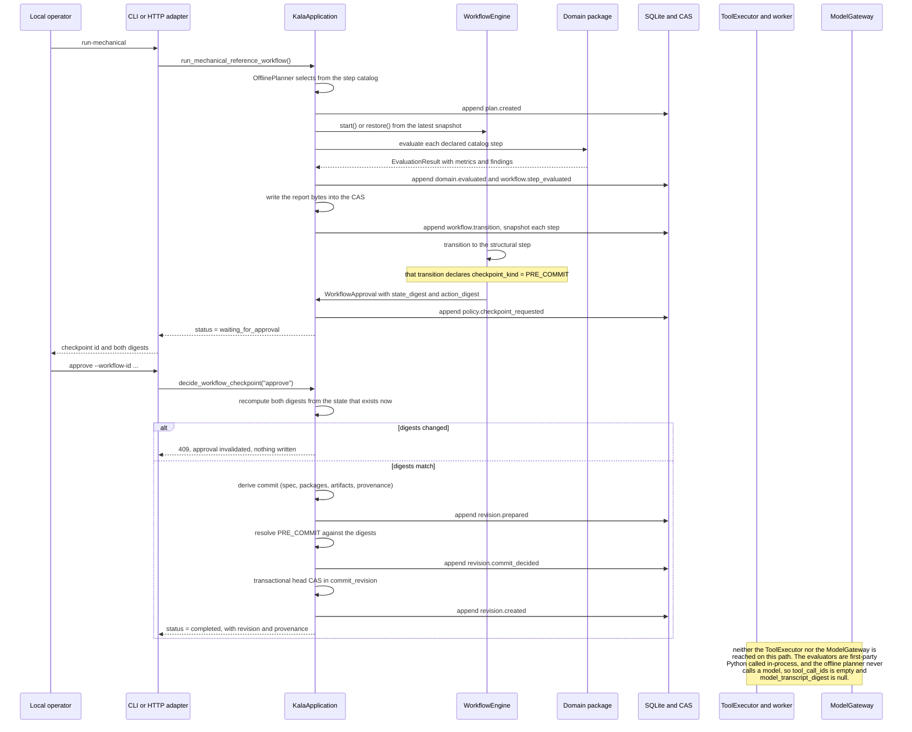

# Kala Agent Architecture and Implementation Report

| Field | Value |
|---|---|
| Document | Architecture and implementation report |
| Product scope | Local-first, single-user Kala Agent MVP |
| Date | 2026-09-26 |
| Repository state | Working local-first MVP. Contracts, persistence, kernel, tool plane, model gateway, three domain packages, HTTP adapter, and CLI are implemented and tested. A **separate, optional** FreeCAD CAD/CAE/FEM adapter distribution (`adapters/freecad`, `kala-agent-freecad`) is implemented and tested but is **not** part of the product composition root (§3.2, §10.7). |
| Decision status | ADR-0001 through ADR-0007 remain **Proposed**. Implementation evidence does not convert a Proposed decision into accepted policy. |
| Evidence basis | The repository source under `src/kala_agent/`, the test suite under `tests/`, the adapter source under `adapters/freecad/` with its suite under `adapters/freecad/tests/`, the seven ADRs in `docs/adr/`, and the measurements in `docs/verification-report.md` |
| Verification summary | **Root suite: 1,227 tests pass on CPython 3.11.16 and on CPython 3.14.7. Branch coverage 94.76% (3.11.16) / 94.77% (3.14.7) against a configured `fail_under = 90`, from a measured range of 94.74–94.80% across repeated runs. `ruff check`, `ruff format --check`, and strict `mypy` are clean on both interpreters. Adapter suite: 301 tests with 100.00% branch coverage, and `ruff check`, `ruff format --check`, and strict `mypy` clean over 30 files.** See `docs/verification-report.md` §2 and §2.7 for the exact commands and the reproducibility caveat. |

## 1. Executive summary and truth boundary

Kala Agent is a local-first, single-user engineering design agent. It uses a
field-independent kernel and declarative domain packages for mechanical components, parametric wings,
and buildings. The end-to-end reference is a mechanical bracket-like component: it exercises typed
parameters, deterministic derived evaluation, a report written to the content-addressed store, a
durable pre-commit checkpoint, and an immutable revision commit.

The central architecture is conservative and, as of 2026-09-26, largely implemented:

- The local SQLite event journal and content-addressed artifact store are the system of record. One
  serialized writer gives revisions and events one total order; revisions are immutable.
- The model may propose a bounded, typed plan, but it never owns control flow or tool authority.
  Egress is authorized **per request** and a manifest must be recorded before dispatch.
- Policy checkpoints are durable decisions recorded in the database, not prompts or console output.
  First use of a tool class requires a `TOOL_CLASS_CHANGE` approval that no replay can reuse.
- Tools are selected from a typed catalog, receive least-privilege capability grants, and run in
  isolated child processes. The tool plane is complete and independently tested; the reference
  workflow does not yet dispatch a tool (§3.10).
- Egress is denied by default and fails closed; design binaries do not leave the device, and artifact
  classification is monotone toward `design_binary`.
- Package trust, provenance, and agent budgets are enforced safety properties, not optional
  reporting features. Every domain evaluator is identified by a digest of its own source and has its
  declared capabilities enforced exactly, before any evaluation runs. Design rollback,
  package-signature trust, and wired memory are **not** implemented (§3.4, §3.9).
- The data directory is created `0o700` and the database `0o600` regardless of umask, and the only
  way to serve the API is a command that refuses any non-loopback bind.
- One **optional** external integration exists: the `kala-agent-freecad` distribution at
  `adapters/freecad`, which publishes two real CAD/CAE tools (`cad.freecad-geometry`,
  `cad.freecad-fem`) behind the existing tool plane. It is a **separate distribution, not a core
  module**: the core never imports it, the core's dependencies are unchanged, and the composition root
  does not register or dispatch it. See §3.2 and §10.7.

The words **implemented**, **available**, and **working** in this report are reserved for behavior
evidenced in the repository. What is *not* evidenced is listed explicitly in section 3.

**The single most important limitation, stated up front:** the domain packages are
non-authoritative arithmetic surrogates. There is no CAD, CAE, FEA, CFD, thermal, solver,
building-code, or certification integration **in the kernel or in any product path**. The mechanical,
wing, and building evaluators compute bounded closed-form arithmetic over declared parameters.
Nothing this system produces is engineering validation, and no report in this repository may be read
as such. The optional FreeCAD adapter (§3.2, §10.7) builds real FreeCAD documents and exports real
STEP/IGES/FCStd/FRD geometry, and it is the first code in the repository that touches a native
engineering kernel — but it is not a product path, and on a host with no solver it produces a document
and a `solver_unavailable` status rather than an analysis.

**The second most important limitation:** the domain evaluators are **executable trusted Python**, not
the data-only bounded expression packages ADR-0002 specified. The implementation digests and
capability enforcement described in §13 detect *substitution* and *capability drift*; they do not
make an evaluator *inert*. See §3.1.

**The third:** the shipped default sandbox profile confines a process, not the host filesystem, and
the composition root does not select the profile that does confine it (§3.6). This is the only
High-severity runtime risk that is still open.

## 2. What is implemented today

| Component | Implementation | Public surface |
|---|---|---|
| Contracts and configuration | `contracts/models.py`, `config.py` | 16 frozen strict Pydantic records, 10 enums, 10 normalized scalar/JSON types; validated `Settings` with 7 environment overrides |
| SQLite persistence | `persistence/database.py`, `chain.py`, `journal.py`, `repositories.py` | `Database` (schema **v2**, private `0700`/`0600` modes), `EventJournal`, `SnapshotStore`, 6 repositories, `HeadMovedError` |
| Content-addressed artifacts | `persistence/artifacts.py` | `ContentAddressedArtifactStore`: SHA-256 buckets, atomic hard-link publication, digest verification on every read |
| Budgets | `kernel/budget.py` | `BudgetLedger` over 7 dimensions, reservations, versioned state export/import |
| Capability policy and checkpoints | `kernel/policy.py` | `PolicyEngine`, `CapabilityGrant`, `PolicyDecision`, 6 checkpoint types, `tool_class_change`, versioned state export/import |
| Plan validation | `kernel/planning.py` | `PlanValidator` with 13 `PlanValidationCode` values |
| Workflow engine | `kernel/workflow.py` | `WorkflowEngine`, `WorkflowState`, `WorkflowApproval`, retry bounds, replan bounds, JSON serialization |
| Memory | `kernel/memory.py` | `MemoryManager` over `MemoryRepository` (working + durable tiers, conflict detection). **Not wired into the composition root.** |
| Subprocess tool plane | `tools/protocol.py`, `registry.py`, `executor.py`, `sandbox.py`, `simulator.py` | `ToolRegistry`, `ToolExecutor`, `SandboxProfile`, `IsolationMode`, 25 `ToolErrorCode` values, reference simulator tool, strict regex admission |
| Model gateway | `runtime/model_gateway.py` | `ModelGateway`, `LLMClient` protocol, `LocalModelClient` (deterministic, offline), `OpenAICompatibleClient` (opt-in: consent + non-empty allowlist + per-request policy + manifest) |
| Agent coordinator | `runtime/agent.py` | `StepCatalog`, `OfflinePlanner`, `ModelPlanner`, `DegradingPlanner`, `AgentCoordinator` |
| Domain packages | `domains/__init__.py`, `domains/{mechanical,wing,building}/` | `DomainPackage`, `ParameterSpec`, `CatalogStep`, `DomainEvaluator`, `EvaluatorImplementation`, `run_reference_workflow`; 3 packages, 10 catalog steps |
| Composition root | `application.py` | `KalaApplication`: two-phase `PRE_COMMIT` revision commit with head CAS, restart restore, reserved kernel-state namespace, workflow driver |
| HTTP adapter | `api/` | FastAPI app, 17 routes, Host guard, bearer token, cross-origin refusal, body limit, security headers |
| CLI | `cli/main.py` | `argparse` CLI, **12** subcommands including a loopback-only `serve`, JSON to stdout, 4 exit codes |
| **Optional FreeCAD adapter (separate distribution, not a core module)** | `adapters/freecad/src/kala_agent_freecad/` — `availability.py`, `contracts.py`, `registration.py`, `policy.py`, `worker.py`, `errors.py`, `cad/{runtime,arguments,artifacts,geometry,fem}.py` | Distribution **`kala-agent-freecad`**: 2 frozen tool contracts (`cad.freecad-geometry` 1.0.0, `cad.freecad-fem` 1.0.0), `discover`, `register`, `register_if_available`, `worker_import_roots`, `freecad_import_roots`, `tool_identifiers`, `cad_profile`, `cad_report`, `FREECAD_IMPORT_ORDER`, 6 typed error classes, 2 worker entry points. 13 modules, 301 tests, 100% branch coverage. **Not loaded by `KalaApplication`.** §3.2, §10.7 |

## 3. Deviations, limitations, and remaining work

These are the honest gaps. Each is a statement about the current repository, not a plan.

### 3.1 Domain evaluators are trusted first-party Python, not data-only expression packages

ADR-0002 specified **data-only** domain packages: a package is a versioned bundle of declarations
that cannot contain executable Python. What is implemented is a middle position:

- The declarative half is real. Each package declares typed parameters with units and ranges
  (`ParameterSpec`), catalog steps (`CatalogStep`), a `WorkflowDefinition`, schema digests, and a
  `DomainPackageManifest` produced by `DomainPackage.digest()`. Everything is inspectable and
  content-addressed.
- The evaluators are **trusted first-party Python** classes implementing the
  `DomainEvaluator` protocol (`GeometryEvaluator`, `MaterialEvaluator`, `LoadCaseEvaluator`,
  `StructuralEvaluator` and the wing/building equivalents). They are imported by the composition
  root and run in the kernel process.
- There is **no** non-Turing-complete expression language, no sandboxed expression evaluator, and no
  data-only loader. A third-party package cannot be loaded at all.
- The import boundary is enforced by a static AST test
  (`tests/unit/test_domains.py:975`): domain code may import only `kala_agent.contracts` and
  `kala_agent.domains`, never `kernel`, `tools`, `persistence`, `runtime`, `api`, `cli`, or
  `config`. That constrains the damage a package can do, but it does not make a package *inert*.

Two controls were added since the last revision of this report, and they are real improvements —
but they address **substitution and capability drift**, not **authority**:

1. **Evaluator implementation digests.** Every evaluator bound to a catalog step is identified by
   `evaluator_implementation` and recorded as an `EvaluatorImplementation` carrying its qualified
   name, the SHA-256 of the **source file on disk** of its defining module, the step it is bound to,
   and the capabilities it declares. The digest is folded into `DomainPackage.digest()` and
   published in the manifest through `manifest_schema_digests`, so it is pinned on every committed
   revision. Substituting an evaluator changes the digest **even when the substitute computes exactly
   the same numbers** — which is precisely the case a value-level check would miss. An evaluator with
   no identifiable source implementation is **refused** rather than digested blind. See §13.
2. **Exact capability enforcement.** A catalog step and its evaluator must declare the same
   capability set or the package refuses to construct, and a run's declared capabilities must be
   granted **exactly** — `enforce_capability_request` refuses a request that is empty, that is
   missing something the package declared, or that carries something the package did not declare.
   The check runs **before any evaluation executes**. See §13.

Neither control changes what an evaluator *is*. A digest identifies code; it does not sandbox it.
A first-party evaluator that computes only arithmetic is trusted to compute only arithmetic. Closing
this deviation requires the data-only expression model ADR-0002 specified, or stating the
first-party-only posture as a permanent architectural decision rather than a deviation.

### 3.2 An optional FreeCAD adapter exists; it is not a product path, and no certified engineering exists

This section used to read "there is no native executable, no vendor SDK, no geometry kernel, no
mesher, no FEA or CFD solver anywhere in the repository". That is no longer true, and the accurate
statement has to be narrower.

**What exists.** `adapters/freecad` is a **separate distribution**, `kala-agent-freecad`, with its own
`pyproject.toml`, its own `src` root, its own tests, and its own lint, type, and coverage configuration.
It publishes two frozen tool contracts through the existing tool plane:

| Tool | Version | What it does | What it does not do |
|---|---|---|---|
| `cad.freecad-geometry` | 1.0.0 | Builds one `box` or `cylinder` solid in a FreeCAD worker, optionally measures it (`area_mm2`, `volume_mm3`, `bounding_box_mm`, edge/face/vertex counts, `solid`), and writes the requested `step`, `iges`, and `fcstd` exports into the call workspace | No assembly, no parametric feature tree, no import of a user model, no analysis |
| `cad.freecad-fem` | 1.0.0 | Builds a real FreeCAD FEM document — an `ObjectsFem.makeAnalysis` container, a solid material card, a fixed constraint on a chosen face, a Gmsh **mesh object**, and a CalculiX **solver object** — recomputes it, and publishes the `.fcstd` analysis plus an optional STEP export of the solid | No mesher runs, no solver runs unless a safely discovered `ccx` exists, no load case, no contact, no nonlinear or dynamic analysis |

**Why it is a separate distribution and not a core module.** The core never imports it, and a static
AST test enforces that in both directions (`tests/unit/test_adapter_boundaries.py`): no module under
`src/kala_agent/` imports `FreeCAD`, `femtools`, or `kala_agent_freecad`, and no module under the
adapter imports `kala_agent.application`, `api`, `cli`, `domains`, `kernel`, `persistence`, or
`runtime`. The root `pyproject.toml` gains no dependency and no extra; its runtime dependencies remain
exactly `fastapi` and `pydantic`. `pyproject.toml` in the adapter declares `kala-agent` and `pydantic`
only, and never a FreeCAD wheel.

**Why that matters for the MVP's claims.** Three properties would all be false if the adapter were
wired in:

1. `kala-agent init` would list two more tools, and the tool catalog would depend on what happens to
   be installed on the host.
2. The product's isolation profile and approval surface would change because of an optional system
   dependency.
3. A host without FreeCAD would see an import error in the composition root instead of an unaffected
   product.

**The composition root does not load the adapter.** `KalaApplication` does not import
`kala_agent_freecad`, does not call `discover()`, does not register `cad.freecad-geometry` or
`cad.freecad-fem`, and does not dispatch them. `kala-agent init` reports exactly
`["mechanical.reference-simulator"]` under `tools`. No HTTP route and no CLI subcommand reaches either
tool. **An embedder that wants CAD must install the distribution and register it explicitly** with
`register_if_available(registry, discover())`, hand the executor `worker_import_roots(...)` as
`import_roots`, and pass `cad_profile()` as the profile. §10.7 shows the construction.

**What is still absent, and is not fixed by the adapter's existence.**

- **No certified engineering and no certification step.** See §3.3. The adapter's `cad.freecad-fem`
  output is a document and a solver status. It is not a validated analysis.
- **No solver and no mesher are installed, bundled, pinned, or verified.** `makeMeshGmsh` creates a mesh
  *object*; `makeSolverCalculiXCcxTools` creates a solver *object*. Neither is an execution. On the
  verification host neither CalculiX nor Gmsh is present (§10.7), so `mesh.generated` is `false` and
  `results.available` is `false`.
- **No BIM, no building-code, and no CFD or thermal integration** of any kind.
- **No workflow step, catalog step, or agent plan maps to either CAD tool.** The step catalog maps the
  mechanical package to `mechanical.reference-simulator` and nothing else.

The honest summary: the repository now contains a working, well-tested, narrowly-scoped bridge to a
real native CAD/CAE kernel, and that bridge is not on any product path. See §10.7, ADR-0007, and
`docs/verification-report.md` G3 and G9.

The kernel's own reference tool is unchanged by any of this. `mechanical.reference-simulator`
(`tools/simulator.py`) computes closed-form rectangular-section arithmetic (hole area fraction, section
modulus, nominal bending stress) and can write a JSON report into the call workspace. Its name
contains "simulator" because it is a reference stand-in, and it is **not** a simulation in any
engineering sense.

### 3.3 No certified engineering and no certification step

`domains/__init__.py:50` defines `NON_AUTHORITATIVE_FINDING`, which is attached to every evaluation:

> Surrogate reference arithmetic only; not a certified analysis and not a substitute for a validated
> CAD or CAE model.

Each package adds a stricter disclaimer of its own, the building package marks its code version
`non-authoritative-placeholder`, and the mechanical material constants are labelled
`illustrative-constant-not-certified-material-data`. Hard constraints in these packages are declared
bounds on surrogate arithmetic, **not** engineering acceptance criteria.

### 3.4 No vector memory

`kernel/memory.py` implements a bounded two-tier `MemoryManager` (in-process working set plus durable
`MemoryRepository` rows, with conflict detection, expiry, and optional provenance-on-promotion). It is
tested and exported, but it is **not constructed by `KalaApplication`**, so no product path stores or
retrieves a memory. There is no embedding, no similarity index, and no retrieval at all. Memory tier
aspiration (T0–T5 in the old report) is not realized beyond the two tiers described here.

### 3.5 No multi-user, no cloud, no sync

Single user, single process, single local data directory. There is no identity system, no
authorization model beyond the per-launch loopback bearer token, no cross-device synchronization, no
conflict resolution between users, and no hosted deployment mode. The API is designed for loopback
and must not be bound to a routable address.

### 3.6 The portable sandbox cannot confine the host filesystem; strict mode fails closed

This is the most important security deviation and it is stated in code as well as here.

- The **portable** profile (`IsolationProfile.PORTABLE`, the application default) confines a
  *process*, not a filesystem. `judge_sandbox` returns the literal reason
  `"the portable profile confines a process, not the filesystem"`, and `SandboxProfile.enforced_controls`
  never claims a filesystem control under it. The enforced set is exactly:
  `artifact_classification_kernel_verified`, `artifact_digest_verification`, `cwd_confined`,
  `environment_minimal`, `file_descriptor_close`, `output_size_limit`, `process_group_kill`,
  `process_isolation`, `wall_clock_timeout`, `worker_concurrency_cap`, plus `resource_limits` where
  the `resource` module is importable.
- The **strict** profile (`IsolationProfile.STRICT_LINUX`) is probed, not assumed.
  `probe_sandbox()` launches a throwaway interpreter that builds exactly the jail the executor would
  build and then verifies, from the inside, that the host filesystem is invisible, the network is
  unreachable, `/usr` is read-only, and the workspace is writable. Only controls the probe observed
  are reported.
- **Fail-closed behavior:** when the strict profile is selected and the probe did not verify the six
  required controls (`chroot_workspace_only`, `mount_namespace`, `network_isolation`,
  `readonly_system_bindings`, `user_namespace`, `workspace_read_write`), `judge_sandbox` refuses, and
  `ToolExecutor._sandbox_unavailable` denies any tool whose side-effect level is `local_write`,
  `network`, or `egress`, or that declares `destructive`. Read-only tools still run. There is no
  silent fallback to in-process execution.
- Measured on the verification host (`linux-x86_64`): the probe reported all six required controls
  plus `device_nodes_minimal`, `ipc_namespace`, `pid_namespace`, `procfs`, `uts_namespace`. Note
  `scratch_tmpfs` was **not** verified on that host, and the tool correctly does not report it.
- The two verdicts are deliberately different in kind. The portable verdict is allowed with a
  non-empty `reason` and an **empty** `controls` tuple — the tool saying in one line that it confines
  a process and not a filesystem. The strict verdict is allowed with an empty `reason` and the full
  observed control set, every one verified from inside a real child.
- The application (`KalaApplication.__init__`) does not select the strict profile, so the MVP runs
  portable. **Consequence: the fail-closed path above is real, tested, and never reached by the
  shipped product.** Enabling strict mode is a configuration change, not a code path the reference
  loop exercises. This remains the only High-severity runtime risk that is open
  (`docs/threat-model.md` **RR-1**, `docs/verification-report.md` gap **G2**).
- The optional FreeCAD adapter's `cad_profile()` **does** default to
  `IsolationProfile.STRICT_LINUX`, so it inherits the same fail-closed path — and, because its tools
  are `local_write`, an unavailable probe refuses both of them outright rather than degrading them to
  portable. The consequence on the verification host is that the adapter's functional tests run the
  **portable** profile and the strict profile is verified as *enforced or refused* (§10.7,
  `docs/verification-report.md` §5.2). This is the fail-closed behaviour working, and it is also why
  the CAD tools have no filesystem confinement in the configuration that is actually exercised.

### 3.7 No retention, no garbage collection

- Artifact objects are immutable and never deleted. There is no retention policy, no orphan sweep,
  and no size cap on the store.
- Journal events are append-only and never pruned. The only bounded collections in the system are
  the policy engine's `max_tracked_requests` (default 512) and the budget ledger's reservations;
  both are in-memory working sets, not persistent history.
- `MemoryRepository.delete` exists and is tested, but nothing calls it.
- SQLite `VACUUM` is never run, and the database file is not rewritten or compacted.

### 3.8 No projection or replay product layer

The journal is verified and queryable (`EventJournal.read`, `/api/v1/events`, `kala-agent events`),
but there is no read-model projection, no projection rebuild, and no golden-replay harness that
re-executes a recorded run. `SnapshotStore` persists canonical-JSON workflow state with a digest, and
`WorkflowState.to_json()`/`from_json()` round-trip, which is the precondition for replay — the replay
driver itself does not exist. `provenance` is recorded on each committed revision but there is no
provenance *graph* traversal or audit query builder.

### 3.9 No rollback of design history

Revisions are immutable and parent-linked, and a commit must extend the current head
(`RevisionForkRefusedError`), which prevents forking. A design-level rollback — creating a new
revision that restores a verified earlier state — is **not** implemented. The only `rollback` in the
codebase is the SQL transaction rollback in `persistence/database.py`. Package rollback as a new
manifest selection is likewise unimplemented.

### 3.10 Other unimplemented items

- No `PLAN_APPROVAL` checkpoint is raised on the mechanical path; the reference workflow declares a
  single `PRE_COMMIT` checkpoint on the `mechanical.constraint-evaluation` step. The other five
  checkpoint types (`PLAN_APPROVAL`, `TOOL_CLASS_CHANGE`, `EGRESS`, `EXPORT`, `PROVIDER_DEGRADED`)
  exist in the contract, the policy engine, and the tool plane, and are covered by security tests,
  but the shipped mechanical workflow reaches only `PRE_COMMIT`.
- `OfflinePlanner` and `ModelPlanner` exist; `KalaApplication` wires only `OfflinePlanner`. The
  reference run therefore plans deterministically and never calls the gateway, so
  `provenance.model_transcript_digest` is `null` on the reference path.
- **The reference workflow does not dispatch a tool.** `run_mechanical_reference_workflow` advances
  the workflow by calling each domain package's evaluator in-process, so
  `provenance.tool_call_ids` is `[]` on every reference revision. `ToolExecutor` is constructed,
  configured with the profile, budget ledger, and policy engine, and exposed as
  `KalaApplication.tool_executor`; `mechanical.reference-simulator` is registered; and
  `AgentCoordinator` dispatches through the executor. But no HTTP route, CLI command, or workflow
  step routes a call through it. The out-of-process tool plane is real and independently tested
  (`tests/security/test_tool_executor.py`, 44 tests); it is simply not wired into the reference loop
  yet. The declared intent of the step catalog — mapping each catalog step to the simulator tool — is
  published as `planned_task_ids` and the `plan.created` event, and is not yet acted on.
- `AgentCoordinator` is a complete parallel-dispatch component with its own tests, but is not used by
  the HTTP or CLI surfaces; both drive the workflow through the kernel engine directly.
- No import-rule linter (import-linter) is configured. The boundary is enforced by two hand-written
  AST tests.
- No domain-vocabulary deny-list test scanning for words such as `airfoil`, `sweep`, or `taper`
  exists; field independence is enforced structurally by the import test and by the absence of
  domain nouns in `kernel/`.
- **The optional FreeCAD adapter is not wired into the product.** It is implemented, tested, and
  measured, and the composition root deliberately does not load it (§3.2, §10.7). `KalaApplication`
  does not call `discover()`, does not register `cad.freecad-geometry` or `cad.freecad-fem`, and does not
  dispatch them; `kala-agent init` lists only `mechanical.reference-simulator`; no HTTP route and no
  CLI subcommand reaches either tool; and no catalog step or workflow step maps to them. The tools are
  reachable only by embedding code that calls `register_if_available` and constructs its own
  `ToolExecutor`. This is the same category of gap as the two rows above it — a real component off the
  critical path — and it is recorded as ADR-0007 D9 rather than presented as a feature.

### 3.11 Security remediations in place, and what each one does not close

This section is the consolidated record of the hardening work verified as of 2026-09-26. Every row
names the test that would fail if it regressed, and every row names what it leaves open. The
sections above give the detail; this table is the index. Read the right-hand column before citing a
left-hand row as a fix.

| # | Remediation | Where | Test evidence | What it does **not** close |
|---|---|---|---|---|
| 1 | **Serialized SQLite writer** — one connection whose every statement takes a per-database reentrant lock, `BEGIN IMMEDIATE` at the top level and a savepoint when nested, and a `serialized()` read context so a read cannot interleave with a write | `persistence/database.py` | `tests/unit/test_persistence.py:218`, `test_revision_commit.py:371` | Multi-**process** write coordination still relies on SQLite's own locking. The head CAS is what makes concurrent commits correct, not the lock. |
| 2 | **Schema-v2 journal hash chain** — domain-separated, length-prefixed preimage over sequence, type, aggregate, workflow, run, timestamp, payload digest, and predecessor; verified at construction, before every read, and against the tail before every append | `persistence/chain.py`, `persistence/journal.py`, migration 2 | `tests/security/test_journal_integrity.py:130,146,159,177,187,223,241,312` | Tamper-**evident** only. A wholesale rewrite yields a different head digest and nothing anchors it (G4). |
| 3 | **Private `0700`/`0600` on-disk modes** — the data directory is created `0o700` and the SQLite file `0o600`, set with an explicit `chmod` *after* creation because `mkdir(mode=…)` is itself umask-masked | `persistence/database.py:312,329` | `tests/unit/test_persistence.py:190` | Decides *who on the host* can read the files. The contents are still plaintext (G5). |
| 4 | **Digest-bound `PRE_COMMIT` + head CAS** — prepare writes nothing and opens a checkpoint bound to a `state_digest` and an `action_digest`; commit recomputes both from the state that exists at that moment, refuses a fork, and performs the head compare-and-swap inside `BEGIN IMMEDIATE` so a lost race leaves no orphan row | `application.py`, `persistence/repositories.py` | `tests/security/test_revision_commit.py:102,138,183,219,254,268,296,325,371,410,455,475,487` | No `SIGKILL`-at-a-boundary fault injection exists (§7 of the verification report). |
| 5 | **Restart restore, fail-closed on missing state** — policy and budget state are restored from journal events with a strict `import_state`; a tampered or non-validating record, or missing state in an already-used directory, **stops the launch** rather than resetting to defaults; a fresh directory restores defaults with no record | `application.py`, `kernel/policy.py`, `kernel/budget.py` | `test_revision_commit.py:515,563,581,608,638,794,842` | A *well-formed* forgery in the journal is not caught without an external anchor (G4). |
| 6 | **Reserved kernel snapshot identifiers** — every kernel-state aggregate is stored under a `kernel-state:` prefix, and a user-supplied `workflow_id` that is a reserved bare aggregate name or begins with that prefix is refused, in-process and over HTTP. The bare names stay reserved so records written by the earlier version still read back | `application.py:671,675,678` | `test_revision_commit.py:676,709,735`, `tests/unit/test_api.py:780` | None identified; the prefix is reserved wholesale, so a future aggregate is covered without a further change. |
| 7 | **Empty-allow-list denies** — `allowed_endpoints` defaults to the empty tuple and the request's own normalized destination must be a member, so an empty allowlist is a denial and `consent=True` alone is not sufficient | `runtime/model_gateway.py:980` | `tests/security/test_model_residency.py:472` | An operator who supplies consent, a matching entry, the capability grant, and the approval has authorized egress. |
| 8 | **`TOOL_CLASS_CHANGE` enforcement** — every non-egress tool call becomes a policy request of that kind, keyed by `(action_digest, scope)`, so first use of a class needs an explicit approval and a changed capability set produces a new class that re-approves | `tools/executor.py:1123`, `kernel/policy.py:345` | `test_tool_executor.py:504,516,552,618`, `test_policy.py:373,406,456` | A same-scope, same-capability class change is a repeat, by design. |
| 9 | **Strict regex admission** — a schema `pattern` is admitted from its own text before anything is compiled or run: a bounded `maxLength` is mandatory, the pattern length is bounded, a fixed table of unsafe constructs is searched, nested repetition is rejected, **ambiguous repetition is rejected**, and over-budget repetition is refused. A refused pattern is never compiled and never executed | `tools/protocol.py:459` | `tests/security/test_schema_redos.py` (9 tests, `:112,118,124,130,145,162,171,181,193`), `test_tool_executor.py:1209` | The construct table is enumerated, not derived. No fuzzing was run. |
| 10 | **Fail-closed classification** — `_derive_classification` is monotone toward `design_binary`; a recognised signature, non-decodable bytes, an unrecognised extension, or the tool's own claim all yield `design_binary`, and an **unknown** format defaults to `design_binary` rather than falling through to a permissive case | `tools/executor.py:441` | `tests/security/test_tool_executor.py:1124` | The signature list is a fixed table. Safety does not depend on its completeness, because the default is the strict case. |
| 11 | **Honest, probed Linux sandbox controls** — the probe builds the exact spec the executor would build and verifies each control from inside a real child; only observed controls are reported, a timeout is 30 s, and a missing required control yields `available=False` with a short sanitized reason | `tools/sandbox.py` | `tests/security/test_tool_executor.py:568`, `docs/verification-report.md` §5 | **G2.** The shipped default is still the portable profile, so the strict verdict and its fail-closed path are not reached by the product. |
| 12 | **Portable-mode limitations stated in code** — `judge_sandbox` returns the literal reason `the portable profile confines a process, not the filesystem` with an **empty** control tuple, and `SandboxProfile.enforced_controls` never claims a filesystem control under the portable profile | `tools/sandbox.py` | `test_tool_executor.py:568` | Making the honest statement is not the same as fixing the limitation. See row 11. |
| 13 | **3.11 interpreter and import-root fix** — the `runtime/model_gateway.py:306` dataclass field uses `default_factory`, removing the version sensitivity that made CPython 3.11 reject `MappingProxyType({})` as a mutable default. Verified on a real 3.11.16 venv with the `src` import root, driving the installed `kala-agent` console script | `runtime/model_gateway.py:306` | `docs/verification-report.md` §6 R1; 1,227 tests and all three gates pass on 3.11.16 | Nothing. The declared `requires-python = ">=3.11"` floor is now true. |
| 14 | **Per-request egress policy and manifest** — a fresh `PolicyRequest` is built and authorized on **every** call rather than cached against a client-level grant, and an `ModelEgressManifest` must be recorded before dispatch; a missing or failing callback raises | `runtime/model_gateway.py:1269,1339` | `tests/security/test_model_residency.py:114,158,185,208,263,300` | The manifest sink is a callback; where it writes is a deployment decision, and no audit query reads it back (G6). |
| 15 | **Byte-safe redaction and truncation** — truncation encodes to UTF-8, slices at the byte bound, and decodes with `errors="ignore"`, so a character straddling the cut is dropped whole; all size checks and outbound payload bounds are in bytes | `runtime/model_gateway.py:236,564,566,1017,1541,1550` | `tests/security/test_model_residency.py:340` | Redaction is a pattern match; a secret in an unusual shape is not caught. |
| 16 | **`Host`/bearer/body boundary** — loopback `Host` only, exactly one `Host`, every wildcard refused explicitly, bearer token on every mutating method from one method set, body limit answering every method with buffered replay, any `Origin` refused, security headers on refusals too | `api/boundary.py`, `api/middleware.py` | `tests/security/test_api_boundary.py` (15), `tests/unit/test_api.py:612,629,652,677,800,815` | A proxy-header middleware that trusts `X-Forwarded-Host` would defeat the guard and is not detected at runtime. |
| 17 | **Loopback-only `serve` command** — `build_serve_target` accepts only `127.0.0.1` or `::1` and raises for a wildcard or routable bind **before any socket is created**; the served app is the unmodified `create_app` app, so the Host guard and the per-launch token are the same ones every launch carries; the token is never printed to stdout | `cli/main.py:450,488,512,80` | `tests/unit/test_cli.py:99,116,138,175,210`, `test_api_boundary.py:436` | A caller who imports `create_app` into their own ASGI server bypasses the bind decision. The Host guard then limits the blast radius rather than preventing it. |
| 18 | **Health egress truth** — `egress_configured` is derived from the client the application actually holds, never from a setting or an intent, and `provider_endpoint_declared` reports whether an endpoint was ever declared | `application.py:1073`, `api/app.py:153` | `tests/unit/test_api.py:76,97,113,125,133,142`, `tests/unit/test_cli.py:175,640` | None identified. The property is client-derived, so it cannot report a path the client does not have. |
| 19 | **Domain evaluator implementation digests** — every evaluator is identified by qualified name, the SHA-256 of its defining module's source file, its step, and its capabilities; the digest is folded into the package digest and pinned on every revision. An evaluator with no identifiable source is refused, not digested blind | `domains/__init__.py:55,169,383,463,570,623` | `tests/security/test_domain_integrity.py:261,320,333,366`, `tests/unit/test_domains.py:834` | **G1.** This identifies the implementation; it does not make it inert. See §3.1. |
| 20 | **Domain capability enforcement** — a step and its evaluator must declare the same capability set, and a run's request must match the declared set **exactly** (not empty, not missing a declaration, not carrying an extra), checked **before any evaluation runs** | `domains/__init__.py:551,727,741,750,757` | `tests/security/test_domain_integrity.py:302,407`, `tests/unit/test_domains.py:872` | **G1.** Exact-match enforcement is not a judgement about whether the requested capability set is reasonable. |
| 21 | **Optional system dependency kept out of the core** — FreeCAD support ships as the separate distribution `kala-agent-freecad` at `adapters/freecad`; no module under `src/kala_agent/` imports `FreeCAD`, `femtools`, or `kala_agent_freecad`, no adapter module imports `kala_agent.{application,api,cli,domains,kernel,persistence,runtime}`, the root `pyproject.toml` gains no dependency, and no adapter module imports FreeCAD at module scope — every import is call-time, in the fixed order `FreeCAD` → `Part` → `ObjectsFem` → optional `femtools.ccxtools` | `tests/unit/test_adapter_boundaries.py`, `adapters/freecad/src/kala_agent_freecad/cad/runtime.py:35`, `adapters/freecad/pyproject.toml` | `adapters/freecad/tests/test_cad_live.py:242` (observed import order in a real subprocess), `test_cad_runtime_loader.py` (16), 301 adapter tests at 100% branch coverage | **G9.** Keeping the dependency out of the core does not put the tools on a product path, and a discovered `ccx` is validated structurally, not by signature. §3.2, §10.7. |
| 22 | **Solver honesty under absence** — the FEM tool always builds a real analysis document and runs the solver only behind a safely discovered `ccx`; without one it reports `solver_unavailable` with `executed: false`, `results.available: false`, and null displacement and stress. No FEM input field carries an executable path, and `is_safe_calculix` requires a bounded basename, no path separator, a regular non-empty file of at most 64 MiB, and an execute bit | `adapters/freecad/src/kala_agent_freecad/cad/fem.py:343`, `availability.py:189` | `adapters/freecad/tests/test_cad_live.py:177`, `test_cad_fem_fakes.py` (32), `test_executor_live.py::test_both_tools_register_and_dispatch` | **G9, G3.** A refused solve is the correct outcome, not an analysis. No mesher or solver is bundled, pinned, or verified. |

Rows 1–22 are closed defects or delivered controls. They are **not** a claim that the system is
finished. The open gaps are enumerated in `docs/verification-report.md` §6 (G1–G9) and
`docs/threat-model.md` §6.1.

## 4. Requirements status

### 4.1 Functional requirements

| ID | Priority | Requirement | Status | Evidence |
|---|---|---|---|---|
| FR-01 | Critical | Local-first single-user, no required network service | Implemented | `KalaApplication` builds a `LocalModelClient` gateway; `/health` reports `offline: true`; `tests/security/test_model_residency.py` |
| FR-02 | Critical | Field-independent kernel | Implemented | `tests/unit/test_kernel.py:268` parses every `kernel/*.py` and rejects imports of `domains`, `runtime`, `tools` |
| FR-03 | High | Mechanical, wing, building packages | Implemented | `domains/{mechanical,wing,building}/`, 10 catalog steps, `tests/unit/test_domains.py:729` runs all three through one interface |
| FR-04 | High | Simple mechanical component as first reference | Implemented | `tests/integration/test_mechanical_loop.py` (12 tests) |
| FR-05 | High | Provider-neutral LLM integration | Implemented | `LLMClient` protocol; `ModelGateway`; no provider SDK type in kernel or contracts |
| FR-06 | Critical | Enforced policy checkpoints | Implemented for the reference path | `PolicyEngine`, `ApprovalRequestRepository`, `PRE_COMMIT` on the mechanical workflow; `tests/security/test_policy.py` (20), `tests/security/test_revision_commit.py` (18) |
| FR-07 | Critical | Design binaries do not leave the device by default | Implemented by construction | No egress path exists in the composition root; `OpenAICompatibleClient` refuses without consent, allowlist, and an approved policy request; `tests/security/test_model_residency.py` |
| FR-08 | Critical | One-writer immutable revisions | Implemented | `_SerializedConnection` + per-database `RLock` + `BEGIN IMMEDIATE`; `DesignRevisionRepository.commit_revision` raises `HeadMovedError`; `tests/security/test_revision_commit.py` |
| FR-09 | Critical | SQLite event journal and content-addressed artifacts | Implemented | Schema v2 with hash chain; `ContentAddressedArtifactStore`; `tests/security/test_journal_integrity.py` (19), `tests/security/test_artifact_concurrency.py` (7) |
| FR-10 | Critical | Tools in isolated processes | Implemented | `IsolationMode.AUTO` never runs tool code in-kernel; `tests/security/test_tool_executor.py:243`; filesystem confinement only under the strict profile (3.6) |
| FR-11 | Critical | Capability-based typed tool contracts | Implemented | `ToolRegistry` with schema digests and immutability re-checks; `RegisteredTool.verify_immutable`; `tests/security/test_tool_executor.py:1430,1457` |
| FR-12 | High | One shared kernel with declarative domain packages | Partially | Declarations are data and evaluators are digest-identified with exactly-enforced capabilities; evaluators are still trusted first-party Python (3.1) |
| FR-13 | Critical | Fail-safe memory | Implemented but not wired | `MemoryManager` conflict/expiry/provenance rules; no product path uses it (3.4) |
| FR-16 | Critical | One served surface, loopback only, with an honest report of what the process can reach | Implemented | `build_serve_target` refuses any non-loopback bind before a socket exists (`cli/main.py:450`); `egress_configured` is client-derived (`application.py:1073`); `tests/unit/test_cli.py:99,175`, `tests/unit/test_api.py:113` |
| FR-14 | Critical | Least privilege, trust, sandboxing, provenance, rollback, budgets | Partially | Least privilege, sandboxing, provenance recording, and budgets implemented; **rollback** and package-signature trust are not (3.9) |
| FR-15 | Critical | Deterministic control flow with bounded LLM planning | Implemented | `WorkflowEngine` + `PlanValidator` (13 rejection codes) + `RunBudget.replanning_attempts`; `ModelPlanner` exists but is not the wired planner |
| FR-17 | High | An optional CAD/CAE tool adapter, delivered outside the kernel, behind the existing tool plane | **Implemented as a separate distribution; not wired into any product path** | `adapters/freecad` (distribution `kala-agent-freecad`), tools `cad.freecad-geometry` 1.0.0 and `cad.freecad-fem` 1.0.0; `tests/unit/test_adapter_boundaries.py` (no core import, in both directions); 301 adapter tests at 100% branch coverage. `KalaApplication` does not register or dispatch either tool, and no HTTP route or CLI command reaches them (3.2, 3.10) |

### 4.2 Non-functional requirements

| ID | Target | Measurement | Status |
|---|---|---|---|
| NFR-01 | Air-gapped operation | No socket is opened by the composition root; the only command that opens one is the loopback-only `serve`; `tools` package import test at `tests/security/test_tool_executor.py:1647` | Demonstrated by construction, not by a network-namespace test |
| NFR-02 | Zero implicit outbound connections | `EgressDeniedError` when no policy engine is attached; manifest required before dispatch | Verified |
| NFR-03 | Durability at transaction boundaries | `BEGIN IMMEDIATE` + head CAS + `revision.prepared` → `revision.commit_decided` → `revision.created` | Verified for the revision write; no `SIGKILL` fault-injection test |
| NFR-04 | Artifact reads verify size and SHA-256 | 100% of `get_bytes`/`get_text`/`contains`/`get_size` verify; every tool artifact verified before exposure | Verified |
| NFR-05 | Replay determinism | Deterministic offline evaluators, canonical JSON, recorded digests | Preconditions present; no replay harness (3.8) |
| NFR-06 | Isolation and negative authority | 44 tool-executor security tests plus 9 strict-regex-admission tests, covering timeouts, flooding, traversal, symlinks, environment leakage, stray children, and hostile schema patterns | Verified for the portable profile; filesystem confinement only under strict mode (3.6) |
| NFR-07 | One writer, at most eight workers | `MAX_WORKERS = 8`; `SandboxProfile.max_workers` bounds 1..8; `Settings.worker_count` bounds 1..8 | Verified |
| NFR-08 | Kernel latency p95 < 200 ms at 10 000 events | Not measured | **Not measured.** No benchmark exists. |
| NFR-09 | Finite resource bounds | 7 budget dimensions with reservation/commit/release; wall-clock, output-size, argument-size, artifact-size, queue, worker, FD, CPU, core-dump limits | Verified |
| NFR-10 | 100% auditability of consequential decisions | Every workflow transition, checkpoint, revision phase, and domain evaluation is journalled; the reference run produced 20 events | Verified for the reference path |
| NFR-11 | No retained secrets | `redact_secrets`, **byte-safe** transcript truncation, `is_secret_name`, workspace-path scrubbing in diagnostics, CLI never prints endpoints or keys and `serve` never prints the launch token | Verified by test; see residual risk on user-supplied text |
| NFR-16 | Confidential files are not readable by another local account | Data directory `0o700`, database `0o600`, artifact store `0o700`/`0o600`, run directory `0o700`, token `0o600`, all set explicitly after creation | Verified — `tests/unit/test_persistence.py:190`, `tests/unit/test_artifacts_branches.py:298`, `tests/unit/test_executor_branches.py:1895` |
| NFR-17 | Evaluator substitution and capability drift are detectable | `evaluator_implementation` digests; exact capability matching before evaluation | Verified — `tests/security/test_domain_integrity.py:261,302,320,333,366,407` |
| NFR-18 | Durable kernel state cannot be named or collided with by a user identifier | `kernel-state:` reserved namespace plus the reserved bare legacy aggregate names | Verified — `tests/security/test_revision_commit.py:676,709,735`, `tests/unit/test_api.py:780` |
| NFR-12 | Provider SDKs confined to adapters | No provider SDK is a declared dependency at all; `pyproject.toml` has only `fastapi` and `pydantic` | Verified structurally |
| NFR-13 | Recovery from a verified checkpoint | `SnapshotStore.restore_latest` + policy/budget state restore; a tampered kernel-state record stops launch | Verified |
| NFR-14 | Portability | Declared `requires-python = ">=3.11"`; 1,227 tests and all three gates pass on CPython 3.11.16 and 3.14.7 | **Met.** The `MappingProxyType` dataclass default that broke 3.11 is now a `default_factory`. See `docs/verification-report.md` R1. |
| NFR-15 | Documentation honesty | This report, `docs/verification-report.md`, `docs/threat-model.md` | This document set |
| NFR-19 | An optional system dependency must not become a core dependency | The root `pyproject.toml` declares only `fastapi` and `pydantic`; no module under `src/kala_agent/` imports `FreeCAD`, `femtools`, or `kala_agent_freecad`; the adapter's own dependencies are `kala-agent` and `pydantic` and never a FreeCAD wheel; 284 of the adapter's 301 tests run with no FreeCAD installed | Verified — `tests/unit/test_adapter_boundaries.py`; `docs/verification-report.md` §2.7. **Not verified:** that no import of the adapter is *possible*, only that none exists in the source tree. The boundary is a repository gate, not a runtime guard (§8.3 rule 7) |

## 5. Assumptions and explicit non-goals

### 5.1 Assumptions

1. The MVP has one local user and one authoritative writer for a data directory. Concurrent writers
   are handled by serialization and CAS, not by collaboration.
2. The user is the approval authority. Checkpoints present typed digests and options; they do not
   impersonate a certification body.
3. The local workstation has a supported Python runtime, a reliable filesystem, and enough storage for
   the journal, artifacts, and tool workspaces. Storage sizing is a deployment concern and there is no
   retention policy to bound it (3.7).
4. Either a local OpenAI-compatible endpoint is available, or the operator accepts the deterministic
   offline path. A hosted provider is optional, is never required for the local source of truth, and
   is not enabled by default.
5. Tool authors can provide strict input and output schemas, declare side effects, and tolerate a
   process boundary. Undocumented ambient behavior is not an accepted integration.
6. SHA-256 provides integrity and identity, not authorship, and not protection against an attacker who
   can replace the whole local store.
7. Package signatures are a policy option that is not implemented. The manifest carries `signer_id`
   and `signature_digest` fields, and `DomainPackageManifest` validates that they are supplied
   together, but nothing verifies a signature. Every package today is first-party and trusted.
8. Real CAD/CAE tools may be added later. Their licensing, native dependencies, hardware needs, and
   solver nondeterminism are outside this MVP. **This assumption has now been exercised once:** the
   optional `kala-agent-freecad` distribution (§3.2, §10.7) integrates FreeCAD 1.1.3 (LGPL-2.0-only)
   as a **host system dependency** discovered at runtime, with no wheel, and handles the licensing,
   native-dependency, and isolation consequences explicitly. Solver nondeterminism and hardware needs
   remain open, and the integration is deliberately not wired in.

### 5.2 Explicit non-goals

The MVP does **not**:

- provide a multi-user, hosted, or collaborative service;
- synchronize projects across devices or resolve concurrent edits by different people;
- perform CAD authoring, geometry, meshing, FEA, CFD, thermal, structural, or optimization analysis
  **as a product capability**. The optional `kala-agent-freecad` distribution builds primitive solids,
  measurements, exports, and a real FEM analysis *document* (§3.2, §10.7), and it is not a product
  path; it produces no solved FEM result without a solver this repository neither bundles nor verifies;
- implement or interpret any building code;
- claim engineering validation, certification, safety approval, or code-compliance determination;
- choose a different model automatically when a provider is unavailable;
- export, upload, or publish any design binary;
- run an autonomous unattended agent with no human checkpoint;
- guarantee that a fresh model run reproduces a historical run without recorded inputs;
- treat generated summaries or memories as authoritative design facts;
- build a package marketplace, organization identity system, or key-management service;
- provide distributed storage, a queue cluster, or multi-region disaster recovery;
- guarantee protection from a compromised operating system, a malicious local administrator, or an
  attacker who can rewrite the journal and every local copy of its head digest.

## 6. Architecture principles

1. **Local authority.** The journal, artifact store, and local policy are authoritative. A remote
   service may accelerate a step but can never silently become the source of truth.
2. **Field independence.** The kernel expresses generic concepts, not mechanical, wing, or building
   nouns, and the boundary is enforced by a static test.
3. **Model as bounded advisor.** The model proposes typed plan data; the state machine, the policy
   engine, and the user decide what happens.
4. **Immutable history.** Meaningful transitions are append-only and hash-chained. A correction is a
   new event and, for design state, a new revision.
5. **Content identity.** Bytes are identified by digest, not by a mutable path or filename.
6. **Deny by default.** Capabilities, egress, tool class changes, and cross-boundary access are
   denied until explicitly granted.
7. **Typed boundaries.** JSON crossing the kernel, planner, package, tool, or persistence boundary has
   strict schemas, duplicate-key rejection, finite numbers, and canonical serialization.
8. **Bounded autonomy.** Replanning, retries, workers, tool calls, model calls, bytes, time, and cost
   all have finite limits.
9. **Deterministic engine, recorded model input.** Determinism means reproducibility of a pinned
   offline run, not clairvoyance about a remote model's next response.
10. **Human control at consequential boundaries.** A revision is never written without a
    digest-bound pre-commit approval.
11. **Least privilege and fail-closed behavior.** A missing control, uncertain classification, invalid
    digest, or unverifiable profile causes refusal, not a fallback with broader authority.
12. **Observability without secret leakage.** Local records explain what happened without retaining
    credentials or dumping the process environment.
13. **Honest control reporting.** A control is reported only when the code enforces it unconditionally
    or a probe verified it inside a real child process.

## 7. System architecture

### 7.1 As-built component diagram

```mermaid
flowchart TB
    subgraph presentation["Presentation adapters"]
        CLI["argparse CLI\ncli/main.py\n12 subcommands, JSON to stdout"]
        SERVE["serve\nloopback-only bind\nrefuses before any socket"]
        API["FastAPI\napi/app.py\n17 routes, Host guard, bearer token"]
    end

    APP["KalaApplication\napplication.py\ncomposition root, two-phase commit, restart restore"]

    subgraph kernel["Field-independent kernel"]
        WF["WorkflowEngine\nkernel/workflow.py"]
        PL["PlanValidator\nkernel/planning.py"]
        POL["PolicyEngine\nkernel/policy.py\nTOOL_CLASS_CHANGE"]
        BUD["BudgetLedger\nkernel/budget.py\n7 dimensions"]
        MEM["MemoryManager\nkernel/memory.py\nnot wired"]
    end

    subgraph plane["Bounded tool plane"]
        REG["ToolRegistry\ntools/registry.py\nschema digests, immutability"]
        EXE["ToolExecutor\ntools/executor.py\nout-of-process dispatch"]
        SBX["SandboxProfile + probe\ntools/sandbox.py\nportable default / strict probed"]
        PROTO["Wire protocol v1.0\ntools/protocol.py\nstrict JSON, regex admission"]
        TOOL["mechanical.reference-simulator\ntools/simulator.py\nreference stand-in"]
    end

    subgraph adapter["Optional external distribution (NOT a core module)"]
        ADAPT["kala-agent-freecad\nadapters/freecad\nseparate distribution, own pyproject"]
        ADTOOLS["cad.freecad-geometry 1.0.0\ncad.freecad-fem 1.0.0\nSubprocessToolHandler"]
        ADREG["discover / register_if_available\nworker_import_roots\ncad_profile() strict Linux"]
        ADWF["worker: invoke_geometry, invoke_fem\nlazy import: FreeCAD, Part, ObjectsFem,\noptional femtools.ccxtools"]
        NOTE["no core import in either direction\nKalaApplication does not load it"]
    end

    subgraph model["Provider-neutral model gateway"]
        GW["ModelGateway\nruntime/model_gateway.py\nper-request egress policy + manifest"]
        LOC["LocalModelClient\ndeterministic, offline"]
        REM["OpenAICompatibleClient\nopt-in: consent + non-empty allowlist + policy"]
    end

    AG["AgentCoordinator\nruntime/agent.py\nparallel dispatch, not used by adapters"]

    subgraph domains["Domain packages (trusted first-party Python)"]
        MEC["mechanical.bracket\n4 catalog steps"]
        WNG["wing.parametric-tapered\n3 catalog steps"]
        BLD["building.storey-envelope\n3 catalog steps"]
        DIG["Evaluator implementation digests\n+ exact capability enforcement"]
    end

    subgraph store["Local system of record"]
        DB[("SQLite schema v2\nkala.sqlite3 0600\nin a 0700 data directory\nserialized single writer")]
        JRN[("events: append-only,\nhash-chained")]
        KSN[("kernel-state: reserved\naggregates")]
        CAS[("Content-addressed\nartifact store\nSHA-256, 0700/0600")]
        SNAP[("workflow_snapshots\ncanonical JSON + digest")]
    end

    CLI --> APP
    SERVE -->|loopback only| API
    API --> APP
    APP --> WF
    APP --> PL
    APP --> POL
    APP --> BUD
    APP --> GW
    APP --> REG
    APP -.constructed, not dispatched by the reference loop.-> EXE
    APP --> DB
    EXE --> REG
    EXE --> SBX
    EXE --> PROTO
    PROTO --> TOOL
    EXE -.subprocess.-> PROTO
    EXE -.the entire seam is four kernel types.-> ADREG
    ADREG --> ADTOOLS
    ADTOOLS --> ADWF
    ADAPT -.embedding code must call register_if_available explicitly.-> ADREG
    NOTE --- ADAPT
    GW --> LOC
    GW -.only with consent, a non-empty allowlist, and a per-request approval.-> REM
    WF --> SNAP
    DB --> JRN
    JRN --> KSN
    APP --> MEC
    APP --> WNG
    APP --> BLD
    MEC --- DIG
    WNG --- DIG
    BLD --- DIG
    AG -.not used by the adapters.-> EXE
```



Dotted edges are real components that the reference path does not take. `KalaApplication` constructs
the executor and registers the simulator tool, and `AgentCoordinator` dispatches through the executor,
but no workflow step, HTTP route, or CLI command does. See section 3.10. The `serve` edge is solid
because it is the one path that actually opens a socket, and it is loopback-only by construction.

The `adapter` subgraph is the one part of that diagram that is **not** in `src/kala_agent/` at all. It
is a separate distribution with its own `pyproject.toml`, its own tests, and its own quality gates. The
only edge into the kernel is the dotted `EXE` → `ADREG` edge, and it is labelled with the entire seam:
`SubprocessToolHandler`, `ToolRegistry.register`, `ToolExecutor(import_roots=…)`, and
`SandboxProfile`. There is **no** edge from `APP` to the adapter, because `KalaApplication` does not
import it, does not discover FreeCAD, and does not register either tool. See §3.2 and §10.7.

### 7.2 The mechanical reference run, as built

This is the exact path exercised by `tests/integration/test_mechanical_loop.py` and by the CLI.



The two-phase commit is the security-relevant part and is spelled out in section 9.6.

The note at the end of that diagram is a material fact, not a footnote. The reference workflow
evaluates each catalog step by calling the domain package's evaluator **in the kernel process**, and
its plan comes from `OfflinePlanner`, so it never contacts a model. `ToolExecutor` is constructed,
configured, and exposed by `KalaApplication`, and `mechanical.reference-simulator` is registered in
the tool registry, but **no tool is dispatched on the reference path** — which is why
`provenance.tool_call_ids` is `[]` and `model_transcript_digest` is `null` on every reference
revision. The out-of-process tool plane is fully implemented and independently exercised by
`tests/security/test_tool_executor.py` (44 tests) and `AgentCoordinator`; it is simply not on this
path yet. See section 3.10.

## 8. Package boundaries and dependency rules

### 8.1 As-built layout

```text
src/kala_agent/
├── config.py              validated Settings, 7 env overrides, 4 derived paths
├── application.py         composition root: wiring, revision commit, restart restore
├── contracts/             frozen strict Pydantic vocabulary; leaf package
├── kernel/                budget, policy, planning, workflow, memory
├── persistence/           database (schema v2), chain, journal, artifacts, repositories
├── runtime/               model gateway, agent coordinator, planners
├── tools/                 protocol, registry, executor, sandbox, simulator
├── domains/
│   ├── __init__.py        domain-neutral support: specs, catalog steps, evaluator protocol
│   ├── mechanical/        parameters, workflow, evaluation, simulation
│   ├── wing/              parameters, workflow, evaluation, simulation
│   └── building/          parameters, workflow, evaluation, simulation
├── api/                   app, boundary, dependencies, errors, middleware, schemas
└── cli/                   argparse CLI

adapters/
└── freecad/               SEPARATE DISTRIBUTION kala-agent-freecad, not on any import path above
    ├── pyproject.toml     own distribution name, own deps (kala-agent, pydantic), own quality config
    ├── src/kala_agent_freecad/
    │   ├── availability.py   discovery, isolated version probe, is_safe_calculix
    │   ├── contracts.py      2 frozen tool contracts, schemas, digests, handlers
    │   ├── registration.py   register, register_if_available, worker_import_roots
    │   ├── policy.py         cad_profile, cad_report
    │   ├── worker.py         invoke_geometry, invoke_fem — the only dispatched callables
    │   ├── errors.py         6 typed errors, each carrying its kernel ToolErrorCode
    │   └── cad/              runtime (fixed import order), arguments, artifacts, geometry, fem
    └── tests/           301 tests, 100% branch coverage
```

There is no `adapters/` **inside** `src/kala_agent/`, and no `security/` or `memory/` package. Their
responsibilities are distributed: provider adaptation lives in `runtime/model_gateway.py`, trust and
sandbox policy in `tools/sandbox.py` and `tools/registry.py`, provenance recording in
`application.py`, memory in `kernel/memory.py`. The one directory named `adapters/` is a **sibling of
`src/`**, outside the core distribution, and the core never references it.

### 8.2 Boundary responsibilities

| Boundary | Owns | Must not own | Evidence |
|---|---|---|---|
| `contracts` | Enums, typed records, identifiers, digests, URIs, canonical JSON, schema/version fields | I/O, network, database, provider SDKs, domain policy | `tests/unit/test_contracts.py` (23) |
| `kernel` | Workflow transitions, plan validation, checkpoints, budgets, memory tiers | Domain nouns, network clients, direct tool execution, provider types | `tests/unit/test_kernel.py:268` import test |
| `persistence` | SQLite transactions, event envelopes, hash chain, CAS, snapshots, repositories, CAS writes | Domain interpretation, model calls, package code, network | `tests/unit/test_persistence.py`, `tests/security/test_journal_integrity.py` |
| `runtime` | Model gateway, egress authorization, transcripts, manifests, planning, parallel dispatch | Bypassing the policy engine, opening sockets outside the gateway | `tests/security/test_model_residency.py` |
| `tools` | Tool descriptors, registry, dispatch, sandbox, result verification, strict regex admission | Journal writes, self-granted capabilities, shell strings, host filesystem under portable mode | `tests/security/test_tool_executor.py` (44), `tests/security/test_schema_redos.py` (9) |
| `domains` | Parameter specs, catalog steps, workflow definitions, evaluators, evaluator implementation digests, capability enforcement, manifests | Importing kernel/tools/persistence/runtime/api/cli/config | `tests/unit/test_domains.py:975` import test, `tests/security/test_domain_integrity.py` (7) |
| `api` | ASGI transport, request boundary, error shapes, request/response models | Business rules, direct provider calls, direct database writes | `tests/security/test_api_boundary.py` (15) |
| `cli` | Argument parsing, JSON presentation, exit codes, loopback-only bind decision | Business rules, approval decisions, network access, binding a routable address | `tests/unit/test_cli.py` (19) |
| `application` | Composition, lifecycle, domain bindings, revision commit, restart restore | Engineering rules of its own; anything not already a rule of a component it holds | `tests/integration/test_mechanical_loop.py` |
| `adapters/freecad` (external distribution) | Host discovery of FreeCAD, two frozen CAD/CAE tool contracts, the CAD sandbox profile, worker entry points, workspace-confined artifact publication | Importing `kala_agent.{application,api,cli,domains,kernel,persistence,runtime}`; importing FreeCAD at module scope; self-authorizing; accepting a solver path from a caller | `tests/unit/test_adapter_boundaries.py` (core direction and adapter direction), `adapters/freecad/tests/` (301) |

### 8.3 Import and vocabulary rules, as enforced

1. `contracts` is a leaf and imports no other Kala Agent subsystem.
2. `kernel` must not import `domains`, `runtime`, or `tools` — enforced by
   `tests/unit/test_kernel.py:268`, which parses every `kernel/*.py` with `ast`.
3. `domains` may import only `kala_agent.contracts` and `kala_agent.domains` — enforced by
   `tests/unit/test_domains.py:975`, which parses every file under `domains/` and checks a fixed
   module count.
4. `tools` must not import the network stack — enforced by
   `tests/security/test_tool_executor.py:1647`.
5. No provider SDK is a dependency at all; `pyproject.toml` declares only `fastapi` and `pydantic`.
6. **Not enforced:** a domain-vocabulary deny-list scan, and a transitive import-linter contract.
   Field independence currently rests on rules 2 and 3 plus review.
7. **The optional adapter boundary, enforced in both directions** by
   `tests/unit/test_adapter_boundaries.py`, which parses every file under `src/kala_agent/` and every
   file under `adapters/freecad/src/kala_agent_freecad/` with `ast`:
   - no core module imports `FreeCAD`, `femtools`, or `kala_agent_freecad`;
   - no adapter module imports `kala_agent.application`, `kala_agent.api`, `kala_agent.cli`,
     `kala_agent.domains`, `kala_agent.kernel`, `kala_agent.persistence`, or
     `kala_agent.runtime`.

   The adapter reaches the kernel only through `kala_agent.contracts` and
   `kala_agent.tools.{protocol,registry,executor,sandbox}`. **This is a repository gate, not a runtime
   guard**: it constrains the source tree, not installed bytecode, and it does not prevent an embedder
   from importing the adapter and calling `register_if_available`. That is the intended API.
8. **Not enforced statically:** that no adapter module imports FreeCAD at module scope. The property is
   real and is covered by the adapter's own tests (a host without FreeCAD runs 284 of them) and by the
   module docstrings, not by an AST rule.

## 9. Data, revision, and event architecture

### 9.1 Authoritative versus derived data

| Data | Authority | Storage | Rebuildable | Notes |
|---|---|---|---|---|
| Journal events | Authoritative | `events` table in `kala.sqlite3` | No | Append-only, hash-chained, schema-versioned |
| Design revisions | Authoritative history | `design_revisions` table | State is reconstructible; the revision record is preserved | One writer, parent-linked, no mutation |
| Design specifications | Authoritative | `design_specs` table | No | Written on first revision insert |
| Checkpoint decisions | Authoritative | `approval_requests` table | No | Pending checkpoints are durable |
| Artifact bytes | Authoritative for a referenced output | CAS at `<data_dir>/artifacts/objects/<ab>/<digest>` | Bytes cannot be reconstructed | SHA-256 identity, atomic publication, verified on read |
| Kernel policy and budget state | Authoritative snapshot | Events with aggregate `kernel-policy-state` / `kernel-budget-state` | Yes, from the last recorded snapshot | Restored at startup; unvalidatable state stops the launch |
| Workflow snapshots | Authoritative checkpoint | `workflow_snapshots` table | No | Canonical JSON with a verified digest |
| Tool calls and results | Audit record | `tool_calls`, `tool_results` | No | Result must reference an existing call (`ON DELETE RESTRICT`) |
| Memory entries | Derived context | `memory_entries` table | Yes | Bounded expiry, conflict detection; not populated by the product |
| Model transcripts | Evidence of a recorded interaction | In-memory on the gateway, with a transcript callback | Not by re-querying a provider | Required for audit; may contain sensitive text |

`Settings` exposes both `journal_path` (`<data_dir>/journal.sqlite3`) and `database_path`
(`<data_dir>/kala.sqlite3`). **The journal path is not used by the implementation** — the
composition root opens `database_path`, and the event journal is the `events` table inside it. Treat
`database_path` as the single authoritative local database, and treat the `journal_path` property as
vestigial.

### 9.2 SQLite schema, version 2

`Database.initialize()` applies migrations in version order inside one transaction, and refuses to
open a database whose recorded version is newer than the application knows. PRAGMAs on open:
`foreign_keys = ON`, `journal_mode = WAL`.

The data directory is created `0o700` and the database file is set to `0o600`, both with an explicit
`os.chmod` after creation rather than relying on `mkdir(mode=…)`, because the mode passed to `mkdir`
is masked by the process umask and would still yield `0o755` under umask `022`. See §3.11 row 3.

Migration 1, `initial_persistence_schema`, creates:

| Table | Purpose | Notable constraints and indexes |
|---|---|---|
| `schema_migrations` | Applied migration versions | `version` primary key |
| `events` | Append-only event journal | `sequence INTEGER PRIMARY KEY AUTOINCREMENT`; indexes on `(event_type, sequence)`, `(aggregate_id, sequence)`, `(workflow_id, sequence)`, `(run_id, sequence)`; `BEFORE UPDATE` and `BEFORE DELETE` triggers that `RAISE(ABORT, 'events are append-only')` |
| `design_specs` | Design specifications | `id` primary key, full model JSON |
| `design_revisions` | Immutable revisions | `revision_id` primary key, `UNIQUE(design_id, sequence)`, index on `(design_id, sequence)` |
| `approval_requests` | Checkpoint decisions | `request_id` primary key, index on `(workflow_id, created_at, request_id)` |
| `tool_calls` | Issued tool calls | `call_id` primary key, index on `(tool_id, issued_at, call_id)` |
| `tool_results` | Tool results | `call_id` primary key with `FOREIGN KEY(call_id) REFERENCES tool_calls(call_id) ON UPDATE RESTRICT ON DELETE RESTRICT` |
| `memory_entries` | Bounded memory | `memory_id` primary key, indexes on `(source, created_at, memory_id)` and `(expires_at)` |
| `workflow_snapshots` | Resume points | `sequence` primary key autoincrement, `snapshot_id` unique, index on `(workflow_id, sequence)` |

Migration 2, `journal_event_hash_chain`, adds `previous_event_digest` and `event_digest` to `events`,
drops the update trigger, backfills the chain, restores the trigger, and adds
`events_require_event_chain`, a `BEFORE INSERT` trigger that aborts unless both digest columns are
64-character lowercase hex.

### 9.3 Single-writer, serialized access

There is one `sqlite3.Connection` per `Database`, created with `check_same_thread=False`,
`isolation_level=None` (autocommit; the code issues its own `BEGIN IMMEDIATE`), and `factory=_SerializedConnection`.

- `Database` holds a single reentrant `threading.RLock`.
- `_SerializedConnection` overrides `execute`, `executemany`, `executescript`, `commit`, and `rollback`
  to take that same lock, which closes the remaining escape hatch: code holding only the connection
  cannot interleave a statement with another thread's transaction.
- `Database.transaction()` is a context manager that issues `BEGIN IMMEDIATE` at the top level and
  `SAVEPOINT kala_agent_persistence` when already inside a transaction, rolling back only the
  savepoint on a nested failure.
- `Database.serialized()` is the read counterpart: it takes the lock for the duration of a read, so a
  read cannot observe a partially applied multi-statement write.
- Journal appends read the tail **inside** the write transaction, so a concurrent append can neither
  reuse nor skip a sequence.
- `busy_timeout_ms` defaults to 5000 and is validated to `0..2147483647`.
- One real-thread test drives concurrent transactions and asserts that a single writer serializes them
  with no acknowledged event lost (`tests/unit/test_persistence.py:218`).

What this buys: exactly one thread writes at a time, no acknowledged write is lost, and a lost CAS
race is rolled back before anything is written. What it does not buy: multi-process write
coordination. Two `Database` objects on the same file coordinate only through SQLite's own locking,
which is why `commit_revision` treats a head mismatch as a `HeadMovedError` rather than assuming
exclusion.

### 9.4 The hash-chained append-only journal

Each event commits to its own immutable content and to the digest of the event before it:

- `EventChainFields` covers `sequence`, `event_type`, `aggregate_id`, `workflow_id`, `run_id`,
  `occurred_at`, the **payload** digest, and `previous_event_digest`.
- The preimage is domain-separated (`kala-agent.event-chain.v1.sha256`) and every part is
  length-prefixed with an 8-byte big-endian length, so no field boundary can be forged by shifting
  characters between adjacent fields.
- The genesis predecessor is `"0" * 64`.
- `EventJournal.__init__` verifies the whole chain before the object exists.
- `verify_chain()` walks from genesis, checking sequence continuity, predecessor linkage, the payload
  digest, and the recomputed chain digest. It is called again **before every read** and returns
  `ChainVerification(event_count, head_sequence, head_event_digest)`.
- `append()` re-verifies the tail it extends, so a write cannot extend an already-broken chain.
- `backfill_event_chain` (migration 2) is the only time the journal is rewritten. It refuses a
  journal with a sequence gap or a failing payload digest rather than blessing it.

An empty journal verifies without a head rather than raising
(`tests/security/test_journal_integrity.py:146`).

The chain is **tamper-evident, not tamper-proof.** `tests/security/test_journal_integrity.py` is
written from the position of an attacker who already has direct write access to the database file: it
drops the append-only triggers the way a file-level attacker would and requires detection anyway. A
test (`test_a_rewritten_history_keeps_a_verifiable_chain_but_a_different_head`) pins the honest limit:
a wholesale rewrite produces an internally consistent chain with a **different head digest**. That head
digest is the value to anchor outside the database, and no anchoring or backup mechanism is
implemented yet.

### 9.5 The content-addressed artifact store

`ContentAddressedArtifactStore(root, max_object_size=1_000_000)` implements:

1. **Layout.** `objects/<first two hex chars>/<full sha256>`, directories `0o700`, objects `0o600`.
2. **Path safety.** Every operation resolves path components from an open directory descriptor with
   `O_NOFOLLOW | O_DIRECTORY | O_CLOEXEC`. A bucket or object replaced by a symlink between two calls
   cannot redirect a read or a write out of the root. The root itself is refused if it is a symlink.
3. **Publication.** Write to a `secrets.token_hex(16)` temporary file in the target bucket with
   `O_CREAT|O_EXCL`, `fsync` the bytes, then publish with a same-directory `os.link`. A
   `FileExistsError` means the object is already there, and its bytes are compared; a mismatch raises
   `existing artifact failed integrity verification`. After linking, the bucket directory is `fsync`ed
   and the final name is re-checked as a regular file.
4. **Bucket identity.** After publishing, the store compares the `(st_dev, st_ino)` of the directory
   descriptor it wrote through with the entry at the bucket's path. A bucket swapped mid-write is
   reported as `artifact publication failed` rather than a lost or misdirected artifact.
5. **Read verification.** Every read requires a regular file, re-reads at most
   `max_object_size + 1` bytes, and compares `sha256(data)` with the requested digest. A digest
   mismatch raises `ValueError`.
6. **Concurrency.** No writer coordinates with another. `tests/security/test_artifact_concurrency.py`
  runs real multi-threaded and real multi-process stress over one shared root, and separately proves
  that artifact publication never waits for the database writer lock.

### 9.6 The two-phase revision commit

A revision is written in two phases and never in one (`application.py`, module docstring and
`PREPARE`/`COMMIT` flow).

**Phase 1 — prepare.** Derive the commit: `DesignSpec`, pinned `DomainPackageManifest` digests, the
`ArtifactRef` for the report, and a `Provenance` record. Reduce it to two digests:

- `state_digest` covers the design head, the parent revision, the specification, the domain package
  digests, and the artifact digests.
- `action_digest` covers the write those digests authorize.

Open a `PRE_COMMIT` checkpoint bound to both, and append `revision.prepared`. **Nothing is written to
the design.**

**Phase 2 — commit.** On approve or reject:

1. Recompute both digests from the state that exists **at that moment**. A mismatch is
   `CheckpointDigestMismatchError`; the approval is marked `invalidated`; nothing is written.
2. A reject appends `revision.commit_rejected` and writes no revision. A rejection is terminal: it
   cannot be reused for a later approval.
3. A revoked or ungranted capability denies the write even if the digests match.
4. A commit whose `parent_revision_id` is not the current head is `RevisionForkRefusedError`.
5. On success, append `revision.commit_decided`, then `DesignRevisionRepository.commit_revision`
   re-reads the head **inside** `BEGIN IMMEDIATE`, compares it to `expected_head_revision_id`, checks
   that `revision.sequence == head.sequence + 1`, and inserts. A mismatch raises `HeadMovedError` and
   the whole transaction rolls back, so a lost race leaves **no orphan revision row**. Two further
   bindings close adjacent holes: a completed workflow cannot authorize *another* design's commit, and
   a completed workflow with no stored approval authorizes nothing
   (`tests/security/test_revision_commit.py:475,487`).
6. Append `revision.created`.

Observed event sequence for one approved reference run:

```text
 1 domain.evaluated            bracket-reference
 2 plan.created                workflow-mechanical-reference
 3 workflow.started            workflow-mechanical-reference
 4 workflow.created            workflow-mechanical-reference
 5 workflow.step_evaluated     workflow-mechanical-reference
 6 workflow.status_changed     workflow-mechanical-reference
 7 workflow.transition         workflow-mechanical-reference
 8 workflow.step_evaluated     workflow-mechanical-reference
 9 workflow.transition         workflow-mechanical-reference
10 workflow.step_evaluated     workflow-mechanical-reference
11 workflow.transition         workflow-mechanical-reference
12 workflow.step_evaluated     workflow-mechanical-reference
13 workflow.checkpoint         workflow-mechanical-reference
14 policy.checkpoint_requested workflow-mechanical-reference
15 workflow.approval_resolved workflow-mechanical-reference
16 workflow.transition         workflow-mechanical-reference
17 workflow.checkpoint_decided workflow-mechanical-reference
18 revision.prepared           commit-mechanical-reference-…
19 revision.commit_decided     commit-mechanical-reference-…
20 revision.created            rev-mechanical-reference-r0
```

### 9.7 Restart restore

`KalaApplication.__init__` calls `_restore_kernel_state()` when it owns the policy engine or the
budget ledger. It reads the last `kernel-policy-state` and `kernel-budget-state` journal events and
imports them. Import is strict:

- `BudgetLedger.import_state` requires `version == 1`, rejects unknown keys, requires
  `reserved` to equal the sum of the listed reservations, and rejects duplicate reservation ids.
- `PolicyEngine.import_state` requires `version == 1`, rejects unknown keys, rejects duplicate
  requests and approvals, and rejects an approval whose `request_id` has no tracked request.

If the recorded state does not validate, the launch raises `CorruptKernelStateError` and the API maps
it to `503`. It does **not** silently reset to defaults. Missing kernel state in an **already-used**
directory also stops the launch; a **fresh** directory restores defaults with no record at all.
`tests/security/test_revision_commit.py` covers survival across a restart, a revoked capability
staying revoked, a tampered record, a non-validating record, a clean full round-trip, missing state in
a used directory, and defaults in a fresh one.

**The reserved kernel-state namespace.** Kernel state is namespaced so no user-supplied identifier can
name the aggregate it is stored under. `kernel_state_aggregate` prefixes every aggregate with
`kernel-state:`, and `_is_reserved_identifier` refuses both the bare legacy aggregate names
(`kernel-policy-state`, `kernel-budget-state`) and anything beginning with that prefix in a
user-supplied `workflow_id`, raising `ReservedIdentifierError`. The bare names stay reserved so
records written by the earlier version still read back. The refusal is enforced in-process and over
HTTP.
Verified by `tests/security/test_revision_commit.py:676,709,735` and `tests/unit/test_api.py:780`.

## 10. The tool plane

### 10.1 Contract shape

`ToolDescriptor` is a frozen contract record: `tool_id`, `version`, `name`, `description`,
`input_schema_digest`, `output_schema_digest`, `side_effect_level`, `required_capabilities`,
`timeout_seconds`, `destructive`, `supports_structured_output`, `idempotent`. It refuses
`destructive` combined with `side_effect_level = none`.

`ToolRegistry`:

- keys tools by `(tool_id, version)` and refuses duplicates, with `MAX_REGISTERED_TOOLS = 512`;
- requires a side-effecting tool to declare at least one required capability;
- deep-freezes both schemas at registration and recomputes their digests, raising
  `SchemaDigestMismatchError` if they differ from the descriptor;
- re-verifies descriptor and schema immutability on **every** `require()` and `latest()`, so a
  mutated registration is detected at dispatch rather than trusted;
- exposes `require_capabilities()` with a precise `missing_capabilities` list.

`RegisteredTool.trusted_in_process` is the only way tool code may run in the kernel process, and it
is granted only to a handler that is (a) implemented by a module inside the `kala_agent` package
directory, (b) not a `SubprocessToolHandler`, (c) `side_effect_level = none`, (d) not destructive, and
(e) declares none of `egress`, `export`, `network`, `network.access`, `network.egress`,
`network.internet`, `process.spawn`, `shell.execute`, `system.admin`.

### 10.2 Wire protocol

`PROTOCOL_VERSION = "1.0"`. A worker is started as
`python -I -B -c <WORKER_BOOTSTRAP> <module>:<attribute>`, receives one canonical-JSON
`ToolRequestEnvelope` on stdin, and writes one `ToolResponseEnvelope` to stdout; stdout is redirected
to stderr for the duration so tool prints cannot corrupt the protocol channel. The bootstrap catches
`BaseException` and emits a structured failure envelope rather than a traceback.

Bounds enforced on the protocol: `MAX_JSON_BYTES = 1_048_576`, `MAX_ARGUMENT_BYTES = 262_144`,
`MAX_STRING_LENGTH = 32_768`, `MAX_COLLECTION_ITEMS = 2_048`, `MAX_KEY_LENGTH = 256`,
`MAX_JSON_DEPTH = 48`, `MAX_SCHEMA_DEPTH = 32`, `MAX_PATTERN_LENGTH = 256`,
`MAX_PATTERN_REPEAT = 1_000`, `MAX_SANITIZED_DETAIL_LENGTH = 512`. JSON parsing rejects duplicate
object keys, `NaN`/`Infinity`, and non-finite numbers.

**Strict regex admission.** A schema `pattern` is admitted from its own text by `_bounded_pattern`
(`tools/protocol.py:459`) **before anything is compiled and before the pattern is ever run against a
value**, so a tool author cannot buy an unbounded regex by registering a hostile schema:

- the schema **must** carry a `maxLength`, itself bounded to `1..MAX_PATTERN_INPUT_LENGTH`; a pattern
  with no input bound is refused outright;
- the pattern must be within `MAX_PATTERN_LENGTH`;
- a fixed table of unsafe constructs is searched — backreferences, lookaround assertions, conditional
  groups, inline flags, atomic and possessive groups, and wildcard repetition;
- nested repetition is rejected (`_reject_nested_repetition`), because `(a+)+` makes matching cost
  grow exponentially in the subject length;
- **ambiguous repetition is rejected** (`_reject_ambiguous_pattern`): a quantifier whose split point is
  not unique cannot be registered, even when it is not literally nested;
- a repetition count beyond the backtracking budget is refused.

A refused pattern is never compiled and never executed. `tests/security/test_schema_redos.py` proves
this from four directions: the compiler is monkeypatched to prove a refused pattern is never reached
(`:145`), the admitted subset still matches and still binds (`:162`), refusing a hostile pattern is
itself bounded work (`:171`), and both the validator and the registry refuse an ambiguous schema
(`:181,193`). The construct table is enumerated rather than derived, and no fuzzing was run.

`ToolErrorCode` has 25 values. The mapping to `ToolRunStatus` is explicit: authorization, capability,
egress, schema, isolation, and capacity codes become `DENIED`; `TIMEOUT` becomes `TIMED_OUT`;
everything else becomes `FAILED`. An unrecognised code from a tool is normalized to
`internal_error` rather than surfaced as authoritative.

### 10.3 Dispatch pipeline

1. `registry.require(tool_id, tool_version)` — unknown tool or version is denied.
2. `_approval_binding` builds the digests an approval is bound to, covering the argument digest, the
   resolved workspace, the effective capabilities, the tool and version identity, the descriptor
   digest, and both schema digests.
3. `_authorize` checks: effective capabilities are granted; the call requests nothing the descriptor
   does not declare; forbidden, network, and egress capability names are denied by profile; the
   declared side effect matches the descriptor; and the policy engine allows the request.
4. `_select_isolation` — `AUTO` **never** runs tool code in the kernel. An in-kernel handler is only
   eligible under the explicit `TRUSTED_IN_PROCESS_EVALUATOR` mode, and only if the registry marked
   it a first-party pure evaluator.
5. `_sandbox_unavailable` — a side-effecting or destructive tool is denied when the configured
   profile cannot back it.
6. `_prepare_dispatch` materialises the workspace, re-validates the arguments **after** approval, and
   refuses if the resolved workspace changed between authorization and dispatch.
7. A bounded worker slot is acquired with `max_queue_seconds` timeout; exhaustion is
   `worker_capacity_exhausted`, not an unbounded wait.
8. Budget reservation for one tool call and the deadline.
9. `Popen` with `close_fds=True`, `start_new_session=True`, a minimal child environment, `cwd` set to
   the workspace, and a `preexec_fn` that applies child resource limits and then builds the jail.
   The child sets `RLIMIT_CORE=0`, `RLIMIT_CPU`, `RLIMIT_FSIZE`, `RLIMIT_NOFILE=256` and
   `os.umask(0o077)`.
10. Bounded readers drain stdout (`max_output_bytes`) and stderr (64 KiB sample); stderr is
    sanitized with the workspace path replaced before it can reach a diagnostic.
11. On timeout, cancellation, or truncation, the **process group** is killed with `SIGKILL` and
    reaped; a timeout that leaves a running descendant is a tested failure.
12. `_verify_response` re-checks call id, tool id, version, terminal status, and result schema, then
    verifies every artifact: `file:` URI only, confined to the workspace, no traversal segments, no
    symlink in any path component, regular file, size within bounds, size matching the report, and
    SHA-256 matching the report.
13. `_derive_classification` re-derives the artifact classification (`tools/executor.py:441`). It is
    **monotone**: a recognised binary signature, a payload that is not decodable text, an
    unrecognised extension, or a tool's own `design_binary` claim all yield `design_binary`, and no
    weaker claim can move content back to `TEXT`. An **unknown** format is classified `design_binary`
    by default rather than falling through to a permissive case — the fail-closed direction, required
    by `tests/security/test_tool_executor.py:1124`.
14. Budget commit, then the `ToolExecutionReport` is recorded with the enforced controls, the
    isolation mode, the process id, and the envelope digest.

A child exiting zero is not evidence of success. A response that violates its schema, digest, status,
identity, or provenance contract is a failed call.

### 10.4 Capability policy in the executor

Denied by default, independent of the policy engine:

| Denied unless the profile opts in | Names |
|---|---|
| Privileged capabilities | `package.install`, `process.spawn`, `shell.execute`, `system.admin` |
| Network capabilities | `egress`, `network`, `network.access`, `network.egress`, `network.internet` |
| Egress capabilities | `egress`, `export`, `network.egress` |

`SandboxProfile` defaults: `allow_network=False`, `allow_egress=False`,
`allow_privileged_capabilities=False`, `max_workers=4` (bounded 1..8), `max_output_bytes=262_144`,
`max_artifact_bytes=8_388_608`, `default_timeout_seconds=30.0`, `max_queue_seconds=5.0`,
`enforce_child_limits=True`, `isolation_profile=PORTABLE`. `extra_environment` accepts only `TZ` and
refuses any protected key.

When a `PolicyEngine` is attached, **every** call becomes a policy request whose `checkpoint_type`
is `TOOL_CLASS_CHANGE`, or `EGRESS` for an egress-level tool
(`tools/executor.py:1123`). `PolicyRequest.tool_class_change` is `True` only for that kind
(`kernel/policy.py:345`), so the checkpoint is genuinely enforced rather than merely declared. The
first use of a tool class requires an explicit approval and repeat uses inside the same class do not.
The `TOOL_CLASS_CHANGE` approval is keyed by `(action_digest, scope)`; a change to the requested
capability set for that class produces a different `action_digest` and is therefore a new class, which
re-approves. Verified by `tests/security/test_policy.py:373,406,456` and
`tests/security/test_tool_executor.py:504,618`.

### 10.5 Isolation profiles and honest control reporting

`SandboxProfile.enforced_controls` returns only controls the code enforces unconditionally, plus
`resource_limits` when the `resource` module is importable, plus the exact control set a successful
strict probe verified. It never lists a control it has not established.

Portable (default) enforced controls:

```text
artifact_classification_kernel_verified
artifact_digest_verification
cwd_confined
environment_minimal
file_descriptor_close
output_size_limit
process_group_kill
process_isolation
wall_clock_timeout
worker_concurrency_cap
[resource_limits]
```

Strict Linux probe — required controls:

```text
chroot_workspace_only      host filesystem invisible (verified with a canary file)
mount_namespace            the jail's own mount table
network_isolation          connect() to 8.8.8.8:53 fails from inside
readonly_system_bindings   /usr is not writable from inside
user_namespace             unprivileged user namespace
workspace_read_write       the workspace is writable from inside
```

Optional controls, verified when the host provides them: `device_nodes_minimal`, `ipc_namespace`,
`pid_namespace`, `procfs`, `scratch_tmpfs`, `uts_namespace`.

The probe is a real process. `probe_sandbox()` builds the exact spec the executor would build, runs
`python -I -B -c <probe entrypoint>` with a sanitized environment, and reads the verified control
list from the child's stdout. A non-zero exit, a timeout (30 s), or a missing required control yields
`SandboxProbe(available=False, ...)` with a short sanitized reason. `judge_sandbox` then refuses, and
`ToolExecutor` denies side-effecting tools. On the verification host the probe reported:

```text
available: True
platform:  linux-x86_64
controls:  chroot_workspace_only, device_nodes_minimal, ipc_namespace, mount_namespace,
           network_isolation, pid_namespace, procfs, readonly_system_bindings,
           user_namespace, uts_namespace, workspace_read_write
elapsed:   ~224 ms
```

`scratch_tmpfs` was not verified on that host, and the tool does not report it.

### 10.6 The reference tool

`mechanical.reference-simulator` v1.0.0 (`tools/simulator.py`), entry point
`kala_agent.tools.simulator:invoke`. It is a `SubprocessToolHandler` with strict input and output
schemas, `side_effect_level = local_write`, and capabilities read from `SIMULATOR_CAPABILITIES`
(`artifact.read`, `artifact.write`, `design.read`, `tool.execute`). It supports two operations,
`beam_volume` and `bar_summary`, and can write `outputs/reference-report.json` into the call
workspace.

`KalaApplication` registers it in the tool registry — `kala-agent init` reports it under `tools` — and
`mechanical_step_catalog()` maps every mechanical catalog step to it. **It is not dispatched by the
reference workflow** (see section 3.10); it is dispatched by the tool plane's own tests and by
`AgentCoordinator`.

The module also ships a family of deliberately misbehaving entry points used by the security suite:
`hang_invoke`, `crash_invoke`, `flood_invoke`, `liar_invoke`, `unrecognized_code_invoke`,
`stray_child_invoke`, and `escape_invoke`. They exist to prove the executor's timeout, crash,
output-bound, error-normalization, process-group-kill, and workspace-confinement behavior, and they
are not product functionality.

### 10.7 The optional FreeCAD adapter and the seam it uses

This subsection describes a **separate distribution** at `adapters/freecad`, not a module of the core.
It is included here because the whole point of the adapter is the seam, and the seam is the tool plane.
Full detail, including the reasoning and the rejected alternatives, is in ADR-0007.

#### What ships

| Item | Value |
|---|---|
| Distribution | `kala-agent-freecad` 0.1.0, package `kala_agent_freecad`, 13 modules |
| Declared dependencies | `kala-agent>=0.1`, `pydantic>=2.10,<3`. **No FreeCAD, and no FreeCAD wheel** — it is a host system dependency |
| Tools | `cad.freecad-geometry` 1.0.0 (`…worker:invoke_geometry`), `cad.freecad-fem` 1.0.0 (`…worker:invoke_fem`), both `1.0.0` and both `SubprocessToolHandler` |
| Capabilities | `("artifact.write", "design.write", "tool.execute")` — a subset of the kernel's default grant |
| Side effect | `local_write`, `destructive = false`, `idempotent = true` |
| Timeouts | geometry 180 s, FEM 900 s, on the descriptors |
| Verified | 301 tests, **100.00% branch coverage** (1 152 statements, 306 branches, 0 missed), `ruff` and strict `mypy` clean over 30 files; 17 tests marked `freecad`, 284 run without an installation |

#### The seam: four kernel types and nothing else

1. **`SubprocessToolHandler`** carries a `ToolDescriptor` and an `entry_point`. Its `invoke()` raises
   `ToolProtocolError` by design; only `ToolExecutor` dispatches a subprocess handler, and
   `IsolationMode.AUTO` never runs one in-kernel.
2. **`ToolRegistry.register(descriptor, handler, input_schema=…, output_schema=…)`** is the admission
   path. The registry deep-freezes both schemas, recomputes their canonical digests, and raises
   `SchemaDigestMismatchError` on a mismatch, so the adapter's pre-computed
   `GEOMETRY_INPUT_DIGEST` / `GEOMETRY_OUTPUT_DIGEST` / `FEM_INPUT_DIGEST` / `FEM_OUTPUT_DIGEST` are
   verified rather than trusted. A side-effecting tool must declare at least one capability, which both
   CAD tools do.
3. **`ToolExecutor(..., import_roots=(…))`** is what makes a host-installed native module reachable from
   a worker. The worker is started as `python -I -B -c <bootstrap>`, and `-I` ignores the host's import
   settings, so a child that could not see FreeCAD on the parent `sys.path` would fail with
   `sandbox_unavailable`. `_normalize_import_roots` refuses any root that is not an existing directory;
   `_child_import_roots` appends the kernel package root and the interpreter's own
   `stdlib`/`platstdlib`/`purelib`/`platlib`. The adapter's `worker_import_roots(availability)`
   returns the discovered FreeCAD roots plus the adapter's own package root, collapsing non-directories
   and duplicates.
4. **`cad_profile()` → `SandboxProfile`** supplies the budget and the isolation decision, described next.

Nothing else is reimplemented. Dispatch, timeouts, worker limits, `RLIMIT`s, capability intersection,
the `TOOL_CLASS_CHANGE` checkpoint, workspace confinement, artifact digest verification, and
fail-closed classification are all the kernel's existing code.

#### Discovery, and why a bare import does not work

`discover()` never imports FreeCAD and never touches the network. It locates `freecadcmd` then
`freecad` on `PATH`, derives candidate import roots from the interpreter's parents and a fixed prefix
list crossed with a fixed relative-layout table, and **keeps a candidate only if it actually contains
`FreeCAD.so`, `FreeCAD.dylib`, or `FreeCAD.py`.** It then reads the version in an isolated
`python -I -B -c` probe with a constructed environment, a fresh temporary `HOME`, `cwd` inside that
directory, a fixed `PATH`, no inherited `PYTHONPATH`, and a 30 s timeout; the roots travel in
`KALA_FREECAD_PROBE_ROOTS` precisely because an isolated interpreter ignores `PYTHONPATH` on purpose.
The result is a frozen `FreeCADAvailability` whose fields are all bounded strings or tuples, and
`availability.to_payload()` is safe to log.

Measured on the verification host:

```text
FreeCAD              1.1.3-2   (pacman; LGPL-2.0-only)
interpreter_path     /usr/bin/freecadcmd
executable_path      /usr/bin/freecad
import_roots         ('/usr/lib/freecad/lib',)      # holds FreeCAD.so
version              1.1.3   version_parts (1, 1, 3)
detail               "FreeCAD 1.1.3 is available for import"
calculix_path        ""       solver_available = False
worker_import_roots  ('/usr/lib/freecad/lib', '<repo>/adapters/freecad/src')
```

```console
$ python -c "import FreeCAD"
ModuleNotFoundError: No module named 'FreeCAD'      # a bare import requires the discovered root
```

FreeCAD is **LGPL-2.0-only** and is consumed as a host system library. No FreeCAD PyPI wheel is used,
and none is listed anywhere in either `pyproject.toml` (§17).

#### `cad_profile()`: bigger budget, strict by default, no new authority

`cad_profile(isolation=IsolationProfile.STRICT_LINUX, probe=None)` returns a **new** profile built
with `dataclasses.replace` from the shipped defaults, which are read and never mutated:

| Field | Shipped default | `cad_profile()` |
|---|---|---|
| `profile_name` | `portable-minimum` | `freecad-cad` |
| `max_output_bytes` | 262 144 | 1 048 576 |
| `max_argument_bytes` | 262 144 | 65 536 |
| `max_artifact_bytes` | 8 388 608 | 268 435 456 (256 MiB) |
| `default_timeout_seconds` | 30.0 | 900.0 |
| `max_workers` | 4 | 2 |
| `max_queue_seconds` | 5.0 | 30.0 |
| `allow_network` / `allow_egress` / `allow_privileged_capabilities` | `False` | `False` (unchanged) |
| `enforce_child_limits` | `True` | `True` (unchanged) |
| `isolation_profile` | `PORTABLE` | **`STRICT_LINUX`** (the only authority-shaped change) |

`cad_report()` renders the enforced control set, the isolation profile, and the budget for an operator
run report.

**The strict default is fail-closed and it is load-bearing here.** Because both CAD tools are
`local_write`, if the probe cannot verify the six required controls the executor **denies both of them**
with `sandbox_unavailable`; there is no degradation to portable. On the verification host that is
exactly what happens when the executor computes its own probe, so:

- the adapter's **functional** tests deliberately construct the executor with
  `cad_profile(isolation=IsolationProfile.PORTABLE)`, and under that profile a FreeCAD worker sees the
  host filesystem (§3.6, **RR-1**);
- the **strict** profile is verified as *enforced or refused*:
  `test_strict_profile_is_enforced_or_refused` asserts `SUCCEEDED` plus control containment when a probe
  is available and `DENIED` with `sandbox_unavailable` when it is not;
- the host itself **can** build the jail. Run outside the suite with the venv interpreter, the probe
  reports all six required controls plus `device_nodes_minimal`, `ipc_namespace`, `pid_namespace`,
  `procfs`, and `uts_namespace`, and no `scratch_tmpfs`. The refusal is therefore the executor's
  `python_executable` default resolving to an interpreter that cannot import `kala_agent` before it
  isolates — a kernel concern, recorded as an ADR-0007 Revisit Trigger and as **RR-19**.

#### The lazy import order, and why it is a safety property

No module of the adapter imports FreeCAD at module scope. Every import happens at call time inside
`freecad_session`, in the order published as `FREECAD_IMPORT_ORDER`:

```text
FreeCAD          required   initialises the application library
Part             required   the geometry kernel: makeBox, makeCylinder, export
ObjectsFem       required   makeAnalysis, makeMaterialSolid, makeConstraintFixed,
                           makeMeshGmsh, makeSolverCalculiXCcxTools
femtools.ccxtools  optional the CalculiX bridge; failure is reported, not raised
```

The order is not a style preference. The workbench modules bind to the application library that only
`FreeCAD` initialises, and importing one first can abort the process **inside the native library**,
where no Python-level `try`/`except` can recover. `test_cad_live.py` asserts the observed order in a
real `python -I -B` subprocess, not the declared constant.

Two further properties of the session matter for correctness:

- **`native_output_to_stderr` redirects native file descriptor 1 to stderr** for the duration of every
  FreeCAD call and restores it afterwards. FreeCAD writes to fd 1 from native code, bypassing
  `sys.stdout`, so a banner printed there would otherwise land in the middle of the response envelope
  and turn a successful call into a malformed one.
- **Every document the call opened is closed on both the success and the failure path**, and every
  import root the call introduced into `sys.path` is removed on exit.
  `test_documents_are_closed_after_every_call` asserts `FreeCAD.listDocuments() == []` after a geometry
  call and an FEM call in the same process.

#### What the FEM tool actually does, and what it refuses to invent

Unconditionally, on every call: build the `Part::Feature` solid, `makeAnalysis`,
`makeMaterialSolid` with a real material card, `makeConstraintFixed` referencing the requested face,
`makeMeshGmsh`, and `makeSolverCalculiXCcxTools`, then recompute and export the analysis document
(`.fcstd`) and, unless `export_solid` is false, the solid as STEP.

The solve is behind three gates, in order: `run_solver` must be `true`; `is_safe_calculix` must pass on
a path the **worker itself** resolved with `resolve_calculix()` over the fixed name list
`("ccx", "CalculiX", "ccx_2.22", "ccx_2.21", "ccx_2.20", "ccx_2.19")`; and `femtools.ccxtools` must have
imported. `is_safe_calculix` requires a bounded basename with no path separator, a regular non-empty
file of at most 64 MiB, and an execute bit. **No FEM input field carries a path, so a caller cannot
supply the executable.**

If any gate fails, the reported status is `solver_unavailable`, `executed` is `false`, and `results` is
`available: false` with `max_displacement_mm` and `max_stress_mpa` set to `null` and `node_count` 0.
Those extrema are computed only from a real `Fem::FemResultObjectPython` object's `DisplacementLengths`
and `vonMises` arrays. **No displacement, stress, or verdict is ever synthesised.** The status set is
closed: `not_requested`, `solver_unavailable`, `prerequisites_unmet`, `completed`, `failed`.

**On the verification host `ccx`, `CalculiX`, and `gmsh` are not installed.** `discover()` therefore
reports `calculix_path: ""` and `solver_available is False`, and a live FEM call with
`run_solver: true` returns `solver_unavailable`. The test that asserts this skips itself on a host that
*does* have a solver, so the assertion cannot silently become vacuous. `femtools.ccxtools` is also
unimportable in the verification interpreter (`ModuleNotFoundError: No module named 'PySide6'`), so
`modules.solver_bridge_available` is `False` with a bounded detail string; geometry and analysis
construction are unaffected.

#### Artifact confinement and `design_binary`

Every file the adapter produces goes through `cad.artifacts`:

1. `resolve_target` delegates to the kernel's `resolve_workspace_path`, so traversal, an absolute path,
   and a path outside the workspace are refused by the same code the executor uses.
2. `prepare_target` creates the `artifacts` directory with mode `0o700` and refuses it if `lstat` says
   it is a symlink or not a real directory, and refuses a symlinked destination.
3. `finalize` stats the file, refuses an empty export, refuses one above the caller's
   `max_artifact_bytes`, then `digest_artifact` reads it back in 1 MiB chunks and SHA-256s the bytes
   that are actually on disk. If the measured byte count differs from the stat, the export is an error.
4. A rejected export is `discard`ed rather than left as a partial file.
5. The published `ArtifactRef` carries `ArtifactClassification.DESIGN_BINARY` explicitly.

The kernel re-derives the classification independently and monotonically, so nothing the adapter
declares can move a STEP, IGES, FCStd, or FRD file back to `text`. The media types
(`application/x-free-cad`, `model/step`, `model/iges`, `text/plain` for FRD) are declared constants, not
sniffed; the kernel's verdict is the authority.

`test_geometry_confines_every_write_to_the_workspace` asserts that a sibling path outside the workspace
does not exist after a call and that the only files written are the three declared exports, and
`test_geometry_stays_inside_the_artifact_budget` drives a 1 KiB budget and asserts the call fails with
`output_too_large` or `artifact_rejected` and publishes nothing.

#### PolicyEngine: checkpoint and capability flow

The adapter carries no authority and no policy code. For every call the executor does the following,
unchanged by this adapter:

1. `registry.require(tool_id, tool_version)` re-verifies descriptor and schema immutability and
   recomputes both schema digests.
2. The approval binding digests the arguments, the resolved workspace, the effective capabilities, the
   tool and version identity, the descriptor digest, and both schema digests.
3. Effective capabilities — the union of the descriptor's and the call's, intersected with the grant —
   must all be granted. A call requesting a capability the descriptor does not declare is denied
   (`capability_denied`). Both CAD tools request exactly their declared set.
4. The declared `side_effect_level` must match the descriptor, or the call is `side_effect_mismatch`.
5. With a `PolicyEngine` attached, the call becomes a `PolicyRequest` with
   `checkpoint_type = TOOL_CLASS_CHANGE` (the tools are not `EGRESS`). `PolicyRequest.tool_class_change`
   is `True` only for that kind, so the checkpoint is genuinely enforced. The two CAD tools are two
   distinct classes, each keyed by `(action_digest, scope)`, and **each needs its own explicit first-use
   approval**. Changing the requested capability set produces a different `action_digest`, hence a new
   class, hence a re-approval.
6. `_sandbox_unavailable` denies a `local_write` tool when the configured profile cannot back it — the
   fail-closed path described above.
7. Arguments are re-validated **after** approval, and the call is refused if the resolved workspace
   changed between authorization and dispatch.
8. The response is verified for identity, terminal status, and result schema; every artifact is
   re-checked for `file:` URI, workspace confinement, no traversal, no symlink in any component,
   regular file, size within bounds, size matching the report, and SHA-256 matching the report.

The adapter's own contribution to that flow is exactly six typed error classes, each of which already
knows the `ToolErrorCode` the kernel must see: `FreeCADInputError` → `invalid_arguments`,
`FreeCADDependencyError` → `sandbox_unavailable`, `FreeCADWorkspaceError` → `workspace_violation`,
`FreeCADArtifactError` → `artifact_rejected`, `FreeCADOutputTooLargeError` → `output_too_large`,
`FreeCADOperationError` and the base `FreeCADAdapterError` → `internal_error`. Each worker entry point
returns exactly one `ToolResponseEnvelope`; nothing escapes as an exception and nothing else is
written to the protocol channel.

#### The public registration pattern, and an executor construction

```python
from kala_agent.tools.executor import ToolExecutor
from kala_agent.tools.registry import ToolRegistry
from kala_agent_freecad import (
    cad_profile, discover, register_if_available, tool_identifiers, worker_import_roots,
)

availability = discover()            # filesystem only; imports no FreeCAD, reaches no network
registry = ToolRegistry()
registered = register_if_available(registry, availability)   # () on a host without FreeCAD

executor = ToolExecutor(
    registry,
    run_directory=run_directory,
    granted_capabilities=("artifact.write", "design.write", "tool.execute"),
    profile=cad_profile(),                  # strict Linux; fails closed if the probe is unavailable
    policy=policy_engine,                   # required for the TOOL_CLASS_CHANGE checkpoint
    isolation=IsolationMode.AUTO,           # the default: a subprocess handler never runs in-kernel
    import_roots=worker_import_roots(availability),
)
```

`register_if_available(registry, availability)` is the whole integration. `register(registry, …)` is
the same call with type checks that raise `TypeError` for a non-`ToolRegistry` or a wrong-typed
availability record. `freecad_import_roots(availability)` returns just the FreeCAD roots if a caller
wants to add them to something else. `tool_identifiers()` returns the published
`(tool_id, version)` pairs, `("cad.freecad-geometry", "1.0.0")` and `("cad.freecad-fem", "1.0.0")`.

#### What the composition root does not do

**`KalaApplication` performs none of the above.** It does not import `kala_agent_freecad`, does not call
`discover()`, does not register either tool, and does not dispatch them. `kala-agent init` reports
`tools: ["mechanical.reference-simulator"]` and nothing else. There is no HTTP route and no CLI
subcommand for either CAD tool. **Embedding code must register the adapter explicitly**, and an
operator who has not written that code has no CAD capability in this product even though the
distribution is installed. This is stated as a gap in §3.2 and §3.10 and as ADR-0007 D9; it is a
deliberate property, because automatic discovery would make the tool catalog, the approval surface, and
the isolation profile depend on which optional system packages happen to be installed.

## 11. The kernel

### 11.1 Budgets

`BudgetLedger` tracks seven dimensions: `model_calls`, `tool_calls`, `total_tokens`,
`artifact_bytes`, `duration_seconds`, `cost` (exact `Decimal`), `replanning_attempts`. The default
`RunBudget` is 32 / 64 / 100 000 / 1 000 000 000 / 3 600 s / 0 / 3.

- `check` and `can_consume` answer without mutating; `consume` charges; `reserve` / `commit` /
  `release` implement a two-phase reservation so concurrent work cannot oversubscribe.
- `remaining` subtracts both usage and outstanding reservations and floors at zero.
- Exhaustion raises a per-dimension subclass of `BudgetExhaustedError` carrying
  `(dimension, requested, remaining, limit)`.
- `BudgetUsage.__sub__` refuses to produce a negative counter.
- `export_state` / `import_state` round-trip the whole ledger, including reservations, and the
  import cross-checks the reservation total.
- The executor reserves one tool call plus the deadline before dispatch and commits actual duration
  and artifact bytes afterwards.

### 11.2 Capability policy and checkpoints

`PolicyEngine` evaluates a `PolicyRequest` (`request_id`, `state_digest`, `action_digest`,
`requested_capabilities`, `side_effect_level`, `destructive`, `egress`, `scope`, `checkpoint_type`)
and returns a `PolicyDecision` with a `PolicyDecisionStatus` and a `PolicyReason`.

- Wildcard capability `"*"` is refused at construction.
- A grant may carry a `scope` and an `expires_at`; an expired grant denies.
- Distinguishes `capability_not_granted`, `capability_expired`, and `scope_mismatch` in the reason.
- An approval is keyed by `(request_id, state_digest, action_digest)`. If the state or action digest
  changes, the existing approval is marked `invalidated` with the reason
  `state or action digest changed` and the tool class is forgotten.
- `PolicyRequest.requires_approval` is true for any declared `checkpoint_type`, any `destructive`
  flag, any `egress` flag, or any of `local_write`, `network`, `egress`.
- A side-effecting or egressing request with **no** requested capabilities is denied outright and can
  never be approved — an approval must be bound to named capabilities.
- Rejection and abort are terminal; approving afterwards raises `PolicyTransitionError`.
- `export_state` / `import_state` round-trip grants, requests, approvals, and remembered tool
  classes, and prune to `max_tracked_requests` with an eviction order that discards fully-resolved
  requests first and never discards a pending one while others remain.

The six checkpoint kinds are `plan_approval`, `tool_class_change`, `egress`, `pre_commit`, `export`,
and `provider_degraded`. **Only `pre_commit` is reached by the shipped mechanical workflow.** The other
five are implemented and tested, but the reference loop reaches none of them, because the reference
loop dispatches no tool and calls no model (§3.10).

### 11.3 Plan validation

`PlanValidator` returns a `NormalizedPlan` or a `PlanValidationError` carrying one of 13 codes:
`invalid_definition`, `empty_plan`, `too_many_steps`, `invalid_step`, `duplicate_step_id`,
`unknown_catalog_step`, `unknown_dependency`, `self_dependency`, `dependency_cycle`,
`capability_not_granted`, `invalid_attempts`, `too_many_attempts`, `replanning_limit`.

It checks plan size (`max_steps`, default 256), replan attempts against
`WorkflowDefinition.max_replanning_attempts`, catalog membership, contract re-validation of every
step, dependency existence, an explicit cycle search, per-step and aggregate attempt bounds, and the
capability closure. Two `allowed_capabilities` sources are **intersected**, so passing an explicit
empty list denies everything rather than widening anything. `validate_or_raise` raises
`PlanRejectedError`.

### 11.4 The workflow engine

`WorkflowEngine` executes a bounded state machine over a `WorkflowDefinition`. It holds an immutable
`WorkflowState` (`workflow_id`, `definition_id`, `definition_version`, `status`, `current_state`,
`completed_step_ids`, `attempts`, `pending_approval`, `replanning_attempts`, `history`, `last_error`).

- `start`, `run`, `resume`, `record_step_result`, `approve_checkpoint`, `reject_checkpoint`,
  `abort_checkpoint`, `decide_checkpoint`, `cancel`, `request_replan`, `serialize`, `restore`,
  `state_digest`.
- A transition that declares a `checkpoint_type` moves the workflow to
  `WAITING_FOR_APPROVAL` and mints a `WorkflowApproval` bound to a `state_digest` over the workflow
  state and an `action_digest` over the transition plus that state digest.
- A step cannot run before its checkpoint is approved (`WorkflowApprovalError`), and if the digests no
  longer match, the approval is invalidated and the workflow returns to
  `WAITING_FOR_APPROVAL` with the reason `state_or_action_digest_changed`.
- Retry bounds are per step; exhausting them produces `step_retry_bound_exhausted` and a `FAILED`
  state. Replanning is bounded by the definition and raises `WorkflowLimitExceeded`.
- `WorkflowState.to_json()` / `from_json()` are canonical and round-trip; `restore()` refuses a state
  whose `definition_id`, `definition_version`, or `current_state` does not match the engine.
- Events are emitted to a single callback, adapted by arity so the sink can be a callable or an
  object with `append`, and the sink can take `(event)`, `(event_type, payload)`, or
  `(event_type, workflow_id, payload)`.

### 11.5 Memory

`MemoryManager` provides a bounded working tier in front of a durable repository tier.
`try_add` classifies an addition as `ADDED`, `DUPLICATE`, or `CONFLICT`, checking both tiers for a
same-source contradiction and for an expired record. A conflict raises `MemoryConflictError` rather
than overwriting. `promote` re-checks conflicts, can require a `provenance_id` when
`require_provenance_on_promotion` is set, and writes through to `MemoryRepository.put`. The working
set is bounded by `max_working_records` and expired entries are evicted first; exceeding the bound
without an expired entry raises `MemoryPromotionError`.

**It is not constructed by `KalaApplication`,** so no product path writes or reads a memory. See
section 3.4.

## 12. The model gateway

`ModelGateway` wraps any `LLMClient` and is the only component permitted to call a provider.

### 12.1 Fail-closed egress

`ModelGateway.complete()` runs, in order: sanitize, authorize egress, check declared capabilities,
reserve budget, record the manifest, dispatch, verify identity, validate structured output, record
the transcript. A failure at any step raises; nothing is retried against another provider.

- If the client declares `requires_egress` and **no policy engine is attached**, the call raises
  `EgressDeniedError`. It does not proceed optimistically.
- An egress policy request is built with `requested_capabilities = ("model.egress",)`,
  `side_effect_level = egress`, `egress=True`, and `checkpoint_type = EGRESS`. Its `state_digest`
  covers destination, provider, model, request id, and a digest of the redactions; its
  `action_digest` additionally covers the request digest and the capability list. Both are
  recomputed at call time, so a stale approval is refused.
- The `model.egress` capability is not in the application default grant set, so the default
  composition root cannot egress at all.
- An `ModelEgressManifest` must be recorded **before** dispatch. If no manifest callback is attached,
  the call raises rather than proceeding unrecorded, and a failing callback also raises.
- `OpenAICompatibleClient` additionally requires explicit `consent=True` and an `allowed_endpoints`
  entry containing the normalized endpoint, refuses plaintext endpoints that are not loopback, and
  refuses any request carrying artifacts outright with
  `artifact payloads are never sent to a remote provider`. It uses `trust_env=False` and
  `follow_redirects=False`, so proxies in the environment cannot redirect a call.
- **An empty allow-list denies.** `allowed_endpoints` defaults to the empty tuple, and the request's
  own normalized destination must be a member of that set. So the default is a denial and `consent=True`
  alone is never sufficient. Confirmed directly on 3.11.16: constructing the client with consent and no
  allow-list entries raises
  `EgressDeniedError: the hosted provider endpoint is not in the egress allowlist`.

### 12.2 Secret handling and transcripts

- `redact_secrets` scrubs assignment-shaped secrets and long base64 runs and returns the count and
  kind of each redaction. `is_secret_name` matches common secret key names.
- Message content, artifact metadata, and artifact preview text are all sanitized before the request
  is built, and each redaction becomes a `ModelRedaction` that is folded into the egress digests and
  the manifest — so an approval is bound to the fact that redaction happened, not merely that it was
  requested.
- Transcripts are bounded (`MAX_MESSAGES = 128`, `MAX_MESSAGE_LENGTH = 32_768`,
  `MAX_REQUEST_BYTES = 1_048_576`, `MAX_TRANSCRIPT_BODY_BYTES = 65_536`) and truncation is **byte-safe**:
  the text is encoded to UTF-8, sliced at the byte bound, and decoded with `errors="ignore"`, so a
  multi-byte character straddling the cut is dropped whole rather than producing a replacement
  character or an invalid sequence. Every size check is on the encoded form
  (`len(text.encode("utf-8")) > MAX_TRANSCRIPT_BODY_BYTES`), and outbound payloads are bounded in bytes
  at serialization. Verified by `tests/security/test_model_residency.py:340`.
- An `api_key` is replaced with `<redacted>` in any outgoing provider text.

### 12.3 The deterministic offline model

`LocalModelClient` is the default and the only client the composition root builds. It opens **no
socket**, declares `requires_egress = False`, reports cost `Decimal("0")`, and synthesizes a
response from the request's `response_schema` by walking `const`, `enum`, `default`, `allOf`/
`anyOf`/`oneOf`, then the JSON type, filling required object properties and honouring `minItems`
(capped at 4). Without a schema it returns `{"request_digest": "<digest>"}`. It supports
`structured_output` and `seed`, and counts its calls.

It is a **test double, not a language model.** It does not reason, does not plan, and does not
produce engineering content. Its role is to make the offline path a first-class, fully exercised
code path rather than a stub. `provenance.model_transcript_digest` is `null` on the reference run
because `OfflinePlanner` never calls the gateway.

### 12.4 Planners

| Planner | Behaviour |
|---|---|
| `OfflinePlanner` | Deterministic keyword match against a `StepCatalog`, with a declared fallback step. This is what `KalaApplication` wires. |
| `ModelPlanner` | Calls the gateway with a strict response schema derived from the catalog, converts the response to `PlanStep`s, and requires the caller to validate them. Not wired. |
| `DegradingPlanner` | Wraps a planner and may fall back on transient provider errors, but never on the `NEVER_DEGRADED_ERRORS` set, which includes every policy denial. It records each degradation for reporting. |

## 13. Domain packages

`domains/__init__.py` holds the domain-neutral support: `ParameterSpec`, `CatalogStep`,
`EvaluationContext`, the `DomainEvaluator` protocol, `EvaluatorImplementation`,
`evaluator_implementation`, `module_source_digest`, `enforce_capability_request`, `DomainPackage`,
`StepOutcome`, `ReferenceWorkflowRun`, `run_reference_workflow`, `parameter_schema_digest`,
`canonical_digest`, and `require_name` / `require_identifier` / `require_digest`.

`DomainPackage` is validated at construction: catalog step ids must be unique and must match
`WorkflowDefinition.available_step_ids` exactly; every step must have exactly one evaluator; the
workflow must satisfy the contract; schema digests must be present and well formed; a description and
disclaimer are required; and every declared checkpoint must be carried by the workflow transition that
runs its step, with matching kinds. `DomainPackage.digest()` is the SHA-256 of the canonical package
payload, and `manifest()` produces the contract `DomainPackageManifest` that a revision pins.

### 13.1 Evaluator implementation identity

A package digest that covered only the declarations would not detect an evaluator swapped behind an
unchanged catalog. `evaluator_implementation` closes that gap.

For every evaluator bound to a catalog step, `DomainPackage._identify_evaluators` produces an
`EvaluatorImplementation` recording:

| Field | What it is | Why it is in the digest |
|---|---|---|
| `step_id` | The catalog step the evaluator is bound to | Binds the identity to a position in the workflow, not to a free-floating class |
| `qualified_name` | `module.QualName` of the evaluator's class | Detects substitution by a different class, even in the same module |
| `module_name` | The defining module | Must be a safe, importable dotted name that names its own module |
| `module_digest` | SHA-256 of the **source file on disk** of that module | Detects an edit to the implementation that leaves the class name unchanged |
| `required_capabilities` | The capabilities the evaluator declares | Detects a capability change even when the arithmetic is identical |
| `digest` | The canonical digest of all of the above, under `IMPLEMENTATION_DIGEST_VERSION = "evaluator-implementation-digest-v1"` | The value that is published and pinned |

`module_source_digest` digests **the bytes on disk that would be imported**, not the loaded module
object, so it identifies the implementation rather than the declaration that references it. Repeated
calls inside one process are cached per file identity `(path, st_dev, st_ino, st_size, st_mtime_ns)`,
which keeps the digest stable and cheap within and across processes while a rewritten file yields a
new digest. A module that is not imported, has no `__file__`, or whose file cannot be read has no
identifiable implementation and is **refused with `DomainPackageError`** rather than digested blind —
the honest failure mode, since a digest computed from nothing reports a number that means nothing.

`_identify_evaluators` additionally requires the evaluator's declared capabilities to equal its
catalog step's declared capabilities, so a step cannot advertise a narrow capability set while its
evaluator asks for a wider one. The digests are folded into `DomainPackage.digest()` through
`package_payload` and published in the manifest through `manifest_schema_digests`
(`schema_digests ∪ evaluator_implementation_digests`), so they are pinned on **every** committed
revision alongside the schema digests.

Verified by `tests/security/test_domain_integrity.py:261` (substitution changes the package digest),
`:320` (stability within and across processes), `:333` (rewriting the module changes the digest),
`:366` (an unidentifiable evaluator is refused), and `tests/unit/test_domains.py:834`.

### 13.2 Exact capability enforcement

`enforce_capability_request` requires a run's `required_capabilities` to match the package's declared
set **exactly**, and it runs **before any evaluation executes**:

- a request with no declared capabilities is refused, however it was produced;
- a request missing something the package or its catalog steps declared is refused;
- a request carrying something the package did **not** declare is refused — this is the direction that
  stops a substituted evaluator from smuggling an undeclared capability;
- a grant that omits a requested capability is refused.

Verified by `tests/security/test_domain_integrity.py:302` and `:407`, and
`tests/unit/test_domains.py:872`.

**What 13.1 and 13.2 do not do.** They make substitution and capability drift *detectable*. They do
not make an evaluator *inert*. The evaluators are still trusted first-party Python classes imported
into the kernel process. See §3.1, and the explicit warning in `docs/threat-model.md` **RR-16**.

`run_reference_workflow` is a fixed sequence of pure evaluator calls: no clock, no network, no
unbounded loops, and no dependency on the kernel workflow engine. It stops at the first hard-constraint
failure and records the blocked step.

| Package | Id | Workflow | Catalog steps | Evaluators |
|---|---|---|---|---|
| mechanical | `mechanical.bracket` v0.1.0 | `mechanical.bracket-evaluation` | `mechanical.geometry-check`, `mechanical.material-check`, `mechanical.load-check`, `mechanical.constraint-evaluation` (declares `PRE_COMMIT`) | 4 |
| wing | `wing.parametric-tapered` v0.1.0 | `wing.surrogate-evaluation` | `wing.planform-geometry`, `wing.span-load`, `wing.aerodynamic-surrogate` | 3 |
| building | `building.storey-envelope` v0.1.0 | `building.envelope-evaluation` | `building.storey-model`, `building.area-model`, `building.thermal-envelope` | 3 |

The mechanical package is the only one wired into a runnable workflow in the product. All three are
reachable through `kala-agent evaluate --domain <name>` and `POST /api/v1/domains/{domain}/evaluations`.
`tests/unit/test_domains.py:729` runs all three through the same `DomainEvaluator` interface, which
is the field-independence evidence for the declarative half.

The domain layer's arithmetic is a deterministic surrogate in every case: nominal section modulus and
bending stress for the bracket, an elliptical induced-drag/moment surrogate for the wing, and a
steady-state UA/transmittance surrogate for the building. Every evaluation carries
`NON_AUTHORITATIVE_FINDING`, and each package adds its own disclaimer string.

## 14. The HTTP adapter

`create_app()` builds a FastAPI application bound to one `KalaApplication`. It is transport only: it
holds no engineering rule, writes no database row, calls no provider, and opens no outbound
connection. The declared server is `http://127.0.0.1:8000`, "Local loopback only". `redoc_url` is
`None`; `/docs` is served.

### 14.1 Exact endpoints

| Method | Path | Success | Purpose |
|---|---|---|---|
| GET | `/health` | 200 | Provider, model, schema version, domains, `offline`, `egress_configured`, `provider_endpoint_declared`, `data_dir`, disclaimer. `egress_configured` is derived from the client the process **actually holds**, never from a setting or an intent. No endpoint or secret. |
| GET | `/api/v1/domains` | 200 | Every package with digests, plus every workflow definition. |
| GET | `/api/v1/domains/{domain}` | 200 | One package declaration with its workflow and catalog steps. |
| POST | `/api/v1/domains/{domain}/evaluations` | 200 | Evaluate the reference design, optionally with parameter overrides. |
| POST | `/api/v1/revisions` | 201 | Prepare **and** commit one revision in the local single-user flow. `Location` header set. |
| POST | `/api/v1/revision-commits` | 201 | Prepare one commit and open its pre-commit checkpoint. Writes nothing to the design. `Location` header set. |
| GET | `/api/v1/revision-commits/{request_id}` | 200 | Read the stored digests and the decision recorded against them. |
| POST | `/api/v1/revision-commits/{request_id}/approve` | 200 | Approve against the digests and write the revision. |
| POST | `/api/v1/revision-commits/{request_id}/reject` | 200 | Record the rejection. No revision is written and none can follow it. |
| GET | `/api/v1/revisions?design_id=…&limit=…` | 200 | Revisions of one design in sequence order. |
| GET | `/api/v1/revisions/{revision_id}` | 200 | One stored revision with its provenance. |
| POST | `/api/v1/workflows/mechanical/reference` | 201 / 200 | Start the mechanical reference run, or resume the one in flight. 201 when started, 200 when resumed. |
| GET | `/api/v1/workflows/{workflow_id}` | 200 | Current workflow state. |
| GET | `/api/v1/workflows/{workflow_id}/checkpoints` | 200 | Recorded checkpoints plus any still pending. |
| POST | `/api/v1/workflows/{workflow_id}/checkpoints/approve` | 200 | Approve the pending checkpoint and commit the declared revision. |
| POST | `/api/v1/workflows/{workflow_id}/checkpoints/reject` | 200 | Reject the pending checkpoint; the workflow ends failed. |
| GET | `/api/v1/events?after_sequence=…&limit=…&workflow_id=…&event_type=…&aggregate_id=…` | 200 | A bounded page of journal events. |

List limits: `limit` is bounded 1..200 with a default of 50; `after_sequence` is bounded 0..1 000 000 000.

**Scope note — no CAD route exists.** The seventeen routes above are the complete API surface. There is
no route that lists, describes, or dispatches `cad.freecad-geometry` or `cad.freecad-fem`, and
`/health` does not report FreeCAD availability. The optional `kala-agent-freecad` distribution is not
imported by `KalaApplication`, so even with it installed the API cannot reach either tool. That is
recorded as a gap in §3.2 and §3.10 and as ADR-0007 D9, not as a deliberate API design.

Error mapping: `UnknownDomainError`, `UnknownRevisionError`, `UnknownPreparedRevisionError`,
`UnknownWorkflowError`, `ProvenanceUnavailableError` → 404; `CheckpointNotPendingError`,
`RevisionCommitRejectedError`, `RevisionForkRefusedError`, `RevisionHeadMovedError`,
`CheckpointDecisionDeniedError`, `CheckpointDigestMismatchError`, `WorkflowFinishedError` → 409;
`CorruptKernelStateError`, `ClosedApplicationError` → 503; `InvalidIdentifierError`,
`InvalidParametersError` → 422; any other `ApplicationError` → 400; `RequestValidationError` → 422;
an unexpected exception → 500 with only the exception type logged locally. No response ever carries
a traceback, an exception chain, a submitted value, or credential-shaped text.

### 14.2 The request boundary

Middleware, outermost first. **The order is the policy.**

1. `SecurityHeadersMiddleware` — wraps everything, so a refusal is as complete as a success. Adds
   `cache-control: no-store`,
   `content-security-policy: default-src 'none'; frame-ancestors 'none'; base-uri 'none'`,
   `cross-origin-opener-policy: same-origin`, `cross-origin-resource-policy: same-origin`,
   `referrer-policy: no-referrer`, `x-content-type-options: nosniff`, `x-frame-options: DENY`, and
   strips `server` and `x-powered-by`.
2. `HostGuardMiddleware` — a request is served only when its `Host` header names loopback. Exactly
   one `Host` is required. A userinfo section, a path, a query, a fragment, a non-numeric or
   out-of-range port, an empty authority, a trailing dot, a non-loopback name, **and every wildcard
   authority** (`0.0.0.0`, `::`, `[::]`, `[::0]`, `0:0:0:0:0:0:0:0`, `*`) is refused with **421**.
   It runs before a body is read, before routing, and before the application is touched.
3. `MaxBodySizeMiddleware` — a limit of 262 144 bytes by default, valid range 1 024..262 144. It
   answers **every** method, not only those with a payload, and does not depend on a declared
   `content-length`: the body is buffered up to the limit and replayed, so a chunked request without
   a declared length cannot bypass it. Refusal is **413**. It runs before the token is judged, so the
   limit answers identically for an unauthenticated caller.
4. `BearerTokenMiddleware` — `DELETE`, `PATCH`, `POST`, and `PUT` must present
   `Authorization: Bearer <token>`, compared with `secrets.compare_digest` against the token this
   process holds. Refusal is **401** with `WWW-Authenticate: Bearer realm="kala-agent"` and a message
   that gives no hint about the expected value. `GET`, `HEAD`, and `OPTIONS` are read-only and need no
   token, because a local process that can reach the data directory can already read it.
5. `CrossOriginGuardMiddleware` — **any** request carrying an `Origin` header is refused with
   **403**. No CORS header is granted to anyone, so there is no allowlist to configure and a refusal
   is also unreadable to the page that caused it.

The token is `secrets.token_urlsafe(32)`, validated to 16..128 characters of `[A-Za-z0-9._~-]`,
written to `<data_dir>/api-token` with mode `0o600` and `O_NOFOLLOW`, and rotated on every launch. It
is never logged, never returned in a response, and never echoed in an error. If the data directory is
unusable the token still guards the process, in memory only, and the failure is logged by type.
`kala-agent token` is the only way to read it back.

**Deployment note carried in the module docstring:** serve this app without a proxy-header middleware.
One that trusts `X-Forwarded-Host` rewrites the very header the Host guard judges. And do not bind it
to a routable address — doing so publishes a design surface.

## 15. The CLI

`kala-agent` (also `python -m kala_agent.cli`) is presentation only. Every command prints one
indented, key-sorted JSON document to stdout and returns an exit code. Exit codes: **0** completed,
**1** could not complete, **2** usage error from `argparse`, **3** completed with a failed outcome
(a hard-constraint violation or a workflow that ended failed). There are **twelve** subcommands;
`serve` is the only one that opens a socket, and it is loopback-only by construction.

| Command | Required arguments | Optional arguments | Effect |
|---|---|---|---|
| `init` | — | — | Create or verify the data directory, database, and artifact store; report provider, model, schema version, domains, tools, worker count, paths, `offline`, `egress_configured`, and the disclaimers. Never prints credentials. |
| `domains` | — | — | List every package, digest, and workflow definition. |
| `token` | — | — | Print the bearer token the running API launch stored. Errors if no launch has stored one. |
| `serve` | — | `--host` (loopback only, default `127.0.0.1`), `--port` | Mint the launch token, write it to the data directory, and serve the local API until interrupted. **Refuses any wildcard or routable bind before a socket is created.** Serves the unmodified `create_app` app, so the Host guard and the per-launch token are unchanged. Never prints the token. Requires the optional `serve` extra. |
| `evaluate` | `--domain` | `--design-id`, `--param NAME=VALUE` (repeatable), `--parameters-json` | Run the deterministic reference evaluation. Exit 3 on a hard-constraint failure. |
| `run-mechanical` | — | `--design-id` (default `mechanical-reference`), `--workflow-id`, `--actor`, `--reason` | Run to the pre-commit checkpoint, or resume the run in flight. |
| `workflow-status` | `--workflow-id` | — | Print the stored workflow state. |
| `approve` | `--workflow-id` | `--actor`, `--reason` | Approve the pending checkpoint, drive to completion, commit the revision. |
| `reject` | `--workflow-id` | `--actor`, `--reason` | Reject the pending checkpoint; the workflow ends failed, no revision is written. |
| `prepare-revision` | `--design-id`, `--domain` | `--summary`, `--parent-revision-id`, `--param`, `--parameters-json` | Derive a commit, publish its two digests, write nothing. |
| `commit-revision` | `--request-id` | `--decision {approve,reject}`, `--state-digest`, `--action-digest`, `--actor`, `--reason` | Approve (honoured only against the digests the state carries now) or reject. |
| `events` | — | `--after-sequence`, `--limit` (1..1000, default 50), `--workflow-id`, `--event-type`, `--aggregate-id` | Print a bounded page of journal events. |

Global: `--data-dir` overrides `KALA_AGENT_DATA_DIR` for one invocation. Errors go to stderr as
`{"error": {"code": ..., "message": ...}}` with the message truncated to 512 characters and a
configuration error summarised by field and validation type only — never the invalid value.

**Scope note — no CAD subcommand exists.** The twelve commands above are the complete CLI surface.
There is no `cad` command, no FreeCAD availability probe, and no way to dispatch
`cad.freecad-geometry` or `cad.freecad-fem` from the shell. `init` reports `tools:
["mechanical.reference-simulator"]` and never mentions the adapter, because `KalaApplication` does not
load it. A user who has installed `kala-agent-freecad` still has to write the embedding code in §10.7
before the tools are reachable at all.

Verified end-to-end sequence:

```console
$ export KALA_AGENT_DATA_DIR=/tmp/kala-data
$ kala-agent init                    # -> status "ready", schema_version 2, offline true
$ kala-agent evaluate --domain mechanical          # -> status "passed"
$ kala-agent run-mechanical          # -> status "waiting_for_approval" + both digests
$ kala-agent approve --workflow-id workflow-mechanical-reference
                                       # -> status "completed" + revision rev-mechanical-reference-r0
$ kala-agent events --limit 50       # -> 20 events, see section 9.6
```

## 16. Failure modes and observed behavior

| Failure | Detection | Fail-safe response | Verified by |
|---|---|---|---|
| Hosted provider unavailable | `httpx` timeout or transport error | `ProviderUnavailableError` → `ProviderDegradedError`. No substitution, no retry elsewhere. | `tests/security/test_model_residency.py:526` |
| Policy denial or failure | `PolicyDecision`, `PolicyError` | Propagates; `DegradingPlanner` never downgrades a denial. | `test_model_residency.py:526,585` |
| Egress without a policy engine | `ModelGateway._authorize_egress` | `EgressDeniedError` | `test_model_residency.py:114` |
| Egress without consent or allowlist | `OpenAICompatibleClient._authorize_destination` | `EgressDeniedError` at construction and at call | `test_model_residency.py:472` |
| Model emits an invalid plan | `PlanValidationError` code | Nothing executes; `validate_or_raise` raises `PlanRejectedError`. | `tests/unit/test_kernel_memory_planning.py` |
| Replanning limit reached | `WorkflowDefinition.max_replanning_attempts` | `WorkflowLimitExceeded`; the counter is never implicitly reset. | `tests/unit/test_kernel_workflow_branches.py` |
| Stale checkpoint digests | Digest recomputation | `INVALIDATED` with `state or action digest changed`; nothing written. | `test_revision_commit.py:183,444` |
| Rejected checkpoint | `ApprovalStatus.REJECTED` | Nothing written, and the rejection cannot be reused. | `test_revision_commit.py:219` |
| Revoked capability | `PolicyEngine.revoke` | Denies even with matching digests, including after a restart. | `test_revision_commit.py:254,563` |
| Design history fork | `parent_revision_id` is not the head | `RevisionForkRefusedError`; nothing written. | `test_revision_commit.py:268` |
| Lost CAS race | `HeadMovedError` inside `BEGIN IMMEDIATE` | Whole transaction rolls back; **no orphan revision row**. | `test_revision_commit.py:296,325,371` |
| Tampered kernel state | `import_state` validation | `CorruptKernelStateError`; the launch stops rather than resetting. | `test_revision_commit.py:581,608` |
| SQLite busy | `busy_timeout_ms` (5 s default) | The second writer waits, then fails; the CAS still refuses the stale writer. | `test_revision_commit.py:371` |
| Journal event omitted, reordered, or edited | `verify_chain` | `JournalIntegrityError`; the read raises instead of returning loaded rows. | `tests/security/test_journal_integrity.py:177,187,223,241` |
| Journal is empty on first launch | `verify_chain` on genesis | Verifies without a head; not an error. | `test_journal_integrity.py:146` |
| Whole journal rewritten | Different `head_event_digest` | Detectable **only** against an external anchor. No anchor is implemented. | `test_journal_integrity.py:256` |
| Artifact bytes tampered | `sha256` on every read | `ValueError: artifact digest verification failed` | `test_artifact_concurrency.py`, `test_tool_executor.py:1094` |
| Symlinked bucket or object | `O_NOFOLLOW` + inode identity | Write or read refused; a swapped bucket is reported as a failed publication. | `test_artifact_concurrency.py:341,418` |
| Strict profile not verified | `probe_sandbox`, `judge_sandbox` | Side-effecting and destructive tools denied; read-only tools still run. | `test_tool_executor.py:568` |
| Sandbox cannot be built in the child | exit code `ISOLATION_FAILURE_EXIT` (121) | `sandbox_unavailable`; no silent in-process fallback. | `tools/executor.py:1474` |
| Tool timeout | wall-clock deadline | Process group killed with `SIGKILL`, reaped, `timed_out`. No running descendant. | `test_tool_executor.py:627,724` |
| Tool crash | non-zero exit | Structured `tool_crashed` failure, not a result. | `test_tool_executor.py:833` |
| Tool floods stdout | bounded reader | `output_too_large`; the reader stops and the group is killed. | `test_tool_executor.py:871` |
| Tool lies about an artifact | size + digest + confinement checks | `artifact_rejected`. | `test_tool_executor.py:1024,1061` |
| Tool claims text for binary bytes | `_derive_classification` | Upgraded to `design_binary`; a tool can never downgrade, and an unknown format defaults to `design_binary`. | `test_tool_executor.py:1124` |
| A hostile schema `pattern` is registered | strict regex admission, before compilation | Registration refused; the pattern is never compiled and never run. | `tests/security/test_schema_redos.py` (9 tests) |
| Tool returns an unknown error code | `_normalize_error_code` | Normalized to `internal_error`. | `test_tool_executor.py:1316` |
| Worker pool saturated | `BoundedSemaphore` with `max_queue_seconds` | `worker_capacity_exhausted`; never an unbounded queue. | `test_tool_executor.py:757,790` |
| A `serve` launch is asked for a routable bind | `build_serve_target`, `is_loopback_host` | Refused **before any socket is created**. | `tests/unit/test_cli.py:99` |
| Budget exhausted | Per-dimension check before and after dispatch | Denied before the side effect; reservation released. | `test_tool_executor.py:1612` |
| Memory contradicts itself | `MemoryManager.try_add` | `MemoryConflictError`; nothing overwritten. **Unreachable from the product**: `MemoryManager` is not constructed by `KalaApplication`. | `tests/unit/test_kernel_memory_planning.py` |
| An evaluator is swapped behind an unchanged catalog | `evaluator_implementation` digest | Package digest changes; a revision pinned to the old digest no longer matches. | `tests/security/test_domain_integrity.py:261,333` |
| An evaluator declares an undeclared capability | step/evaluator equality check, then `enforce_capability_request` | Package refuses to construct, or the run is refused **before any evaluation**. | `tests/security/test_domain_integrity.py:302,407` |
| A user-supplied `workflow_id` names a reserved kernel aggregate | `_is_reserved_identifier` | `ReservedIdentifierError`; refused in-process and over HTTP. | `test_revision_commit.py:676`, `tests/unit/test_api.py:780` |
| FreeCAD is not installed on the host | `discover()` finds no usable interpreter, import root, or version | `register_if_available` returns `()` and registers nothing; a host without FreeCAD is unaffected. If a call is forced, `FreeCADDependencyError` → `sandbox_unavailable`. | `adapters/freecad/tests/test_registration.py`, `test_availability.py` |
| A FreeCAD worker cannot import the native module | No import root reachable in the worker started with `python -I` | `freecad_session` raises `FreeCADDependencyError` → `sandbox_unavailable`. No work is attempted. | `test_cad_runtime_loader.py` |
| A FreeCAD workbench module is imported before `FreeCAD` | **Can abort the process inside the native library** | The order is fixed in `FREECAD_IMPORT_ORDER` and asserted in a real subprocess; reordering it would fail `test_cad_live.py` rather than abort a production worker silently. | `adapters/freecad/tests/test_cad_live.py:242` |
| FreeCAD's native output lands on fd 1 mid-call | The response envelope is corrupted and a successful call becomes a malformed one | `native_output_to_stderr` redirects fd 1 around every FreeCAD call and restores it afterwards. | `test_cad_runtime_loader.py`; every live test |
| No CalculiX executable, or an unsafe one, is on `PATH` | A solve is requested but cannot be performed honestly | `is_safe_calculix` refuses anything not found by name on the fixed list with a bounded basename, no separator, a regular non-empty file ≤ 64 MiB, and an execute bit. The call reports `solver_unavailable`, `executed: false`, and null extrema. No result is invented. | `test_cad_live.py:177`, `test_cad_fem_fakes.py` |
| The strict CAD profile's probe is unavailable | A CAD tool would run without filesystem confinement | `judge_sandbox` refuses and `ToolExecutor` denies both `local_write` tools with `sandbox_unavailable`. No degradation to portable. | `test_policy.py:117`, `test_executor_live.py::test_strict_profile_is_enforced_or_refused` |
| A CAD export is refused (over budget, empty, changed while measured, or a symlinked destination) | A partial or unrepresentable file is published | `finalize` refuses and `discard` unlinks; the call fails and publishes no artifacts. | `test_cad_artifacts_limits.py` (5) |
| Local user account compromised | Outside application detection | Application controls cannot guarantee integrity or secrecy. | Not applicable |

## 17. Technology

| Concern | Choice | Rationale | Trade-off |
|---|---|---|---|
| Language | Python >= 3.11 (declared and **verified**) | Matches the Pydantic typing ecosystem; tools run as separate processes. The suite and all three gates run on both 3.11.16 and 3.14.7. | The dataclass field that used to break 3.11 is now a `default_factory`, so there is no version-specific default left to reason about. `docs/verification-report.md` R1. |
| Contracts | Pydantic v2, `extra="forbid"`, `frozen=True`, `validate_default=True` | One typed vocabulary across API, kernel, persistence, and packages. | Validation cost on every construction. |
| Canonical JSON | Sorted keys, `separators=(",", ":")`, `ensure_ascii=True`, `allow_nan=False`, duplicate-key and non-finite rejection | Makes digests reproducible and ambiguity impossible. | None material. |
| Persistence | Standard-library `sqlite3` with explicit ordered migrations and a hand-written repository layer | No service, no ORM obscuring transaction semantics. | No connection pooling; the serialized connection is a bottleneck by design. |
| Journal integrity | SHA-256 hash chain with a domain-separated, length-prefixed preimage | Tamper evidence with a single `hashlib` call. | Tamper-*evident* only; needs an external head anchor. |
| Artifact store | Filesystem CAS, `O_NOFOLLOW`, temp-file + fsync + same-directory hard link, digest verified on read | No service; each step is individually atomic so writers never coordinate. | POSIX-oriented; hard-link publication is not available on every filesystem. |
| Tools | A generated bootstrap worker, newline-delimited canonical JSON over stdin/stdout, `preexec_fn` limits and jail | A process boundary with a typed, bounded, verifiable message protocol. | `preexec_fn` is documented as unsafe in a multi-threaded parent. |
| Sandboxing | Probed Linux namespaces via `ctypes` into libc; portable fallback that confines the process only | Reports only what the host actually enforces. | Portable mode does not confine the filesystem. |
| Model gateway | Internal `LLMClient` protocol, `httpx` imported lazily inside the hosted client | Keeps `httpx` and the network out of the kernel import graph entirely. | The deterministic client is a test double, not a model. |
| HTTP | FastAPI with ASGI middleware, no CORS, loopback-only, served only through a bind decision that refuses anything else | Typed, introspectable routes with a policy-ordered boundary. | Introspection docs are served; that is a deliberate local-only trade. A caller who bypasses `serve` bypasses the bind decision too. |
| CLI | `argparse`, JSON to stdout, 4 exit codes | Scriptable, no TTY state, no partial output. | Verbose output for interactive use. |
| Quality | `pytest` with `asyncio_mode=strict`, `coverage --branch` with `fail_under = 90`, `ruff` (E4,E7,E9,F,I,B,UP,ANN,ASYNC,RUF), `mypy --strict` | **Root: 1,227 tests, 94.76% branch coverage (3.11.16) / 94.77% (3.14.7), clean lint and types on both interpreters. Adapter: 301 tests at 100.00% branch coverage, clean lint and types.** The coverage figure is one measurement from a 94.74–94.80% range; all values clear the floor by more than 4.7 points. | No mutation testing, no property-based testing, no import-linter, and no fuzzing of the regex admission. |
| **Optional CAD/CAE integration** | FreeCAD 1.1.3 as a **discovered host system dependency** (LGPL-2.0-only), reached through `python -I` + explicit `import_roots`, never as a wheel | The first real native engineering dependency, and the test of ADR-0005's import-root seam. Keeps the core's dependency list at two pure-Python packages and makes a missing optional dependency invisible to the product. | FreeCAD is LGPL-2.0-only, large, and host-specific; the adapter is host-sensitive and the tools are not wired into any product path (§3.2, §10.7). No solver is bundled or verified, so a real solve is not demonstrated. |

A distributed queue, a cloud database, a service mesh, and a general agent framework are all
deliberately absent. They add operational failure modes before the local reference workflow has
validated the kernel.

## 18. Phased delivery status

| Phase | Deliverable | Status |
|---|---|---|
| 0. Decisions and contracts | ADRs, strict vocabulary, settings, unit tests | Complete |
| 1. Durable local foundation | SQLite schema v2, writer serialization, event journal, hash chain, CAS, repositories, snapshots | Complete |
| 2. Deterministic kernel | Workflow engine, plan validator, policy engine, checkpoints, budgets, memory | Complete; memory not wired (3.4) |
| 3. Capability and tool boundary | Registry, executor, isolated workers, sandbox probe, result and artifact verification, fail-closed classification, strict regex admission, worker cap 8 | Complete; portable mode does not confine the filesystem and the strict profile is not the default (3.6) |
| 4. Provider-neutral model and egress | `LLMClient`, gateway, fail-closed egress, redaction, transcripts, manifests, deterministic offline client | Complete; the hosted client is opt-in and off by default |
| 5. Domain packages and reference workflow | Mechanical package and reference loop; wing and building packages on the same kernel | Complete for the mechanical loop; all three packages evaluate through one interface |
| 6. Trust, provenance, budgets, hardening | Budget accounting, provenance recording, policy/budget state restore under a reserved namespace, evaluator implementation digests, exact capability enforcement, private on-disk modes, strict regex admission, local security tests | Partial: **no rollback, no package signature verification, no retention policy, and the evaluators are still trusted Python rather than data-only (3.1)** |
| 7. Real CAD/CAE/BIM/solver integrations | Reviewed native adapters, licensing, hardware, exchange formats, nondeterminism handling | **Started, and deliberately narrow.** `adapters/freecad` ships the separate distribution `kala-agent-freecad` with two real FreeCAD tools (geometry with measurements and STEP/IGES/FCStd exports; FEM document construction with a material, a fixed constraint, a mesh object, and a solver object), 301 tests at 100% branch coverage, and a strict-by-default CAD profile that fails closed. **Not done: no wiring into the composition root, no HTTP route or CLI command, no BIM or building-code integration, and no mesher or solver — so no solved FEM result is demonstrated anywhere.** §3.2, §10.7, ADR-0007 |
| 8. Projection, replay, and broader surfaces | Read-model projections, a replay driver, provenance graph queries, retention, richer UI | Not started |

Phase 5's field-independence gate is met **for the declarative half**: the wing and building packages
run on the unmodified kernel through the same evaluator interface, and the import boundary is enforced
statically. It is not met for the evaluator implementation strategy — those are trusted Python
objects, not data (3.1).

## 19. Acceptance criteria status

| ID | Criterion | State |
|---|---|---|
| AC-01 | Strict contracts for revisions, plans, tools, approvals, budgets, provenance | Met — `tests/unit/test_contracts.py` (23) |
| AC-02 | A mechanical component planned, evaluated, checkpointed, and committed with no domain nouns in the kernel | Met — `tests/integration/test_mechanical_loop.py` |
| AC-03 | All three packages complete representative work on an unmodified kernel | Met for the declarative surface — `tests/unit/test_domains.py:729,975` |
| AC-04 | An unknown step, invalid parameter, cycle, or ungranted capability executes nothing | Met — 13 `PlanValidationCode` values, validator tests |
| AC-05 | Checkpoints survive restart and invalidate on digest change | Met — `test_revision_commit.py:515,638` |
| AC-06 | Every revision is immutable, parent-linked, package-pinned, single-writer | Met — `test_revision_commit.py:296,325,371` |
| AC-07 | Artifacts are digest-addressed, atomically published, verified on read, never overwritten | Met — `test_artifact_concurrency.py` (7) |
| AC-08 | A recorded run replays to the same event sequence and artifact references | **Not met** — no replay driver (3.8) |
| AC-09 | The reference workflow completes with the public network disabled | Not met as a network-namespace test; demonstrated structurally instead |
| AC-10 | A tool cannot read undeclared files, inherit secrets, reach the journal, or use the network | Met under the strict profile; under portable mode the filesystem is not confined (3.6). **The optional FreeCAD adapter inherits this exactly**: its `cad_profile()` defaults to strict and fails closed, and the configuration its functional tests exercise is portable (10.7) |
| AC-11 | Worker count is 1..8 and no worker commits a revision | Met — `Settings.worker_count`, `SandboxProfile.max_workers`, `MAX_WORKERS = 8`; workers only return `ToolResult` |
| AC-12 | A package with executable code, bad schema, digest mismatch, or excess capability is quarantined | Partial — inconsistent declarations raise `DomainPackageError`; there is no installer, no quarantine store, and packages are first-party (3.1) |
| AC-13 | Provenance reconstructs packages, artifacts, transformations, and policy decisions for a revision | Met for recording and read-back; no graph traversal query (3.8) |
| AC-14 | Rollback creates a new head and preserves prior history and artifacts | **Not met** — no rollback exists (3.9) |
| AC-15 | Exhausting any budget counter stops before the next side effect and is auditable | Met — `tests/unit/test_kernel.py`, `test_tool_executor.py:1612` |
| AC-16 | Stale, conflicting, oversized, or untrusted memory is quarantined and cannot authorize | Met in `MemoryManager`; unreachable from the product (3.4) |
| AC-17 | Transcripts and decisions stay local and redactable without retaining API keys | Met — `test_model_residency.py:340,378,445`; truncation is byte-safe |
| AC-18 | Tests, lint, strict typing, and documentation review pass | Met — **root: 1,227 tests on CPython 3.11.16 and 3.14.7, 94.76% branch against a configured `fail_under = 90`, `ruff` and `mypy` clean on both. Adapter: 301 tests at 100.00% branch coverage, `ruff` and `mypy` clean over 30 files.** See `docs/verification-report.md` §2 and §2.7. |
| AC-19 | A package's evaluator cannot be substituted without changing the pinned digest, and cannot carry an undeclared capability | Met — `tests/security/test_domain_integrity.py:261,302,320,333,366,407` |
| AC-20 | A schema `pattern` cannot be registered to make the validator run long | Met — `tests/security/test_schema_redos.py` (9 tests) |
| AC-21 | Confidential files are not readable by another local account | Met — `tests/unit/test_persistence.py:190` and the mode assertions in `test_artifacts_branches.py:298`, `test_executor_branches.py:1895` |
| AC-22 | The only shipped way to open a socket refuses a routable bind | Met — `tests/unit/test_cli.py:99`, `tests/security/test_api_boundary.py:436` |
| AC-23 | A user identifier cannot name a reserved kernel-state aggregate | Met — `tests/security/test_revision_commit.py:676,709,735`, `tests/unit/test_api.py:780` |
| AC-24 | An optional external tool dependency does not become a core dependency | Met — no core module imports `FreeCAD`, `femtools`, or `kala_agent_freecad`; the root `pyproject.toml` gains no dependency; the adapter imports no core application layer (`tests/unit/test_adapter_boundaries.py`); 284 adapter tests run with no FreeCAD installed |
| AC-25 | A CAD/CAE tool that cannot solve says so rather than inventing a result | Met — `cad.freecad-fem` builds the analysis document unconditionally and reports `solver_unavailable` with `executed: false` and null extrema when no safely discovered `ccx` exists; no input field carries a solver path; verified live on a host with FreeCAD 1.1.3 and no solver (`adapters/freecad/tests/test_cad_live.py:177`, `test_cad_fem_fakes.py`) |
| AC-26 | A CAD/CAE tool runs under the same capability, checkpoint, and confinement controls as any other tool | Met by inheritance — both tools are `SubprocessToolHandler`s registered through `ToolRegistry`, dispatched out of process, `local_write`, denied without a capability grant, gated by a `TOOL_CLASS_CHANGE` first-use approval, and their artifacts re-verified by the executor. **Not met: filesystem confinement**, because the configuration the functional tests exercise is portable (§3.6, **RR-1**, **RR-19**) |

## 20. Traceability

| Requirement | Decision | Implementation | Evidence |
|---|---|---|---|
| FR-01, NFR-01, NFR-02 | ADR-0001 | `runtime/model_gateway.py`, `application.py` | `tests/security/test_model_residency.py` (14) |
| FR-02, FR-03, FR-12, NFR-17 | ADR-0002 | `contracts/`, `kernel/`, `domains/` | `tests/unit/test_kernel.py:268`, `tests/unit/test_domains.py:975`, `tests/security/test_domain_integrity.py` (7) |
| FR-04 | ADR-0002 | `domains/mechanical/`, `application.py` | `tests/integration/test_mechanical_loop.py` (12) |
| FR-05, NFR-12 | ADR-0001 | `runtime/model_gateway.py` | No provider SDK dependency in `pyproject.toml` |
| FR-06, FR-15, NFR-10 | ADR-0003 | `kernel/workflow.py`, `kernel/planning.py`, `kernel/policy.py` | `test_policy.py` (20), `test_revision_commit.py` (23) |
| FR-07, NFR-02 | ADR-0001 | `ModelGateway._authorize_egress`, `OpenAICompatibleClient._authorize_destination`, `_derive_classification` | `test_model_residency.py:114,472`, `test_tool_executor.py:1124` |
| FR-08, FR-09, NFR-03–05, NFR-16 | ADR-0004 | `persistence/database.py`, `chain.py`, `journal.py`, `artifacts.py`, `repositories.py` | `test_journal_integrity.py` (19), `test_artifact_concurrency.py` (7), `tests/unit/test_persistence.py` (16) |
| FR-10, FR-11, FR-14, NFR-06–07 | ADR-0005, ADR-0006 | `tools/executor.py`, `registry.py`, `sandbox.py`, `protocol.py` | `test_tool_executor.py` (44), `test_schema_redos.py` (9) |
| FR-12, FR-13, FR-14, NFR-09–10 | ADR-0002, ADR-0006 | `domains/`, `kernel/memory.py`, `kernel/budget.py` | `test_domains.py`, `test_kernel_memory_planning.py` |
| FR-16, NFR-14 | — | `cli/main.py` `build_serve_target`, `pyproject.toml` `requires-python` | **Met** — `tests/unit/test_cli.py:99,175`; 1,227 tests and all three gates on CPython 3.11.16. See `docs/verification-report.md` R1 |
| **FR-17, NFR-19, AC-24, AC-25, AC-26** | **ADR-0007** | `adapters/freecad/` (distribution `kala-agent-freecad`): `availability.py`, `contracts.py`, `registration.py`, `policy.py`, `worker.py`, `cad/*`; boundary test in the root suite | `tests/unit/test_adapter_boundaries.py` (2); 301 adapter tests at 100.00% branch coverage, including 17 that drive a real FreeCAD 1.1.3 |
| NFR-11, NFR-18 | ADR-0003, ADR-0004 | `runtime/model_gateway.py`, `application.py` | `test_model_residency.py:340`, `test_revision_commit.py:676,709,735` |
| NFR-15 | All ADRs | `docs/architecture-report.md`, `docs/verification-report.md`, `docs/threat-model.md` | This document set |

## 21. Open decisions

These remain open because all seven ADRs are Proposed and the implementation has not yet validated
them against production use.

1. Which canonical JSON profile and event `schema_version` should be frozen for the first external
   migration? The chain currently has a domain string but no explicit event-schema version column.
2. What is the minimum viable trusted profile for portable mode? Today a side-effecting tool runs
   with the host filesystem visible, which is honest but weak. Should the strict, probed profile
   become the default for side-effecting tools, and should startup refuse when the probe fails?
3. Where is the journal head digest anchored outside the database, and how is that anchor backed up?
4. What is the local trust-root format for package signatures, and how is a signer rotated or
   revoked? The manifest fields exist; nothing verifies them.
5. What retention policy governs artifacts, journal events, and rolled-back revisions? Today nothing
   is ever deleted and nothing bounds growth.
6. Which design-level rollback semantics are wanted: a new revision restoring an earlier state, a
   head pointer move, or a branch?
7. Should `MemoryManager` be wired into the composition root, and with what retrieval strategy? There
   is no vector store and no embedding.
8. What is the first projection or replay product surface worth building on top of the verified
   journal?
9. Which artifact classification rules cover the first real CAD/CAE/BIM formats, and how are unknown
   signatures handled without false confidence?
10. Should the HTTP adapter be reachable over a Unix domain socket, and does the Host guard need to
    learn that case?
11. Now that the declared 3.11 floor imports, what is the oldest interpreter still worth
    supporting, and what is the retirement schedule for 3.12 and 3.13, which this verification did not
    exercise?
12. Should the reference workflow be rewired through `ToolExecutor`, so the domain evaluators
    run out of process under the capability, approval, and sandbox controls rather than in the kernel?
    This is the single change that would move the tool plane from independently tested to on the
    critical path.
13. Which artifact-classification and ReDoS-admission cases should be property-based or fuzz tested
    rather than enumerated by hand? Both are currently constructed from fixed tables, which is safe by
    default but incomplete by construction.
14. Should encryption at rest be implemented, or documented as an operator responsibility with an
    encrypted-backup requirement? The private file modes decide who on the host can read the data; they
    do not protect the bytes.
15. Should the optional FreeCAD adapter be wired into the product — registered by `KalaApplication`,
    exposed over HTTP and the CLI, and mapped to workflow steps — or is explicit embedding the right
    permanent posture? Wiring it would make the tool catalog, the approval surface, and the isolation
    profile depend on which optional system packages are installed on the host, which ADR-0007 D9
    deliberately refuses. If it is wired, the isolation question has to be answered first (§3.6,
    §10.7).
16. Which solver and mesher supply chain is acceptable for CAD/CAE work: discover a host `ccx` and
    validate it structurally, as the adapter does now, or pin, verify, and redistribute a known build?
    Redistributing one raises its licence, provenance, and binary-verification questions, which are
    ADR-0006's unimplemented D3. Related: should the reference workflow's FEM path be allowed to claim
    a result at all without a certified solver?
17. Should the executor's strict sandbox probe be given a usable interpreter by default? On the
    verification host the CAD profile's strict probe is unavailable because
    `os.path.realpath(sys.executable)` resolves the venv launcher to a system interpreter that cannot
    import `kala_agent` before it isolates — so a host that *can* build the jail is refused. This is a
    kernel concern raised by the adapter, recorded as **RR-19** and as an ADR-0007 Revisit Trigger.

## 22. Definition of done for the MVP

The MVP is **not** complete until all of the following are true:

- [x] A local user can run the mechanical reference workflow from a clean data directory.
- [x] The mechanical, wing, and building packages run through one evaluator interface with no domain
      imports in the kernel.
- [x] The run operates without network access and uses a deterministic provider-neutral gateway.
- [x] A model plan is optional, strictly bounded, and cannot execute without catalog, capability,
      budget, and checkpoint validation.
- [x] The event journal, artifact store, revision, and provenance paths are durable and tested.
- [x] Tool processes are isolated, typed, least-privilege, resource-bounded, and report their
      enforced controls honestly.
- [x] Budget counters, policy state, and pending checkpoints survive a restart.
- [x] The declared Python floor actually imports, and the suite and all three quality gates pass on
      it as well as on the development interpreter.
- [x] Confidential on-disk state is not readable by another local account, regardless of umask.
- [x] The only shipped way to open a socket refuses any non-loopback bind before the socket exists.
- [x] A user-supplied identifier cannot name a reserved kernel-state aggregate.
- [x] Evaluator substitution and capability drift are detectable and pinned on every revision.
- [x] An optional external engineering dependency exists without becoming a core dependency, and it
      declines to invent a result it cannot compute. (FR-17, NFR-19, AC-24–AC-26; §3.2, §10.7,
      ADR-0007. **The tools are not on any product path**, which is the next unchecked item.)
- [ ] The optional CAD/CAE adapter is reachable from a product surface, or explicit embedding is
      recorded as the permanent decision rather than an omission.
- [ ] Filesystem confinement for side-effecting tools is the default, not an opt-in strict profile.
- [ ] Domain evaluators are data-only bounded expressions, or the first-party-only posture is stated
      as a permanent architectural decision rather than a deviation.
- [ ] The reference workflow dispatches its evaluators through the tool executor.
- [ ] Design-level rollback exists and preserves prior history.
- [ ] A retention policy bounds artifact and journal growth.
- [ ] A replay driver reconstructs a recorded run.
- [ ] There is an external anchor for the journal head digest.
- [ ] Design data is encrypted at rest, or an encrypted-backup requirement is documented as a
      deployment decision.
- [ ] ADR statuses are explicitly reviewed by a stakeholder; this report does not convert Proposed
      decisions into accepted policy by assertion.

Until the unchecked items are met, this repository is described as a **working local-first MVP with
non-authoritative surrogate domains, a durable verified local system of record, a hardened bounded
tool plane, and one optional native CAD/CAE adapter that is not on any product path** — not a
completed engineering design agent, and never a certification of any design.

The unchecked items are not a wish list attached to a finished product. Four of them — filesystem
confinement by default, data-only evaluators, dispatching the reference workflow through the tool
executor, and reaching the CAD/CAE adapter from a product surface — are what stand between the current
state and the architecture this document set describes. The rest — rollback, retention, replay, an
external journal anchor, and encryption at rest — are what stand between a verified store and a
recoverable, confidential one. None of them is claimed as fixed here, and
`docs/verification-report.md` §6 (G1–G9) and `docs/threat-model.md` §6.1 enumerate the same gaps from
the verification and threat-analysis sides.

One thing about the adapter is worth stating without qualification, because it is the easiest claim in
this document set to overstate. `adapters/freecad` contains working, well-tested code that drives a
real FreeCAD 1.1.3 installation through the kernel's own tool plane, and it is the best evidence in
the repository that the seam in ADR-0005 is real. It is also true that: it is a separate distribution
the core does not load; the composition root does not register or dispatch it; no HTTP route or CLI
command reaches it; no mesher or solver is installed, bundled, or verified, so a real solve has never
been observed; and under the isolation profile the functional tests actually exercise, a FreeCAD
worker sees the host filesystem. **It is an integration, not a capability.**
