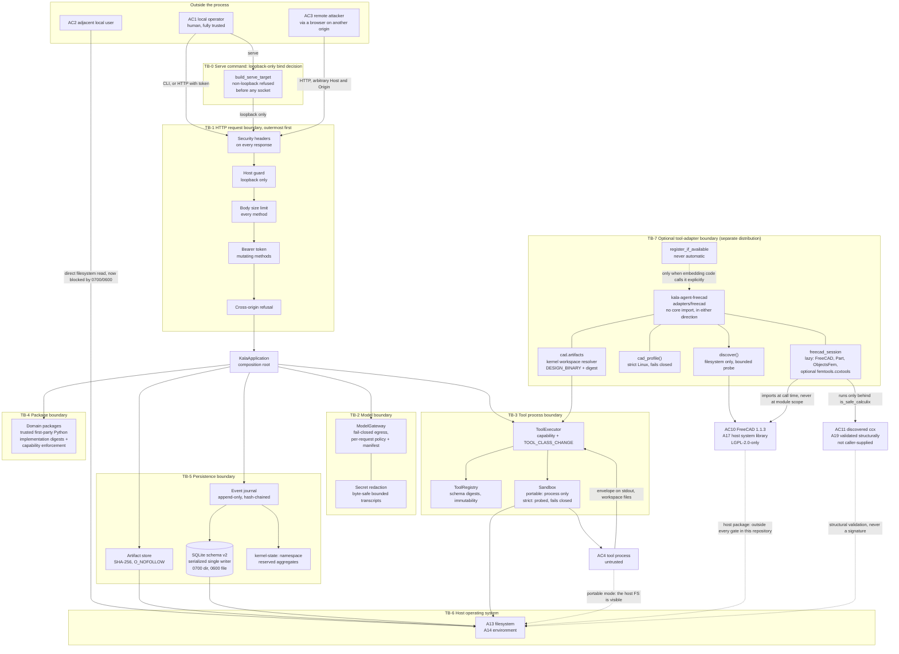

# Kala Agent Threat Model

| Field | Value |
|---|---|
| Document | Threat model |
| Date | 2026-09-26 |
| Scope | The local-first, single-user Kala Agent MVP as implemented in this repository, plus the separate optional `kala-agent-freecad` adapter distribution at `adapters/freecad` |
| Method | Asset/actor/trust-boundary enumeration followed by per-boundary threat and control mapping |
| Verification | Every control row names the test that would fail if it regressed. Root: 1,227 tests pass on CPython 3.11.16 and 3.14.7; branch coverage 94.76% against a configured `fail_under = 90`. Optional FreeCAD adapter: 301 tests pass with 100.00% branch coverage, 17 of which drive a real FreeCAD 1.1.3. See `docs/verification-report.md` §2, §2.7, and §4. |
| Related documents | `docs/architecture-report.md`, `docs/verification-report.md`, `docs/adr/0001`–`0007` |

## 1. Scope and honest framing

This document describes threats **to a single local operator's confidential engineering design data
and to the integrity of the design history on their own machine**. It is written against the code as
it exists, not against a target architecture.

Three things this threat model is not:

1. **It is not an engineering-safety analysis.** The domain packages compute non-authoritative
   arithmetic surrogates. A wrong surrogate produces a wrong report, not an unsafe structure, because
   nothing built here is ever used as a design of record. See `docs/architecture-report.md` §3.3.
2. **It is not a multi-user model.** There is one operator, one process, one data directory. There is
   no account system, no authorization model, and no per-user isolation, by design.
3. **It is not a claim of completeness.** It enumerates the boundaries the code actually has. Where a
   control is missing, the row says so and points at the residual risk rather than describing an
   aspiration.

Two facts frame everything below:

- The composition root **opens no outbound socket**. `LocalModelClient` declares
  `requires_egress = False` and synthesizes responses in-process. The hosted client is opt-in,
  off by default, and cannot be reached without an explicit consent flag, a non-empty endpoint
  allowlist containing the destination, a granted `model.egress` capability, and an approved
  `EGRESS` policy request. An empty allowlist is itself a denial, not a bypass.
- The application runs the **portable** sandbox profile, which confines a *process* and **not the
  host filesystem**. Any threat that assumes a tool cannot read the host filesystem is not mitigated
  for side-effecting tools. The strict Linux profile that does confine it exists, is probed rather
  than assumed, and fails closed when it cannot be built — but the shipped composition root does not
  select it. This is the largest open risk in this document and it is named as **RR-1**.

A third fact frames §5.7, the optional tool-adapter boundary:

- **One optional external integration exists: the `kala-agent-freecad` distribution at
  `adapters/freecad`.** It publishes two real CAD/CAE tools (`cad.freecad-geometry`,
  `cad.freecad-fem`) that drive a host-installed **FreeCAD 1.1.3** (LGPL-2.0-only) as a system
  dependency. It is a **separate distribution, not a core module**: the core never imports it, the
  root dependency list is unchanged, and `KalaApplication` does not discover, register, or dispatch
  it. It therefore introduces a genuine third-party native code dependency (FreeCAD, and a CalculiX
  binary if one is present) into the threat surface **without** giving it product authority. Its
  isolation is the strict Linux profile by default, which fails closed; its functional tests run
  portable, so the confinement threat is inherited unchanged from T3.4. It is analysed as its own
  boundary, **TB-7**, and its remaining limits are **RR-18** through **RR-22**.

## 2. Assets

| ID | Asset | Why it matters | Where it lives | Sensitivity |
|---|---|---|---|---|
| A1 | Design specifications and parameters | Confidential IP; the thing the product exists to hold | `design_specs` table, in-memory `DesignSpec` | Confidential |
| A2 | Committed design revisions | Authoritative design history; tampering rewrites history | `design_revisions` table, `DesignRevision` records | Confidential + integrity-critical |
| A3 | Artifact bytes (reports, derived data, any future design binary) | May contain geometry, dimensions, load cases | `<data_dir>/artifacts/objects/<ab>/<digest>` | Confidential |
| A4 | The event journal | The audit record; the only proof of what was decided and when | `events` table | Integrity-critical |
| A5 | Policy state (grants, approvals, remembered tool classes) | Authority. Forging an approval is forging consent | last `kernel-policy-state` journal event | Integrity-critical |
| A6 | Budget state (usage, reservations) | Bounded-autonomy guarantee; forging it removes the bound | last `kernel-budget-state` journal event | Integrity-critical |
| A7 | Workflow state and pending checkpoints | A pending checkpoint is an unreviewed future write | `workflow_snapshots`, `WorkflowState` | Integrity-critical |
| A8 | Tool call arguments and results | May contain design values; also the record of what a tool saw | `tool_calls`, `tool_results`, call workspaces | Confidential |
| A9 | The API bearer token | Authorizes every mutating request | `<data_dir>/api-token`, process memory | Secret |
| A10 | Model transcripts and egress manifests | Record of what left the device, and proof that nothing did | Gateway memory, transcript callback sink | Confidential |
| A11 | Package manifests and content digests | Identity of the code that produced a result | `DomainPackageManifest`, in-memory registry | Integrity-critical |
| A12 | Registered tool descriptors and schema digests | The contract a result is judged against | `ToolRegistry` | Integrity-critical |
| A13 | Local filesystem access to the data directory | The actual trust anchor; anyone with it can read everything | OS permissions on a `0o700` directory holding a `0o600` database | The root of the whole model |
| A14 | The process environment | May contain API keys for the hosted client | OS process environment | Secret |
| A15 | The identity of the code that produced a result | If an evaluator is swapped, the numbers change with nothing to detect it | `EvaluatorImplementation` digests, published in the manifest and pinned on every revision | Integrity-critical |
| A16 | The kernel-state namespace in the event journal | Policy and budget snapshots live under reserved aggregates; a user-supplied id must not be able to name one | `kernel-state:` prefix and the reserved bare aggregate names | Integrity-critical |
| A17 | The optional FreeCAD installation and its import root | The CAD/CAE tools import a third-party native library from a host directory. A tampered, replaced, or trojaned `FreeCAD.so` executes with the operator's authority inside a tool worker | `/usr/lib/freecad/lib`, discovered by `discover()`; the LGPL-2.0-only `freecad` host package | Integrity-critical, third-party |
| A18 | CAD/CAE export bytes (STEP, IGES, FCStd, FRD) | Real geometry and dimensions. This is the first artifact class in the repository that genuinely contains design content rather than a text report | Worker workspace, then the content-addressed store if the caller persists it | Confidential + integrity-critical |
| A19 | The discovered CalculiX executable path | A solver is an external program that the adapter may execute. The name and path shape of a discovered binary is authority-bearing | `resolve_calculix()` over a fixed name list; never supplied by a caller | Integrity-critical |
| A20 | The discovered FreeCAD **version** | A CAD result is only interpretable against the kernel that produced it, and a version jump can change both geometry and export semantics | `FreeCADAvailability.version`, reported in every result payload | Integrity-critical (provenance) |

## 3. Actors

| ID | Actor | Capability assumed | Trust level |
|---|---|---|---|
| AC1 | The local operator | Full filesystem access, decides every checkpoint, owns the machine | Fully trusted. **This model has no other trusted principal.** |
| AC2 | An adjacent local user (not the operator) | Read access to paths the umask permits; may run processes as themselves | Untrusted. Out of the design's assumption set, but see RR-3. |
| AC3 | A browser page on another origin, driven by a remote attacker | Can send HTTP requests to `127.0.0.1`; controls the `Origin` header and can attempt DNS rebinding | Untrusted, actively hostile |
| AC4 | A tool process | Runs as the operator's account; receives declared capabilities and a scoped workspace | Untrusted by default; trusted only by registration and review |
| AC5 | A malicious or buggy domain package | First-party Python imported into the kernel process; constrained by the import boundary | Semi-trusted; **not** inert |
| AC6 | The model provider (hosted, when enabled) | Receives the sanitized request; returns untrusted text | Untrusted input source |
| AC7 | An attacker with direct write access to the SQLite file | Can read and write every table; can drop triggers | Untrusted, already inside the boundary |
| AC8 | An attacker with the operator's OS account | Everything AC7 has, plus process memory and the token file | Out of scope. No application control helps. |
| AC9 | A network attacker | Can observe and tamper with traffic | Out of scope for the default configuration, because no traffic exists |
| AC10 | The host FreeCAD installation (optional dependency) | LGPL-2.0-only native code imported by a tool worker from a host directory. Owned by the host package manager, not by this repository | Untrusted third-party code. Reached only if an embedder registers the adapter, and then only inside a tool worker |
| AC11 | A `ccx` binary discovered on `PATH` (optional dependency) | An external solver executable the adapter may run, found by name and validated structurally | Untrusted until validated; **never caller-supplied** |

## 4. Trust boundaries

| ID | Boundary | What crosses it | Direction of trust |
|---|---|---|---|
| TB-0 | Serve bind decision (`cli/main.py` `build_serve_target`, `is_loopback_host`) | The operator's requested bind address | Refused unless loopback, before any socket is created |
| TB-1 | HTTP request boundary (`api/boundary.py`, `api/middleware.py`) | Operator requests, browser-originated requests | Untrusted in, typed and bounded out |
| TB-2 | Model boundary (`runtime/model_gateway.py`) | Sanitized request out, untrusted response in | Untrusted both ways; egress denied by default and per-request |
| TB-3 | Tool process boundary (`tools/executor.py`, `sandbox.py`) | A canonical-JSON request envelope in, a response envelope and workspace files out | Untrusted in; nothing returned is trusted without verification |
| TB-4 | Package boundary (`domains/`) | Declarations, evaluator implementations, and evaluator objects | Semi-trusted; import-constrained and digest-identified, **not** data-only and **not** inert |
| TB-5 | Persistence boundary (`persistence/`) | Identifiers, digests, canonical JSON, artifact bytes, reserved kernel-state aggregates | Trusted store; every read is verified |
| TB-6 | Host operating system | Filesystem permissions, the process environment, the network stack | Fully trusted, and never verified by this application |
| TB-7 | Optional tool-adapter boundary (`adapters/freecad`, distribution `kala-agent-freecad`) | A discovered host FreeCAD installation, a discovered `ccx` executable, an explicit `register_if_available` call, a `ToolExecutor` with `import_roots`, and CAD export bytes written into a call workspace | Untrusted in. The adapter is third-party native code reached only when an embedder registers it, only inside a tool worker, and only under the kernel's existing capability, checkpoint, workspace, and classification controls. It has no authority of its own, and the core never imports it. |

## 5. Threats and controls

Severity reflects the consequence **given the current configuration** (portable sandbox, offline
deterministic model, single local operator).

### 5.1 TB-1 — HTTP request boundary

| # | Threat | Impact | Controls | Test evidence | Residual risk |
|---|---|---|---|---|---|
| T1.1 | DNS rebinding: a rebound name drives `127.0.0.1` with an attacker-chosen `Host` | A browser page could read and mutate the design surface | `HostGuardMiddleware` refuses before the body is read, before routing, and before the application is touched. Exactly one `Host` is required. Userinfo, path, query, fragment, trailing dot, non-numeric or out-of-range port, and every non-loopback name are refused with 421. | `test_api_boundary.py:93,128,139` | A proxy-header middleware that trusts `X-Forwarded-Host` would defeat the guard. Not detected at runtime. **RR-8** |
| T1.2 | Wildcard bind (`0.0.0.0`, `::`) mistaken for loopback | Requests from another interface accepted | `WILDCARD_AUTHORITIES` refuses each wildcard explicitly rather than by accident | `test_api_boundary.py:283` | Mitigated on the shipped path: the `serve` command refuses any non-loopback bind before a socket is created. A caller who imports `create_app` into their own ASGI server bypasses that decision. **RR-7** |
| T1.3 | The API is published on a routable address by configuration | The design surface becomes reachable off-host | `build_serve_target` accepts only `127.0.0.1` or `::1` and raises for a wildcard or routable bind, before any socket exists. `SERVE_HOST` defaults to `127.0.0.1`. The served app is the unmodified `create_app` app, so the Host guard and the per-launch token are the same ones every other launch carries. | `tests/unit/test_cli.py:99`, `test_api_boundary.py:436` | A caller who bypasses `serve` still gets the Host guard, which refuses non-loopback `Host` headers. That limits the blast radius; it does not close the listening socket. **RR-7** |
| T1.4 | Unauthenticated mutation | A local process commits a revision without the operator's decision | `BearerTokenMiddleware` on `POST`/`PUT`/`PATCH`/`DELETE`, `secrets.compare_digest` against the launch token, evaluated above routing so a route added later is still covered, and every mutating method is judged from one `MUTATING_METHODS` set rather than a hand-maintained list | `test_api_boundary.py:147,194,211,224` | Reads are deliberately open: a local process that can reach the data directory can already read it. An adjacent user (AC2) can read through the API. **RR-3** |
| T1.5 | Token disclosure through logs, responses, or errors | Full mutating authority leaks | The token is never logged, never returned, and never echoed in an error. A refusal says only that a valid token is required. Storing it uses `O_NOFOLLOW` and mode `0o600`, and rotates per launch. The `serve` command never prints it to stdout. | `test_api_boundary.py:147,340,396`, `tests/unit/test_cli.py:210` | `kala-agent token` prints it to the operator's terminal by name. Anything that captures that terminal gets it. |
| T1.6 | Memory-denial or body-flood on a method with no payload | Resource exhaustion of the operator's own process | The limit answers **every** method, checks a declared `content-length` first, and then buffers up to the limit and replays, so a chunked request without a declared length cannot bypass it. It runs before the token check so the answer is identical for an unauthenticated caller. | `test_api_boundary.py:243`, `tests/unit/test_api.py:612,629` | The whole body is buffered in memory, up to 256 KiB per connection. Bounded, but concurrent connections multiply it. |
| T1.7 | Cross-origin request from a page the attacker controls | A browser page uses the operator's session to mutate designs | Any request carrying an `Origin` header is refused with 403. No CORS header is granted to anyone, so there is no allowlist to configure and a refusal is unreadable to the page that caused it. | `test_api_boundary.py:310`, `tests/unit/test_api.py:677` | A non-browser client simply omits `Origin` and is held to the token instead. That is the intended layering. |
| T1.8 | Traceback, submitted value, or credential text returned in an error | Leaks internals or secrets through a side channel | Every error is `{code, message, details}` with a 256-character message and at most 16 bounded details. Only the exception **type** is logged, locally. An unexpected exception fails closed rather than returning a partial success. | `tests/unit/test_api.py:652,815`, `test_mechanical_loop.py:388` | None identified. |
| T1.9 | A user-supplied identifier names a reserved internal aggregate | A workflow write lands in the kernel-state namespace that holds the policy or budget snapshot | `_require_workflow_identifier` refuses `RESERVED_WORKFLOW_IDS` and anything beginning with `kernel-state:`, and `kernel_state_aggregate` prefixes every stored aggregate. Refused in-process and over HTTP. | `tests/security/test_revision_commit.py:676,709`, `tests/unit/test_api.py:780` | Records written by the earlier version live under the bare aggregate names; those names stay reserved so they still read back. **A legacy record is still writable-adjacent only by an internal path.** |
| T1.10 | Missing security headers on a refusal | Weakens browser-side containment for a partially failed response | `SecurityHeadersMiddleware` wraps everything, and `send_refusal` attaches the same header set for transport refusals raised below the router. | `tests/unit/test_api.py:76,800` | `/docs` is served, so the OpenAPI schema is readable by any loopback caller. Deliberate, and loopback-only. |
| T1.11 | Health output overstates what the process can actually do | The operator believes a hosted path is wired when it is not | `egress_configured` is derived from the client the application actually holds, not from a setting or an intent, and `provider_endpoint_declared` reports whether an endpoint was ever declared. | `tests/unit/test_api.py:76,97,113,125,133,142`, `tests/unit/test_cli.py:175,640` | None identified. The property is client-derived, so it cannot report a path the client does not have. |

### 5.2 TB-2 — Model boundary

| # | Threat | Impact | Controls | Test evidence | Residual risk |
|---|---|---|---|---|---|
| T2.1 | Confidential design data leaves the device | NDA, export-control, or employer-policy violation | There is no egress path in the composition root. `LocalModelClient.requires_egress` is `False`. `model.egress` is not in the default capability grant (`artifact.read`, `artifact.write`, `design.read`, `design.write`, `tool.execute`). | `test_model_residency.py:114` | None for the default configuration. |
| T2.2 | Egress enabled by a boolean | Accidental publication of design context | A `True` in a constructor is not enough. `OpenAICompatibleClient` requires explicit `consent=True` **and** the normalized endpoint in `allowed_endpoints`, and `ModelGateway` additionally requires a granted `model.egress` capability and an approved `EGRESS` policy request. `test_model_residency.py:142` is named for this. | `test_model_residency.py:142,472` | An operator who supplies consent, an allowlist entry, the capability grant, and the approval has authorized egress. The controls make it deliberate; they do not make it impossible. |
| T2.3 | An omitted or empty allowlist reads as "no restriction" | Every destination becomes reachable by supplying consent | `allowed_endpoints` defaults to the empty tuple and the destination must be a member of the normalized set. **An empty allowlist is a denial, not a bypass**, and consent alone does not change that. Confirmed directly: constructing the client with `consent=True` and no allowlist entries raises `EgressDeniedError: the hosted provider endpoint is not in the egress allowlist`. | `test_model_residency.py:472`, `runtime/model_gateway.py:980` | The allowlist is exact-match after normalization. Two spellings of the same host normalize to one entry; a genuinely different host does not match. |
| T2.4 | Stale egress approval replayed onto different content | Context the operator did not review leaves the device | Authorization is evaluated on **every** call, not cached against a client-level grant. The egress `action_digest` covers destination, provider, model, capability list, the request digest, and a digest of the redactions. It is recomputed at call time, so a changed request invalidates the approval. | `test_model_residency.py:158,185,208` | Redaction is a control on content, not a substitute for review. |
| T2.5 | A model response is trusted as authority | A hallucinated value becomes a design fact | The gateway verifies response identity against the request, validates structured output against the request schema, and returns data — never authority. Model output reaches a plan only through `PlanValidator`, and a step only through the policy engine. | `test_model_residency.py`, `tests/unit/test_model_gateway_branches.py` | A schema-valid but semantically wrong response is schema-valid. |
| T2.6 | A secret leaks through a prompt, a transcript, or a log | Credential disclosure | `redact_secrets` scrubs assignment-shaped secrets and long base64 runs; message content, artifact metadata, and preview text are all sanitized before the request is built; every redaction is recorded and folded into the egress digests. Transcripts are bounded. An `api_key` is replaced with `<redacted>` in outgoing text. The CLI reports provider and model identity, never endpoints or keys. | `test_model_residency.py:378,445`, `test_tool_executor.py:1583` | Redaction is a pattern match. A secret in an unusual shape, or typed by the user into a design field, is not caught. **RR-11** overlaps here. |
| T2.7 | Bounding a transcript by characters instead of bytes | A multi-byte character straddling the cut produces a replacement character, an invalid sequence, or a slice that is longer than the declared limit | Truncation encodes to UTF-8, slices at the byte bound, and decodes with `errors="ignore"`, so a straddling character is dropped whole. Size checks are `len(text.encode("utf-8"))` on both request and response bodies, and outbound payloads are bounded in bytes at serialization. | `test_model_residency.py:340`, `runtime/model_gateway.py:236,564,566,1017,1541,1550` | None identified. The bound is on the encoded form, so it is a real byte bound on the wire. |
| T2.8 | Silent provider substitution on failure | Results produced by a model the operator did not choose | `ProviderUnavailableError` becomes `ProviderDegradedError`; nothing retries elsewhere. `DegradingPlanner` records each degradation and never degrades on the `NEVER_DEGRADED_ERRORS` set, which includes every policy denial. | `test_model_residency.py:526,585` | None identified. |
| T2.9 | A design binary is attached to a request | Raw geometry sent to a provider | `OpenAICompatibleClient._payload` raises `EgressDeniedError` for any request carrying artifacts. Independently, the executor's `_derive_classification` upgrades unknown or binary content to `design_binary`, and a tool can never downgrade that verdict. | `test_tool_executor.py:1124`, `test_model_residency.py:378` | No real design binary exists in this repository, so the binary path is verified against synthesized bytes only. |
| T2.10 | An egress request goes unrecorded | No proof of what left the device | A `ModelEgressManifest` must be recorded **before** dispatch. A missing callback raises rather than proceeding, and a failing callback also raises. | `test_model_residency.py:263,300` | The manifest sink is a callback. Where it writes is a deployment decision not made by this repository, and no audit query reads it back. **RR-15** |
| T2.11 | Hosted client is silently reached through an environment proxy | Egress the operator did not configure | `httpx.Client(trust_env=False, follow_redirects=False)` | None specific | A proxy inside the OS network stack is out of scope. |

### 5.3 TB-3 — Tool process boundary

| # | Threat | Impact | Controls | Test evidence | Residual risk |
|---|---|---|---|---|---|
| T3.1 | Tool code runs inside the kernel process | A tool inherits kernel authority | `IsolationMode.AUTO` **never** runs tool code in-kernel: an in-kernel handler is refused rather than silently invoked. In-kernel execution requires the explicit `TRUSTED_IN_PROCESS_EVALUATOR` mode, which the registry restricts to a first-party, side-effect-free, non-destructive, non-privileged evaluator whose module resolves inside the `kala_agent` package directory. | `test_tool_executor.py:243,276,310,362` | The privilege exists and is reachable by configuration. It is loud, not impossible. |
| T3.2 | A tool claims capabilities it was not granted | Authority escalation | Effective capabilities are the union of the descriptor's and the call's, intersected with the grant. Anything outside the grant denies before dispatch. A call requesting a capability the descriptor does not declare is denied. Registration itself refuses a tool claiming ungranted authority. Wildcard `"*"` grants are refused at construction. | `test_tool_executor.py:393,404,496`, `test_policy.py:357` | A capability the operator chooses to grant is genuinely granted. |
| T3.3 | Privileged, network, or egress capability by name | Code execution, exfiltration, or network access | `package.install`, `process.spawn`, `shell.execute`, and `system.admin` are denied unless `allow_privileged_capabilities`. `network`, `network.access`, `network.internet` are denied unless `allow_network`. `egress`, `export`, `network.egress` are denied unless both `allow_egress` and `allow_network`. All three default to `False`. | `test_tool_executor.py:434` | A profile that sets all three to `True` permits all of it. The control is the default, not a prohibition. |
| T3.4 | A tool reads the host filesystem | Confidential data exfiltration to a tool, or host tampering | **Not mitigated in the shipped configuration.** The portable profile confines a process, not a filesystem, and `judge_sandbox` returns that reason verbatim. The strict profile does confine it — verified by a canary file, a failed `connect()` to `8.8.8.8:53`, and an unwritable `/usr` from inside the jail — but it is opt-in and the application does not select it. | `test_tool_executor.py:568` (controls reported only when probed) | **This is the largest open risk. RR-1.** A side-effecting tool in the product can currently read the whole host filesystem as the operator. |
| T3.5 | Path traversal or symlink attack in a workspace | A tool reads or overwrites files outside its scope | `call_id` cannot address a run-directory component. Workspaces are re-checked with `lstat` after creation so a symlink planted in between is refused. Artifact paths are normalized, rejected for `..`, confined to the workspace, rejected if **any** path component is a symlink, and re-resolved and re-checked. | `test_tool_executor.py:992,1024,1061` | Applies to artifacts the tool *reports*. A tool that writes elsewhere inside the portable profile is bounded only by T3.4. |
| T3.6 | A tool lies about an artifact | A result is misrepresented | Size and SHA-256 are verified before exposure. Only `file:` URIs are accepted, confined to the workspace, and required to be regular files. Duplicate artifact ids are rejected. | `test_tool_executor.py:1094,1024` | A tool that writes a *correct* digest for *wrong* content is indistinguishable from a correct tool. |
| T3.7 | A tool downgrades a binary to text so it can be reviewed or exported | A design binary treated as innocuous | `_derive_classification` is **monotone**: it can only move content toward `design_binary`, never away. A recognised binary signature, non-decodable bytes, an unrecognised extension, or the tool's own `design_binary` claim all yield `design_binary`; a weaker `TEXT` claim cannot survive any of them. An **unknown** format is classified `design_binary` by default rather than falling through to a permissive case — the fail-closed direction. | `test_tool_executor.py:1124` | The signature list is a fixed table. A new format gets `design_binary` by default, which is safe, so the table does not need to be complete to be safe. |
| T3.8 | Infinite loop, hang, or fork bomb | Resource exhaustion, non-terminating run | Wall-clock deadline; the whole **process group** is killed with `SIGKILL` and reaped; a timeout that leaves a running descendant is a tested failure. `RLIMIT_CPU`, `RLIMIT_NOFILE = 256`, `RLIMIT_FSIZE`, and `RLIMIT_CORE = 0` are set in the child, with `umask 0o077`. Bounded output readers stop at `max_output_bytes`. A bounded worker semaphore with `max_queue_seconds` denies rather than queueing forever. | `test_tool_executor.py:627,724,871,757,790` | A worker can consume up to `max_artifact_bytes` of disk in its workspace. Nothing sweeps abandoned workspaces. |
| T3.9 | A tool escapes its descriptor or schemas after registration | The contract a result is judged against is no longer the one registered | Descriptor and both schema digests are recomputed on **every** `require()` and `latest()`; a mutation raises. Schemas are deep-frozen at registration. | `test_tool_executor.py:1440,1467` | None identified. |
| T3.10 | A schema `pattern` becomes a ReDoS vector | The executor hangs, or a hostile tool buys unbounded CPU by registering a hostile schema | Admission is decided from the pattern's own text, **before anything is compiled and before the pattern is ever run against a value**. The schema must carry a `maxLength` bounded to the input limit; the pattern must be short; a fixed table of unsafe constructs is searched (backreferences, lookaround, conditional groups, inline flags, atomic/possessive groups, wildcard repetition); nested repetition is rejected; **ambiguous repetition is rejected**; over-budget repetition is rejected. A refused pattern is never compiled and never executed. | `test_tool_executor.py:1209`, and all 9 tests in `tests/security/test_schema_redos.py` (`:112,118,124,130,145,162,171,181,193`) | The construct table is enumerated, not derived. A ReDoS shape outside the listed constructs and outside ambiguity is not caught by construction. No fuzzing was run. |
| T3.11 | A tool reads the operator's environment or credentials | Secret disclosure to a tool | The child environment is built from a fixed key set, not inherited. Executor-owned keys cannot be overridden. `PROTECTED_CHILD_ENVIRONMENT_KEYS` covers `HOME`, `PATH`, `LANG`, `PYTHONPATH`, `PYTHONSAFEPATH`, `PYTHONNOUSERSITE`, `PYTHONDONTWRITEBYTECODE`, `PYTHONHASHSEED`, `PYTHONIOENCODING`, `TMPDIR`, `TMP`, `TEMP`, and `KALA_TOOL_PROTOCOL`. | `test_tool_executor.py:1374,1409` | Under the portable profile a tool can read the parent process's memory and `/proc/<pid>/environ` as the same user. **RR-1** again. |
| T3.12 | A tool's stderr leaks paths or secrets into a diagnostic | Information disclosure through an error path | Stderr is sampled to 64 KiB, the workspace path is replaced before it can surface, and the sample is truncated to a bounded length. Unknown error codes are normalized to `internal_error` so a tool cannot mint authoritative-looking codes. | `test_tool_executor.py:1332,1316` | A tool can print anything it likes into its own stderr; the sanitizer bounds and scrubs it, it does not classify it. |
| T3.13 | A tool is dispatched without an approval | A consequential action without consent | With a `PolicyEngine` attached, **every** call becomes a policy request whose `checkpoint_type` is `TOOL_CLASS_CHANGE` (or `EGRESS` for an egress-level tool). `PolicyRequest.tool_class_change` is `True` only for that kind, and the executor raises it on every non-egress call, so the first use of a tool class needs an explicit approval and a repeat inside the same class does not. The approval is bound to the argument digest, the resolved workspace, the effective capabilities, and the tool and descriptor digests; it is keyed by `(action_digest, scope)`, so a change to the requested capability set produces a new class and re-approves. | `test_tool_executor.py:504,516,552,618`, `test_policy.py:373,406,456`, `kernel/policy.py:345`, `tools/executor.py:1123` | Re-approval is keyed by `(action_digest, scope)`. A same-scope, same-capability class change is a repeat, by design. |
| T3.14 | A tool is executed on a machine that cannot confine it | Silent loss of isolation | `judge_sandbox` refuses when the strict profile is selected and the probe did not verify the six required controls, and the executor then denies any tool with `local_write`, `network`, or `egress` side effects, or that declares `destructive`. Read-only tools still run. There is no fallback to in-process execution. The probe is a real process that builds the exact spec the executor would build and verifies each control **from inside**; only observed controls are reported. | `test_tool_executor.py:568` | **Under the portable profile `judge_sandbox` always allows, so this fail-closed path is not exercised by the shipped product.** The portable verdict returns an empty `controls` tuple and the literal reason `the portable profile confines a process, not the filesystem`. **RR-1** |
| T3.15 | A tool supplies an unbounded or ambiguous envelope | Protocol confusion | Duplicate JSON keys, `NaN`/`Infinity`, and non-finite numbers are rejected. Size, depth, string, collection, and key bounds are enforced, as are schema depth, pattern length, and pattern repeat. | `test_protocol_branches.py`, `test_tool_executor.py:905`, `test_model_residency.py:625` | None identified. |

### 5.4 TB-4 — Package boundary

| # | Threat | Impact | Controls | Test evidence | Residual risk |
|---|---|---|---|---|---|
| T4.1 | A domain package imports kernel, tools, or persistence internals | A package gains authority it was never granted | A static AST test walks every file under `domains/` and rejects any import outside `kala_agent.contracts` and `kala_agent.domains`, and asserts the module count so a new file cannot be added unnoticed. | `test_domains.py:975` | The check is on the source tree, not on installed bytecode. It is a repository gate, not a runtime guard. |
| T4.2 | A package declares something internally inconsistent | Silent nonsense treated as a declaration | `DomainPackage.__post_init__` requires unique catalog step ids matching `WorkflowDefinition.available_step_ids` exactly, one evaluator per step, at least one schema digest, a workflow that satisfies the contract, a description and disclaimer, and a checkpoint on each step that its workflow transition actually carries. | `test_domains.py:754`, `tests/security/test_domain_integrity.py:475` | Semantic nonsense in a well-formed declaration is not detectable. |
| T4.3 | A package is swapped for different code under a trusted name | Supply-chain substitution | `DomainPackage.digest()` is the SHA-256 of the canonical package payload, published in the manifest and pinned on every committed revision, so a later run can detect that the package behind a revision changed. | `tests/integration/test_mechanical_loop.py:127` (manifests are recorded and compared) | **Nothing verifies a signature.** `DomainPackageManifest` validates that `signer_id` and `signature_digest` are supplied together, but no verifier exists. There is no quarantine store and no installer. **RR-5** |
| T4.4 | An evaluator is substituted behind an unchanged catalog | Results change with nothing to detect it | Every evaluator bound to a catalog step is identified by `evaluator_implementation` and given an `EvaluatorImplementation` record: qualified name, the SHA-256 of the **source file on disk** of the module that defines it, the step it is bound to, and the capabilities it declares. That digest is folded into `DomainPackage.digest()` and published in the manifest as part of `manifest_schema_digests`, so it is pinned on every committed revision. A substitute class, a substitute module, or a different capability set changes the digest **even when the substitute computes exactly the same numbers**. | `tests/security/test_domain_integrity.py:261,320,333`, `tests/unit/test_domains.py:834` | The digest identifies the implementation. It does **not** confine it. See T4.5. |
| T4.5 | An evaluator cannot be identified at all | A digest computed from nothing reports a meaningless number | `module_source_digest` digests the bytes on disk that would be imported, not the loaded module object. A module that is not imported, has no `__file__`, or whose file cannot be read has no identifiable implementation and is **refused** with `DomainPackageError` rather than digested blind. Repeated calls inside a process are cached per file identity `(path, dev, ino, size, mtime_ns)`, so a rewritten file yields a new digest while an unchanged one stays stable within and across processes. | `tests/security/test_domain_integrity.py:320,333,366` | The cache key includes size and mtime, so a rewrite that preserves both would be missed. No such rewrite is in the threat model for a local first-party package. |
| T4.6 | A package evaluator runs arbitrary Python in the kernel | Full kernel-process authority, not data-only | **The import boundary constrains what a package may reach. Nothing constrains what its code may do.** The implementation digests of T4.4 and T4.5 make substitution *detectable*; they do not make the evaluator *inert*. Evaluators are trusted first-party Python, imported by the composition root and run in the kernel process. | `test_domains.py:729` (they run), `:975` (they are import-constrained) | **ADR-0002 specified data-only packages with bounded non-Turing-complete expressions. That is not what was built.** See `docs/architecture-report.md` §3.1. **RR-5, RR-16** |
| T4.7 | A package declares excessive or undeclared capabilities | A package acquires authority it should not have | `required_capabilities` is published in the manifest and pinned on each revision. A catalog step and its evaluator **must declare the same capability set**, or `DomainPackage` refuses to construct. And the run's declared capabilities must be granted **exactly** — `enforce_capability_request` refuses a run whose request is empty, is missing something the package declared, or carries something the package did not declare. The check runs **before any evaluation executes**. | `tests/security/test_domain_integrity.py:302,407`, `tests/unit/test_domains.py:872` | A first-party package requesting a capability the operator grants is genuinely granted. The control is exact-match enforcement, not a judgement about whether the request is reasonable. |
| T4.8 | A checkpoint kind declared by a step is not the kind its transition carries | A step claims human oversight it does not receive | `_validate_checkpoints` requires every declared checkpoint to be carried by the workflow transition that runs the step, and the kinds to agree. | `tests/security/test_domain_integrity.py:475` | The reverse direction is not checked: a transition may carry a checkpoint that no step declared. |

### 5.5 TB-5 — Persistence boundary

| # | Threat | Impact | Controls | Test evidence | Residual risk |
|---|---|---|---|---|---|
| T5.1 | An event is edited, omitted, or reordered | History and approvals appear different from what happened | Every event's digest commits to its own content and to its predecessor's digest, with a domain-separated, length-prefixed preimage so no field boundary can be forged. `UPDATE` and `DELETE` abort at the database. `INSERT` without a valid chain digest aborts. The whole chain is verified at construction, before every read, and against the tail before every append. An empty journal verifies without a head rather than raising. | `test_journal_integrity.py:130,146,159,177,187,223,241,312` | See T5.2. |
| T5.2 | The whole journal is rewritten consistently | History is replaced and the chain still verifies | Tamper-**evident**, not tamper-**proof**. `ChainVerification.head_event_digest` exists precisely so a caller can anchor it elsewhere, and a test pins the honest limit: a wholesale rewrite yields a different head digest. | `test_journal_integrity.py:256` | **No anchor and no backup exist.** Nothing compares the head against an external record. **RR-2** |
| T5.3 | Two writers commit concurrently | A forked or lost design history | One serialized connection plus a per-database reentrant lock, `BEGIN IMMEDIATE`, and a head CAS inside the same transaction. A lost race raises `HeadMovedError` and rolls back, leaving **no orphan revision row**. A commit that does not extend the current head is refused outright. A completed workflow cannot authorize another design's commit, and a completed workflow with no stored approval authorizes nothing. | `test_revision_commit.py:268,296,325,371,475,487` | Multi-process write coordination relies on SQLite's own locking plus the CAS. The CAS is what makes it correct, not the lock. |
| T5.4 | A revision is written without an approval | Unreviewed history | A revision is written in two phases. Preparation writes nothing and opens a `PRE_COMMIT` checkpoint bound to a `state_digest` (head, parent, spec, package digests, artifact digests) and an `action_digest`. Commit recomputes both from the state that exists at that moment. A mismatch invalidates the approval and writes nothing. A rejection is terminal and cannot be reused. A revoked capability denies the write even with matching digests. | `test_revision_commit.py:102,138,183,219,254,410,455` | None identified. |
| T5.5 | Artifact bytes are tampered with after publication | A result is misrepresented as the original | Every read re-hashes. Publication is a same-directory hard link of a fully written, fsynced temporary file; a name collision is resolved by comparing bytes and a mismatch is an error. Paths are resolved from directory descriptors with `O_NOFOLLOW`, and a bucket swapped mid-write is detected by `(st_dev, st_ino)` and reported as a failed publication rather than a lost or misdirected artifact. | `test_artifact_concurrency.py:177,207,260,287,341,418`, `tests/unit/test_persistence.py:413` | Objects are immutable, so tampering requires rewriting the file — which the digest catches on read. |
| T5.6 | A symlink redirects a read or a write out of the store | Artifact theft or misplacement | `O_NOFOLLOW` on every component open, symlink refusal for the root, buckets, and objects, and inode-identity re-verification after publication. | `test_artifact_concurrency.py:341,418` | None identified. |
| T5.7 | A second process or thread contends on the database | Corruption or a lost write | One shared connection whose every statement takes the writer lock; nested transactions use a savepoint so a nested failure rolls back only its own work; reads take the same lock. Artifact publication deliberately never waits for the database lock. | `test_artifact_concurrency.py:482`, `test_revision_commit.py:371`, `tests/unit/test_persistence.py:218` | The serialized connection is a throughput bottleneck by design. Correctness was chosen over concurrency. |
| T5.8 | A checkpoint is pending when the process dies | An unreviewed write happens on restart | Workflow state is persisted as canonical JSON with a verified digest in `workflow_snapshots`; policy and budget state are recorded as journal events and restored at startup. A clean restart restores usage, grants, and approvals. Missing kernel state in an already-used directory **stops the launch** rather than silently resetting to defaults; a fresh directory restores defaults with no record at all. A legacy record under a bare aggregate name still reads back. | `test_revision_commit.py:515,563,638,735,794,842` | No `SIGKILL`-at-a-boundary fault injection exists. **RR-9** in the verification report. |
| T5.9 | Kernel state is tampered with to widen authority | Grants or usage are forged | `import_state` is strict: version must match, unknown keys are rejected, duplicate request and approval ids are rejected, an approval without a tracked request is rejected, and `reserved` must equal the sum of the reservations. A record that does not validate raises `CorruptKernelStateError` and **stops the launch** rather than resetting to defaults. | `test_revision_commit.py:581,608`, `test_policy.py:557`, `test_kernel.py:440` | An attacker with the journal can craft a *valid* state record that grants more. The chain catches edits; it does not catch a well-formed forgery without an external anchor. **RR-2** |
| T5.10 | A user-supplied identifier collides with a reserved kernel-state aggregate | A workflow write lands in the aggregate that holds the policy or budget snapshot | `kernel_state_aggregate` prefixes every stored aggregate with `kernel-state:`, and `_is_reserved_identifier` refuses both the bare legacy aggregate names and the whole `kernel-state:` prefix in any user-supplied `workflow_id`. Refused in-process and over HTTP. | `test_revision_commit.py:676,709,735`, `tests/unit/test_api.py:780` | None identified. The prefix is reserved wholesale, so a future aggregate name is covered without a further change. |
| T5.11 | Another local user reads the journal, specs, or revisions | Confidential design disclosure | **The data directory is created `0o700` and the SQLite file `0o600`, explicitly, regardless of the process umask.** The artifact store is `0o700`/`0o600`, the tool run directory is `0o700`, and the API token is `0o600` with `O_NOFOLLOW`. The modes are set with an explicit `chmod` after creation, because `mkdir(mode=…)` is itself masked by the umask and would still yield `0o755` under umask `022`. | `tests/unit/test_persistence.py:190`, `tests/unit/test_artifacts_branches.py:298`, `tests/unit/test_executor_branches.py:1895`, `test_api_boundary.py:340` | **The contents are plaintext.** The modes decide *who on the host* can read the files; they do not protect the bytes from anyone who can read them. There is no encryption at rest. **RR-3, T6.3** |
| T5.12 | Storage is exhausted | Committed state becomes unwritable | Bounded input and output sizes, bounded artifact size, and a bounded working set. | `test_tool_executor.py:905,871` | No quota check, no `STORAGE_EXHAUSTED` path, and no retention policy, so growth is unbounded. **RR-6, RR-9** |

### 5.6 TB-6 — Host operating system (explicitly out of the application's control)

| # | Threat | Impact | Residual risk |
|---|---|---|---|
| T6.1 | The operator's OS account is compromised | Total loss of confidentiality and integrity | Out of scope. No application control helps. Depends on OS account protection, screen lock, and encrypted backups. |
| T6.2 | A malicious local administrator | Total loss | Out of scope. |
| T6.3 | The data directory is on an unencrypted volume | Design data readable from the storage layer | Out of scope at the application layer, and currently the case. The data directory and database are now `0o700`/`0o600`, which removes the *other local account* as a reader; it does nothing for a stolen disk, a disk image, or a backup. **RR-3, R4 in the verification report.** |
| T6.4 | A kernel or libc vulnerability is exploited by the sandbox's `ctypes` calls into `unshare`, `mount`, and `chroot` | Sandbox escape | The strict profile is probed before use and fails closed, which bounds the consequence to "isolation unavailable" rather than "isolation bypassed". A vulnerability that lets a probe succeed and then behaves differently at dispatch time is not covered by the probe model. |

### 5.7 TB-7 — Optional tool-adapter boundary (`kala-agent-freecad`)

This is a separate distribution at `adapters/freecad`, not a core module. It is analysed separately
because its threat profile is different in kind from every other boundary here: it is the only place
where this repository causes **third-party native code** to be loaded and the only place where the
system executes an **external program discovered by name**. The controls are overwhelmingly
inherited from TB-3; what is specific to this boundary is listed below, along with what remains open.

Facts these rows assume, all observed on the verification host: FreeCAD **1.1.3** (`freecad` 1.1.3-2,
**LGPL-2.0-only**) at `/usr/bin/freecadcmd`, `/usr/bin/freecad`, import root `/usr/lib/freecad/lib`;
**no CalculiX** (`ccx`, `CalculiX` absent; `pacman -Qi calculix` reports not found) and **no Gmsh**;
`femtools.ccxtools` unimportable in the verification interpreter (`No module named 'PySide6'`) because
`PySide6` is absent; **no FreeCAD PyPI wheel used or listed** in either `pyproject.toml`.

| # | Threat | Impact | Controls | Test evidence | Residual risk |
|---|---|---|---|---|---|
| T7.1 | The optional dependency is treated as a core one | A host without FreeCAD gets a core import error, and the product's dependency graph acquires a 300 MB LGPL native package | The adapter is a **separate distribution** with its own `pyproject.toml`, `src` root, tests, and quality gates. A static AST test asserts that **no** core module imports `FreeCAD`, `femtools`, or `kala_agent_freecad`, and that no adapter module imports `kala_agent.{application,api,cli,domains,kernel,persistence,runtime}`. The root `pyproject.toml` declares only `fastapi` and `pydantic`. | `tests/unit/test_adapter_boundaries.py:32,38` (root suite) | The gate is a **source-tree** check, not a runtime guard. It constrains this repository, not installed bytecode, and it does not stop an embedder from importing the adapter. **RR-21** covers the supply-chain side. |
| T7.2 | A module-scope `import FreeCAD` is added to the adapter | Every host without FreeCAD fails to import the adapter, and the failure surfaces as a kernel-adjacent error | No adapter module imports FreeCAD at module scope; every import is call-time inside `freecad_session`. `FreeCAD`'s absence is therefore a *refusal*, not an import crash. | 284 of 301 adapter tests run with no FreeCAD needed; `test_cad_runtime_loader.py` (16) | **Not enforced by an AST rule.** The property is covered by tests and by docstrings only, so one careless future edit could reintroduce it. |
| T7.3 | A FreeCAD worker is imported into the kernel process | Third-party native code inherits kernel authority | Both tools are `SubprocessToolHandler`s. `IsolationMode.AUTO` refuses a subprocess handler in-kernel, and `SubprocessToolHandler.invoke()` raises by design. The worker is `python -I -B -c <bootstrap>`, so it never inherits the parent's module state. | `tests/security/test_tool_executor.py:243,276` (kernel); `test_executor_live.py` (a real FreeCAD in a real child) | None identified for the dispatch path. |
| T7.4 | The host `FreeCAD.so` is tampered with, replaced, or trojaned | Arbitrary native code execution as the operator, inside a tool worker | Discovery is filesystem-only and takes a root that must actually hold a `FreeCAD.so` / `FreeCAD.dylib` / `FreeCAD.py` marker; the version is read in an isolated probe with a constructed environment, a fresh temporary `HOME`, a fixed `PATH`, no inherited `PYTHONPATH`, and a 30 s timeout. The adapter loads no FreeCAD **wheel**, so it cannot smuggle a second copy past the host's package manager. | `test_availability.py` (31), `test_availability_records.py` (28) | **Nothing verifies the host binary.** No digest, signature, or version pin; the version is *reported*, not pinned. FreeCAD is outside the Python dependency graph, so no gate in this repository — `ruff`, `mypy`, `pip-audit`, an SBOM — inspects it, and no supply-chain audit was run. **RR-21** |
| T7.5 | A workbench module is imported before `FreeCAD` | The process aborts **inside the native library**, unrecoverably | The order is fixed and published as `FREECAD_IMPORT_ORDER = ("FreeCAD", "Part", "ObjectsFem", "femtools.ccxtools")`. The reason is stated in code: the workbench modules bind to the application library that only `FreeCAD` initialises, and importing one first can abort where no Python-level `try`/`except` can help. | `test_cad_live.py:242` — a real `python -I -B` subprocess records the **observed** order and the test asserts it, rather than asserting the constant against itself | The refusal case (`femtools.ccxtools` missing) is reported, not raised. A native abort inside `FreeCAD` or `ObjectsFem` is not recoverable, which is why the order is asserted in a real subprocess. |
| T7.6 | FreeCAD's native output lands on fd 1 and corrupts the protocol channel | A successful call becomes a malformed envelope, and a result is lost or, worse, misparsed | `native_output_to_stderr` flushes and `dup2`s fd 1 to stderr around every FreeCAD call and restores it in a `finally`. The worker bootstrap additionally redirects `sys.stdout` to `sys.stderr` for the whole call. | `test_cad_runtime_loader.py`; every one of the 17 live tests runs real FreeCAD, which writes a native banner | A tool can still print anything it likes into its own stderr; the executor samples, bounds, and scrubs that (T3.12). |
| T7.7 | A CAD export escapes the call workspace | Confidential geometry is written outside the sandbox boundary, or a symlink redirects a write | `cad.artifacts` resolves every path through the kernel's own `resolve_workspace_path`, creates the `artifacts` directory `0o700`, refuses it via `lstat` if it is a symlink or not a real directory, and refuses a symlinked destination. The executor then re-verifies confinement, no traversal, no symlink in any component, regular file, size, and digest. | `test_cad_live.py:118` (a sibling path outside the workspace does not exist; only the three declared exports were written), `test_cad_artifacts_limits.py` (5), and `tests/security/test_tool_executor.py:992,1024,1061` | Under the portable profile a FreeCAD worker can still reach the rest of the host filesystem; this control bounds *what the adapter publishes*, not what the process can touch. **RR-1** |
| T7.8 | A CAD binary is downgraded to text so it can be reviewed or exported | A real design binary treated as innocuous | The adapter publishes `ArtifactClassification.DESIGN_BINARY` explicitly, and the executor's `_derive_classification` is **monotone**: a binary signature, non-decodable bytes, an unrecognised extension, or the tool's own claim all yield `design_binary`, and an **unknown** format defaults to `design_binary`. | `test_cad_live.py` and `test_executor_live.py` (every artifact re-hashed and asserted `DESIGN_BINARY`); kernel side `tests/security/test_tool_executor.py:1124` | The signature list is a fixed table. Safety does not depend on its completeness because the default is the strict case. |
| T7.9 | A caller supplies a solver executable path | Arbitrary program execution by configuration | **No FEM input schema field carries a path.** `invoke_fem` calls `resolve_calculix()` itself over the fixed name list `("ccx", "CalculiX", "ccx_2.22", "ccx_2.21", "ccx_2.20", "ccx_2.19")`, and `is_safe_calculix` then requires a bounded name-pattern match with no path separator, a regular non-empty file of at most 64 MiB, and an execute bit. `fem.run` re-applies the check before doing anything. | `test_contracts.py` (44), `test_availability.py`, `test_cad_fem_fakes.py` (32) | This is a **structural** check, not a signature or a hash. A trojaned binary on `PATH` named `ccx` passes it. **RR-20** |
| T7.10 | The FEM tool reports a result it did not compute | A fabricated engineering number is treated as a solver output | The analysis document is always built; the solve is behind three ordered gates (`run_solver` true; a safe executable; an importable `femtools.ccxtools`). Any failure yields `solver_unavailable` / `not_requested` / `prerequisites_unmet` / `failed`, `executed: false`, and `results.available: false` with `max_displacement_mm` and `max_stress_mpa` set to `null`. Extrema are read only from a real `Fem::FemResultObjectPython` object's arrays, rejecting non-numeric and non-finite entries. The status set is a closed enum in the schema. | `test_cad_live.py:177` (live, on this host: no solver installed), `test_cad_fem_fakes.py` (32) | The refusal is correct and also easy to misread out of context — a JSON payload full of real object names, a material card, and a solver object, next to a `solver_unavailable` string. **RR-22** |
| T7.11 | The adapter self-authorizes or widens the tool plane | An optional package acquires authority the operator never granted | Both tools declare `("artifact.write", "design.write", "tool.execute")` — a subset of the kernel's default grant — and `local_write`, `destructive = false`. The executor intersects the descriptor's and the call's capabilities with the grant, refuses a call requesting an undeclared capability, and — with a `PolicyEngine` attached — turns every call into a `TOOL_CLASS_CHANGE` request keyed by `(action_digest, scope)`. The adapter ships **no** policy code and cannot mark its own action as approved. | `test_executor_live.py::test_dispatch_refuses_an_ungranted_capability` and `::test_dispatch_refuses_arguments_the_schema_forbids`; kernel side `tests/security/test_tool_executor.py:393,404,496,504,516,552,618` and `test_policy.py:373,406,456` | Each of the two tools is a **separate** tool class, so each needs its own first-use approval. Correct, and an extra interaction. |
| T7.12 | The CAD budget is a lever for exhausting the host | A 256 MiB artifact budget and a 900 s timeout are larger than the shipped defaults | `cad_profile()` raises only the budgets, and only through the kernel's own bounded fields (`max_artifact_bytes`, `max_queue_seconds`, `max_workers` are all validated by `SandboxProfile`). It keeps `allow_network`, `allow_egress`, and `allow_privileged_capabilities` at `False` and `enforce_child_limits` at `True`, and it derives a **new** profile with `dataclasses.replace` so the shipped profile is never mutated. Descriptor timeouts (180 s / 900 s) and `SandboxProfile.timeout_for` take the smaller. | `test_policy.py` (9), including `test_profile_does_not_mutate_the_shipped_profile` | A worker can still consume up to `max_artifact_bytes` of disk in its workspace and nothing sweeps abandoned workspaces (T3.8). **RR-6, RR-9** |
| T7.13 | The strict CAD profile silently degrades to portable | A CAD worker runs with the host filesystem visible while the operator believes it is confined | `cad_profile()` defaults to `IsolationProfile.STRICT_LINUX`; `judge_sandbox` refuses when the six required controls were not verified; and because both tools are `local_write`, `ToolExecutor` **denies** them with `sandbox_unavailable`. There is no fallback to portable and no fallback to in-process. | `test_policy.py:117`; `test_executor_live.py::test_strict_profile_is_enforced_or_refused` — asserts `SUCCEEDED` plus control containment when a probe is available, and `DENIED` / `sandbox_unavailable` when it is not | **Two open problems, and they pull in opposite directions.** (a) On this host the executor's probe is **unavailable** — it resolves `sys.executable` to a system interpreter that cannot import `kala_agent` before it isolates — so a live call under the profile's own default is *refused* even though the host can build the jail (`docs/verification-report.md` §5.2). (b) The configuration the functional tests exercise is **portable**, so a FreeCAD worker in those tests can read the host filesystem. **RR-1, RR-19** |
| T7.14 | The installed adapter changes what the product does | Installing a package silently changes the tool catalog, the approval surface, and the isolation profile | The composition root does not import the adapter, does not call `discover()`, and does not register either tool. `kala-agent init` reports `tools: ["mechanical.reference-simulator"]` regardless of what is installed, and no HTTP route or CLI subcommand reaches a CAD tool. Registration is an explicit `register_if_available(registry, availability)` call by embedding code. | Absence of any `freecad` reference under `src/`; `tests/unit/test_adapter_boundaries.py`; the `init` output in `docs/verification-report.md` §2.5 | The flip side is the risk in **RR-18**: an installed, fully tested adapter can read as a product capability when it is reachable from nothing. |
| T7.15 | The FreeCAD version is not recorded against a result | A CAD result is interpreted without knowing which kernel produced it | `discover()` reads the version in an isolated probe and `FreeCADAvailability` bounds it; `freecad_session` reports `modules.version` and `modules.import_root`, and both tool output schemas require `freecad_version` and `import_root` in every result. | `test_availability_records.py` (28), `test_contracts.py` (44), `test_cad_live.py` | The version is **reported, not pinned**, and there is no compatibility matrix. Only 1.1.3 was exercised. |
| T7.16 | LGPL obligations are unmet by redistribution | A licensing failure | The adapter installs nothing. FreeCAD is used as an installed host system library, which is the ordinary dynamic-linking case for an LGPL work; the adapter ships no FreeCAD source, binary, or wheel. | Neither `pyproject.toml` lists FreeCAD; the adapter's dependency list is `kala-agent` and `pydantic` | This is a legal question, not a code one, and **this threat model does not answer it.** It records the dependency direction and the licence string and stops there. Redistribution inside the adapter is listed as an ADR-0007 Revisit Trigger. |

## 6. Control summary

| Control area | Verified by | Threat rows |
|---|---|---|
| Loopback Host guard, bearer token, body limit, cross-origin refusal, security headers, loopback-only serve, reserved identifiers | 15 tests in `tests/security/test_api_boundary.py`, plus `tests/unit/test_api.py` (29) and `tests/unit/test_cli.py` (19) | T1.1–T1.11 |
| Fail-closed egress, per-request policy and manifest, empty-allow-list denial, byte-safe redaction and truncation, health egress truth, no substitution | 14 tests in `tests/security/test_model_residency.py` | T2.1–T2.11 |
| Capability, `TOOL_CLASS_CHANGE` policy, isolation mode, artifact verification, bounded resources, schema digests, strict regex admission, fail-closed classification | 44 tests in `tests/security/test_tool_executor.py`, 20 in `tests/security/test_policy.py`, 9 in `tests/security/test_schema_redos.py` | T3.1–T3.15, T1.4 |
| Append-only hash-chained journal, serialized single writer, transactional head CAS, CAS integrity and symlink confinement, private on-disk modes | 19 + 7 + 23 tests across three security files, plus `tests/unit/test_persistence.py` (16) | T5.1–T5.12 |
| Two-phase `PRE_COMMIT` commit, restart restore, reserved kernel-state namespace, refusal to reset unverifiable state | 23 tests in `tests/security/test_revision_commit.py` | T5.4, T5.8, T5.9, T5.10 |
| Import boundaries, package declaration consistency, evaluator implementation digests, exact capability enforcement | `test_kernel.py:268`, `test_domains.py:729,754,834,872,975`, 7 in `tests/security/test_domain_integrity.py` | T4.1–T4.8 |
| End-to-end properties through both adapters and a real subprocess | 12 tests in `tests/integration/test_mechanical_loop.py` | T5.3, T5.4 |
| Optional external tool adapter kept out of the core, honest about a missing solver, confined artifacts, fixed lazy import order, fail-closed strict profile, inherited capability and checkpoint controls | 2 tests in `tests/unit/test_adapter_boundaries.py` (root), 301 tests at 100.00% branch coverage in `adapters/freecad/tests`, of which 17 drive a real FreeCAD 1.1.3 | T7.1–T7.16, and T3.4/T3.7/T3.13 as inherited |

### 6.1 Not controlled today, and named rather than implied

This list is the point of the document. Each item is a real gap, not a caveat on a control that
mostly works.

| Gap | What is not controlled | Threat rows | Risk |
|---|---|---|---|
| **G1** | Domain evaluators are **executable trusted Python**, not the data-only bounded expression packages ADR-0002 specified. Implementation digests detect *substitution*; capability enforcement requires an *exact* match. Neither renders an evaluator inert. | T4.4, T4.5, T4.6, T4.7 | RR-5, RR-16 |
| **G2** | The **default portable profile cannot confine the host filesystem or network.** The strict Linux profile is probed rather than assumed, verifies its controls from inside a real child, and fails closed when it cannot — but the shipped composition root does not select it, so the fail-closed path is not exercised by the product. | T3.4, T3.11, T3.14, and T7.7, T7.13 for the adapter | **RR-1**, **RR-19** |
| **G3** | **No certified engineering, and no solved FEM result anywhere.** The optional FreeCAD adapter builds real geometry, measurements, STEP/IGES/FCStd exports, and a real Fem analysis document, but no solver and no mesher is installed, bundled, pinned, or verified, so it reports `solver_unavailable` and produces a document rather than an analysis. There is no BIM model, no building-code implementation, and no CFD or thermal solver. The kernel's own tool is closed-form arithmetic carrying `NON_AUTHORITATIVE_FINDING`. | T7.10, T7.15; T6.1 context | RR-11, **RR-22** |
| **G4** | No external anchor for the journal head digest. Tamper-**evident** only. | T5.2, T5.9 | RR-2 |
| **G5** | No encryption at rest. The private modes of T5.11 decide who on the host can read the files; they do not protect the bytes. | T5.11, T6.3 | RR-3 |
| **G6** | No retention policy, no garbage collection, and no projection or replay product layer. Artifacts are never deleted, events are never pruned, `VACUUM` is never run, and there is no read-model projection, no rebuild, and no replay harness. | T5.12, T7.12 | RR-6, RR-9, RR-15 |
| **G7** | The shipped reference path does **not** dispatch domain evaluators through the tool executor. The evaluator is called in-process, so the out-of-process tool plane is fully implemented and fully tested but never exercised by the reference loop. | T3.1 context | RR-17 |
| **G8** | No vector memory, no multi-user, no cloud sync. `MemoryManager` is implemented and tested but is **not constructed by `KalaApplication`**, so no product path stores or retrieves a memory. | T6.1 context | RR-10 |
| **G9** | **The optional FreeCAD adapter is implemented and measured, and is on no product path.** `KalaApplication` does not import it, discover FreeCAD, register either tool, or dispatch it; no HTTP route and no CLI command reaches it. Alongside that: no mesher or solver is verified, the exercised configuration is portable and does not confine the host filesystem, the discovered `ccx` is validated structurally rather than by signature, and FreeCAD is an LGPL-2.0-only host system dependency outside every gate in this repository. | T7.1, T7.4, T7.9, T7.13, T7.14 | **RR-18, RR-19, RR-20, RR-21** |

Also not implemented and named in `docs/architecture-report.md` §3.9: design-level rollback
(**RR-15**), package signature verification and quarantine (T4.3, **RR-5**), and retention (**RR-6,
RR-9**).

## 7. Residual risk register

Ordered by consequence. This is the short list; the long one is in
`docs/verification-report.md` §8.

| ID | Residual risk | Severity | Status and why it is accepted today |
|---|---|---|---|
| RR-1 | A side-effecting tool can read and write the host filesystem, because the portable profile confines a process only | **High** | **Open (G2).** The strict Linux profile exists, is probed rather than assumed, and fails closed — it is simply not the default. Selecting it is a configuration change the composition root does not make. Until then, only first-party, reviewed tools are registered. This is the only High-severity runtime risk that is currently open. **Extended to the optional adapter as RR-19**, where the picture is split: the CAD profile's own default is strict, but the configuration its tests exercise is portable, and the executor's probe is refused on a host that can build the jail. |
| RR-2 | The journal hash chain has no external head anchor | **High** | **Open (G4).** A wholesale rewrite is detectable only against a record kept elsewhere. No such record, and no backup mechanism, is implemented. |
| RR-3 | Nothing is encrypted at rest | Medium | **Partially reduced.** The data directory and database are now `0o700`/`0o600` regardless of umask, so an adjacent local account can no longer read them (T5.11). What remains is G5: for anyone who can read the files, the contents are plaintext. |
| RR-4 | A tool declares fewer side effects than it performs | Medium | **Open.** A descriptor is a declaration. A lying tool is trusted until review. The `misbehaving` entry points in `tools/simulator.py` are labelled and reviewed; a third-party tool would not be. |
| RR-5 | Domain evaluators are trusted Python, not data-only expressions, and package signatures are unverified | Medium | **Open (G1).** Packages are first-party and import-constrained, and substitution and capability drift are now detected. This remains a documented deviation from ADR-0002, not an oversight. |
| RR-6 | No retention or garbage collection, so artifacts and events grow without bound | Medium | **Open (G6).** Deletion requires walking journal references, which does not exist yet. Nothing is lost; storage is consumed. |
| RR-7 | Nothing prevents binding the API to a routable address | Medium | **Reduced.** The `serve` command refuses any non-loopback bind before a socket is created (T1.3), which closes the shipped path. A caller who imports `create_app` into their own ASGI server bypasses that decision, and the Host guard then limits the blast radius rather than preventing it. |
| RR-8 | A proxy-header middleware would defeat the Host guard | Medium | **Open.** Documented in the module docstring. The `serve` command serves the unmodified app, so the risk is for a caller who wraps it themselves. Not detected at runtime. |
| RR-9 | No crash-injection verification, no replay driver, no read-model projection | Medium | **Open (G6).** Durability is argued from `BEGIN IMMEDIATE` and the CAS and verified by concurrency tests. Replay is a precondition, not a feature. |
| RR-10 | `MemoryManager` is exported and tested but not wired, which can read as "memory is handled" | Low | **Open (G8).** Documented as a deviation. |
| RR-11 | Surrogate output can be mistaken for validated engineering | Low | **Open (G3).** Every evaluation carries a disclaimer and the CLI and API both return one. The risk is social, not technical. **Extended by the adapter:** a real FreeCAD analysis document with a material card, a constraint, a mesh object, and a solver object, next to the string `solver_unavailable`, is even easier to misread. **RR-22.** |
| RR-12 | The declared `requires-python` floor does not import | — | **Closed.** The package imports, the full suite passes, and both quality gates are clean on CPython 3.11.16, driven through the installed `kala-agent` console script. See `docs/verification-report.md` R1. |
| RR-13 | Coverage regression goes unnoticed | Low | **Reduced.** `fail_under = 90` is configured in `[tool.coverage.report]` and the measured 94.76% clears it, so `coverage report` exits non-zero on a regression. CI is not described in this repository, so nothing enforces that the command is run. |
| RR-14 | The `RLIMIT` leak in the test suite silently truncates coverage runs | — | **Closed.** The test now intercepts `setrlimit` instead of calling it, so `coverage run -m pytest` completes and writes its data file. See `docs/verification-report.md` R2. |
| RR-15 | Replay and provenance audit are claimed but absent | Medium | **Open (G6).** Revisions are immutable and parent-linked and provenance is recorded per revision, but there is no design-level rollback, no read-model projection, and no golden-replay harness. The egress manifest is delivered to a callback and no audit query reads it back. The risk is that a reader of the ADRs alone believes ADR-0003's replay verification exists. |
| RR-16 | Evaluator digests are mistaken for evaluator confinement | Medium | **Open (G1).** The newest risk in this register, and the one most likely to be mis-stated. A digest *identifies* code; it does not *sandbox* it. The data-only expression model is the only structural fix. |
| RR-17 | The reference path is read as evidence that the tool plane is on the critical path | Medium | **Open (G7).** The reference workflow calls evaluators in-process, so `provenance.tool_call_ids` is empty on every reference revision while the executor is fully built and tested. |
| RR-18 | The optional FreeCAD adapter is read as a product CAD capability | Medium | **Open (G9).** It is a separate distribution with 301 tests at 100.00% branch coverage driving a real FreeCAD 1.1.3, and `KalaApplication` does not import it, register either tool, or expose either over HTTP or the CLI. An installed adapter plus a fully passing suite is easy to misread as "CAD works". The controls at T7.14 are real; the risk is in the reader, not the code. |
| RR-19 | A FreeCAD worker runs without filesystem confinement, or is refused on a host that could confine it | **High** | **Open (G2, G9).** Both halves are live at once. The CAD profile's own strict default is **refused** on the verification host, because the executor resolves `sys.executable` to a system interpreter that cannot import `kala_agent` before it isolates — while the host itself can build the jail, demonstrated in `docs/verification-report.md` §5.2. And the configuration the adapter's functional tests actually exercise is **portable**, which confines a process and not a filesystem. Neither the confinement nor its absence is a claim this document set makes. |
| RR-20 | A discovered CalculiX executable is trusted on structure alone | Medium | **Open (G9).** `is_safe_calculix` checks a bounded name pattern, the absence of a path separator, a regular non-empty file of at most 64 MiB, and an execute bit, and no caller can supply a path. That prevents argument injection and traversal into an invocation. It is **not** a signature, a hash, or a provenance check, and nothing pins which build was discovered. No CalculiX is installed on the verification host, so only the refusal path was observed. |
| RR-21 | An LGPL-2.0-only native dependency escapes every gate in this repository | Medium | **Open (G9).** FreeCAD is installed by the host package manager, not by pip, and is not in either `pyproject.toml`. `ruff`, `mypy`, `pip-audit`, and any SBOM would not see it, and no supply-chain audit was run. The static import-boundary test constrains *this* source tree and says nothing about the host binary, which is never digested, signed, or version-pinned. |
| RR-22 | A `solver_unavailable` status is read as an analysis result | Medium | **Open (G3, G9).** The FEM tool returns a real FreeCAD document and an honest status; `results.available` is `false` and both extrema are `null`. That is the correct answer, and it is easy to lose out of context — particularly in a screenshot of a JSON payload full of real object names. No result is ever synthesised, which is the control; the residual risk is entirely about how the payload is read. |

## 8. What would most reduce this risk

In order of consequence, and all of them are engineering work rather than configuration:

1. Make the strict, probed sandbox the default for side-effecting tools, and refuse startup when the
   probe cannot verify the six required controls. Closes G2 and RR-1, the only High-severity runtime
   risk that is currently open. **This is now also the fix for RR-19**, because the optional FreeCAD
   adapter's CAD profile already defaults to strict: one change in the executor's probe interpreter
   selection would stop a host that can build the jail from being refused, and making strict the
   default would then give a FreeCAD worker real filesystem confinement.
2. Anchor `ChainVerification.head_event_digest` outside the database and verify it on startup, then
   build a verified backup around that anchor. Closes G4 and RR-2, and hardens the trust in the
   policy and budget state restored at startup.
3. Replace the domain evaluators with a bounded, non-Turing-complete expression language, or state
   the first-party-only posture as a permanent architectural decision rather than a deviation. Closes
   G1, RR-5, and RR-16. **The implementation digests and capability enforcement added since the last
   pass are a real improvement, and they do not substitute for this.**
4. Wire the reference workflow through `ToolExecutor` so the domain evaluators run out of process
   under the capability, approval, and sandbox controls rather than in the kernel. Closes G7 and
   RR-17, and turns the tool plane from independently tested into on the critical path.
5. Add a retention policy that walks journal references before deleting anything, a free-space
   pre-check before a dispatch that will write, and a rebuildable read model. Closes G6, RR-6, and
   RR-9, and gives replay something to replay from.
6. Add encryption at rest, or document an encrypted-backup requirement as a deployment decision.
   Closes G5 and RR-3. The private file modes of T5.11 are already in place and are not a substitute.
7. Add signature verification and a quarantine store for packages, so "first-party" becomes a
   verifiable property rather than a convention. Closes the second half of RR-5. **This is also the
   gate on ADR-0006's D3, and it is what unblocks entry-point discovery of third-party tool adapters** —
   which in turn is the precondition for closing G9's wiring question honestly rather than by
   convention.
8. Add a startup assertion that no proxy-header middleware is installed. Closes RR-8.
9. Decide whether the optional FreeCAD adapter should be reachable from a product surface, and record
   the answer either way. Closes or formally accepts **RR-18**. If it is wired, item 1 must land first,
   or the product would expose a CAD worker with the host filesystem visible. **RR-20** and **RR-21**
   do not close on a decision: they need a pinned, verified solver supply chain and an operator-level
   check on the host FreeCAD package respectively, and neither is code this repository can write
   without the quarantine and signature work in item 7.

