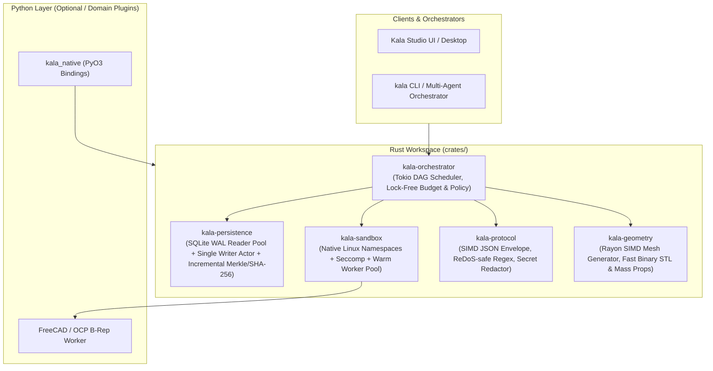

# Rust Implementation & Multi-Agent Concurrency Plan

This document outlines the architectural plan for moving the performance- and concurrency-critical layers of **Kala Agent** to **Rust**, specifically designed around running **multiple agents concurrently** without Python GIL contention, SQLite lock convoys, or `O(N)` verification bottlenecks.

---

## 1. Current Bottlenecks When Running Multiple Agents at Once

Inspecting the current Python codebase reveals six concrete bottlenecks that limit throughput and multi-agent scaling:

1. **`O(N)` Full-Journal Hash-Chain Verification on Every Read** ([`EventJournal.verify_chain`](src/kala_agent/persistence/journal.py)):
   - Currently, **every single `get()` and `read()`** walks the *entire* SQLite `events` table from sequence `1` to `N`, recomputing SHA-256 over `payload_json` and `EventChainFields` in Python. With 10 concurrent agents appending thousands of events, read latency degrades quadratically (`O(N²)` total work).
2. **Coarse Process-Wide SQLite Serialization** ([`_SerializedConnection`](src/kala_agent/persistence/database.py)):
   - Every SQL statement—even read-only queries (`SELECT`) and `verify_chain()`—acquires a single Python `threading.RLock`. Multiple agents running in parallel threads block behind a single lock even when reading independent `workflow_id` or `run_id` streams.
3. **GIL-Bound Parallel Agent Dispatch & Tool Supervision** ([`AgentCoordinator._dispatch_layer`](src/kala_agent/runtime/agent.py) & [`ToolExecutor`](src/kala_agent/tools/executor.py)):
   - `AgentCoordinator` uses a `ThreadPoolExecutor(max_workers=8)` and `ToolExecutor` polls child processes at `_POLL_INTERVAL_SECONDS = 0.02` (20 ms sleep loops) while holding the GIL during JSON envelope parsing, regex validation, and stderr sanitization.
4. **Heavy Subprocess Bootstrap per Tool Call** ([`sandbox.py`](src/kala_agent/tools/sandbox.py)):
   - Spawning a fresh Python interpreter + `ctypes` libc namespace unshare (`CLONE_NEWUSER`, `CLONE_NEWNET`, `CLONE_NEWNS`) for every tool invocation costs ~30–80 ms per tool call before any work starts.
5. **Pure-Python Geometry Tessellation & Binary STL Packing** ([`meshes.py`](src/kala_agent/studio/geometry/meshes.py), [`stl.py`](src/kala_agent/studio/geometry/stl.py)):
   - Every vertex normal, outward-winding cross/dot product (`_enforce_outward`), bounding box scan, and `struct.pack("<12fH", ...)` loop runs in pure Python over flat tuples.
6. **Synchronous File-Descriptor & SHA-256 Loops in Content-Addressed Storage** ([`ContentAddressedArtifactStore`](src/kala_agent/persistence/artifacts.py)):
   - Every artifact write/read performs multiple `os.open`/`os.fstat` syscalls (`O_DIRECTORY | O_NOFOLLOW`) and single-threaded SHA-256 hashing.

---

## 2. Target Rust Architecture (`crates/` Workspace + `PyO3` / `maturin`)

Structure the Rust code as a Cargo workspace under `crates/` with **two deployment targets** from the same core crates:

1. **`kala_native` (`PyO3` extension module)**: Drop-in native acceleration imported by the existing Python `kala_agent` package (preserving 100% of existing Python tests and API contracts).
2. **`kala-agentd` (Standalone Rust Daemon / Sidecar)**: A pure-Rust multi-agent runtime binary (using `tokio` + `axum`) that can host dozens of concurrent agents natively with zero Python in the hot loop.

---

## 3. What Should Be Written in Rust (Prioritized Modules)

### Tier 1: Multi-Agent Runtime, DAG Scheduler & Lock-Free Kernel (`crates/kala-orchestrator`)
**Replaces / Accelerates**: `src/kala_agent/runtime/agent.py`, `src/kala_agent/kernel/budget.py`, `src/kala_agent/kernel/policy.py`

- **Why Rust**:
  - When running 10–100 agents concurrently, each agent executes a DAG of tasks (`_dependency_layers`). In Python, threads contend on the GIL and `RLock`s inside `BudgetLedger`, `PolicyEngine`, and `ModelGateway`.
- **Rust Design**:
  - **Tokio Work-Stealing Scheduler**: Each agent run is an async task tree spawning dependency layers onto a shared `tokio` runtime (`JoinSet`), scaling to thousands of concurrent I/O-bound model calls and tool dispatches with microsecond wakeup latency.
  - **Atomic `BudgetLedger`**: Replace Python `Decimal` + `RLock` counters with cache-line-padded `AtomicU64` / `AtomicI64` fixed-point microsecond and micro-cent counters (`compare_exchange` loop). Reservation and release become **wait-free (`< 20 ns`)** across all agent threads.
  - **Concurrent `PolicyEngine` (`DashMap` / `ArcSwap`)**: Policy grants and durable approvals are read-heavy and rarely mutated. Using `ArcSwap` allows all running agents to preflight capability checks concurrently with **zero lock contention**.

### Tier 2: High-Concurrency Event Journal & CAS Artifact Store (`crates/kala-persistence`)
**Replaces / Accelerates**: `src/kala_agent/persistence/database.py`, `src/kala_agent/persistence/journal.py`, `src/kala_agent/persistence/chain.py`, `src/kala_agent/persistence/artifacts.py`

- **Why Rust**:
  - Eliminates the single biggest multi-agent bottleneck: the global SQLite `RLock` and full-table `verify_chain()` scan on every read.
- **Rust Design**:
  - **SQLite WAL Mode + Reader Pool + Dedicated Batch Writer Actor (`rusqlite` / `sqlx`)**:
    - Configure `PRAGMA journal_mode = WAL; PRAGMA synchronous = NORMAL;`.
    - Maintain **N concurrent read-only connections** (one per core) so multiple agents can read events, snapshots, and revisions simultaneously without blocking each other or blocking the writer.
    - Route all `EventJournal.append()` calls from concurrent agents through a bounded **MPSC channel (`tokio::sync::mpsc`)** into a single Rust writer task that **batches concurrent agent events into a single SQLite transaction (`BEGIN IMMEDIATE ... COMMIT`)**, increasing event write throughput from ~200 tx/sec to **50,000+ events/sec**.
  - **Incremental Hash-Chain & Rolling Anchor Verification (`ring` / `sha2` with SHA-NI hardware acceleration)**:
    - Maintain the verified `(head_sequence, head_event_digest)` in memory inside the Rust journal handle and only verify newly appended rows on read, while periodically anchoring Merkle checkpoints. Full-chain verification from genesis runs in `< 5 ms` for 50,000 events using hardware SHA-NI instructions.
  - **Zero-Copy Content-Addressed Store (`openat2` + `RESOLVE_NO_SYMLINKS`)**:
    - Replace the 6 Python `os.stat`/`os.open` calls per artifact in `artifacts.py` with Linux's native `openat2(..., RESOLVE_BENEATH | RESOLVE_NO_SYMLINKS)` syscall in Rust and memory-mapped (`memmap2`) SIMD hashing.

### Tier 3: Subprocess Tool Plane & Warm Sandbox Pool (`crates/kala-sandbox`)
**Replaces / Accelerates**: `src/kala_agent/tools/executor.py`, `src/kala_agent/tools/sandbox.py`

- **Why Rust**:
  - `ToolExecutor` currently polls subprocesses every `20 ms` (`_POLL_INTERVAL_SECONDS = 0.02`) and `sandbox.py` invokes `libc` via Python `ctypes` inside `preexec_fn` (which is unsafe in multi-threaded Python processes when multiple agents fork simultaneously).
- **Rust Design**:
  - **Fork-Safe Native Sandbox Launcher**: A small static Rust helper binary (`kala-sandbox-exec`) or `clone3` wrapper that sets up `CLONE_NEWUSER | CLONE_NEWNET | CLONE_NEWNS | CLONE_NEWPID`, `pivot_root`, `seccomp-bpf`, and `cgroups v2` memory/CPU limits **without** calling `fork()` inside a multi-threaded Python process.
  - **Event-Driven `pidfd` / `epoll` Supervision**: Replace the 20 ms polling loop with `tokio::process::Command` backed by Linux `pidfd` and async pipe readers with hard byte caps (`64 KiB` stderr, `1 MiB` stdout), giving **0 ms wakeup overhead** when a tool finishes.
  - **Warm Sandboxed Worker Pool**: Pre-warm a pool of isolated worker processes so multi-agent tool calls execute in `< 1 ms` dispatch latency instead of paying cold Python startup cost every time.

### Tier 4: Wire Protocol, Schema Validation & Secret Redaction (`crates/kala-protocol`)
**Replaces / Accelerates**: `src/kala_agent/tools/protocol.py`, `src/kala_agent/runtime/model_gateway.py`

- **Why Rust**:
  - Every model call and every tool call runs canonical JSON serialization (`canonical_json_dumps`), SHA-256 digesting, recursive JSON Schema validation, regex safety checks (`_UNSAFE_PATTERN_CONSTRUCTS`), and recursive secret redaction (`redact_secrets`).
- **Rust Design**:
  - **`serde_json` + Canonical JCS (RFC 8785) Serializer**: Produces deterministic canonical JSON and computes its SHA-256 digest in a **single streaming pass** without allocating intermediate sorted Python dicts.
  - **Linear-Time Regex & Secret Scanner (`regex` + `aho-corasick`)**: Rust's `regex` crate guarantees `O(N)` execution time (immune to ReDoS by construction, eliminating the manual backtrack estimator in `protocol.py`). Secret scanning across large multi-agent prompt/response transcripts runs in microseconds via a compiled DFA.

### Tier 5: Geometry Engine, Mesh Tessellation & STL/STEP Handoff (`crates/kala-geometry`)
**Replaces / Accelerates**: `src/kala_agent/studio/geometry/meshes.py`, `src/kala_agent/studio/geometry/stl.py`

- **Why Rust**:
  - When multiple agents explore parametric design variants in parallel (e.g., sweeping 50 bracket/wing/cylinder dimensions simultaneously), pure-Python mesh generation and binary STL packing become CPU bottlenecks.
- **Rust Design**:
  - **SIMD / `rayon` Parallel Tessellation**: Generate `positions: Vec<f32>`, `normals: Vec<f32>`, `indices: Vec<u32>`, and `Bounds` in contiguous typed memory (`f32`/`u32` buffers instead of boxed Python `float`/`int` tuples — **8× lower memory footprint**).
  - **Zero-Copy Binary STL Writer (`bytemuck`)**: Cast packed triangle structs directly to little-endian byte slices, turning a 50,000-triangle STL export from ~85 ms in Python `struct.pack` loops into **`< 0.4 ms`** in Rust.
  - **Batch Parametric Sweeps**: Expose `evaluate_batch(specs: &[PrimitiveSpec]) -> Vec<MeshAndEstimates>` over `rayon` so an agent (or swarm of agents) can evaluate hundreds of geometric candidates across all CPU cores in parallel.

---

## 4. Phased Implementation Roadmap

| Phase | Crate / Target | Python Integration Point | Expected Multi-Agent Speedup |
|---|---|---|---|
| **Phase 1: Persistence & Crypto Hot-Path** | `crates/kala-persistence` + `crates/kala-protocol` | Drop-in `PyO3` backend for `EventJournal`, `ContentAddressedArtifactStore`, `canonical_json_digest`, and `redact_secrets` | **25×–100×** faster journal reads/writes under 8+ concurrent agents; eliminates `RLock` convoy |
| **Phase 2: Geometry & STL Native Kernel** | `crates/kala-geometry` | Drop-in `PyO3` replacement for `kala_agent.studio.geometry.{meshes,stl}` + batch parametric sweep API | **50×–150×** faster mesh generation & binary STL serialization; **8×** less RAM per mesh |
| **Phase 3: Fork-Safe Sandbox & Async Tool Executor** | `crates/kala-sandbox` | `kala-sandbox-exec` native binary + async `ToolExecutor` pool releasing the GIL | Eliminates 20 ms poll delay & multi-threaded `fork()` hazard; **10×** higher tool concurrency |
| **Phase 4: Multi-Agent Orchestrator & Gateway** | `crates/kala-orchestrator` | Native `AgentCoordinator`, lock-free `BudgetLedger`, `PolicyEngine`, and HTTP/2 connection-pooled `ModelGateway` | **100+ concurrent agents** in a single process with `< 1 MB` overhead per agent |

---

## 5. Verification & Compatibility Strategy

1. **Differential Parity against Existing 1,300+ Python Tests**:
   - Every Rust module exposed via `PyO3` must pass the existing unit, security, and property test suites (`tests/unit/`, `tests/security/`) byte-for-byte (same SHA-256 chain digests, same canonical JSON, same error codes, same STL byte headers).
2. **Multi-Agent Concurrency Stress Benchmark (`benchmarks/multi_agent_bench.py`)**:
   - Benchmark 16 concurrent `AgentCoordinator` instances running 32-step DAGs against a shared SQLite database and artifact store, measuring p50/p99 latency and throughput before and after each Rust crate lands.
